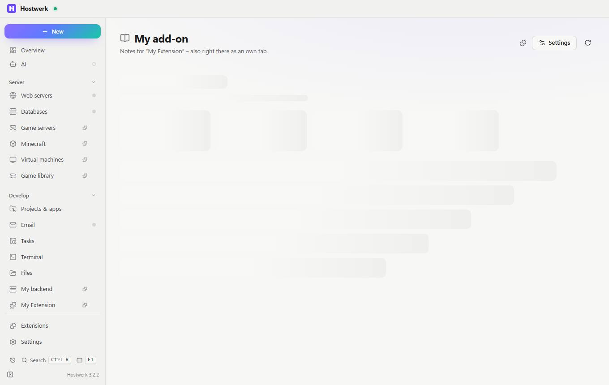

# My add-on

[← Back to the overview](README.md)

Notes for “My Extension” – also right there as an own tab.

### What you can do here

- From the extension “My add-on” – info
- Settings
- Reload

Generated on 2026-11-20 · Hostwerk 3.2.2
