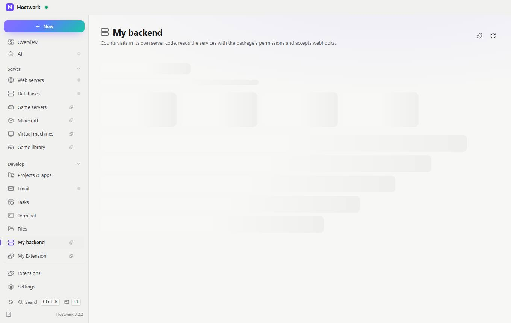

# My backend

[← Back to the overview](README.md)

Counts visits in its own server code, reads the services with the package's permissions and accepts webhooks.

### What you can do here

- From the extension “My backend” – info
- Reload

Generated on 2026-11-20 · Hostwerk 3.2.2
