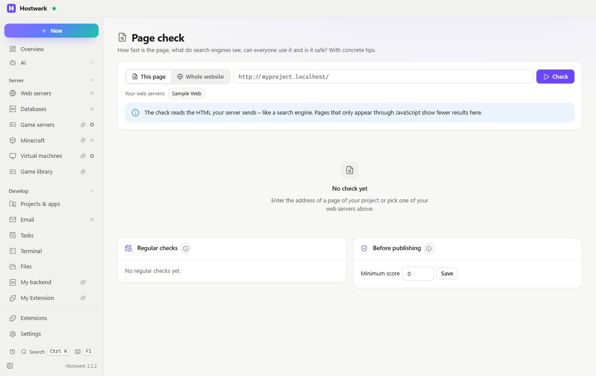

# Page check

[← Back to the overview](README.md)

How fast is the page, what do search engines see, can everyone use it and is it safe? With concrete tips.

### Good to know

- Regular checks Hostwerk checks these addresses on its own and tells you when the score drops by 5 points or more.
- Minimum score Publishing extensions (e.g. “Publish pages”) check the page first and stop below this score. 0 = off.

### Areas on this page

- Regular checks
- Before publishing

### What you can do here

- Check
- Sample Web
- Save

Generated on 2026-11-20 · Hostwerk 3.2.2
