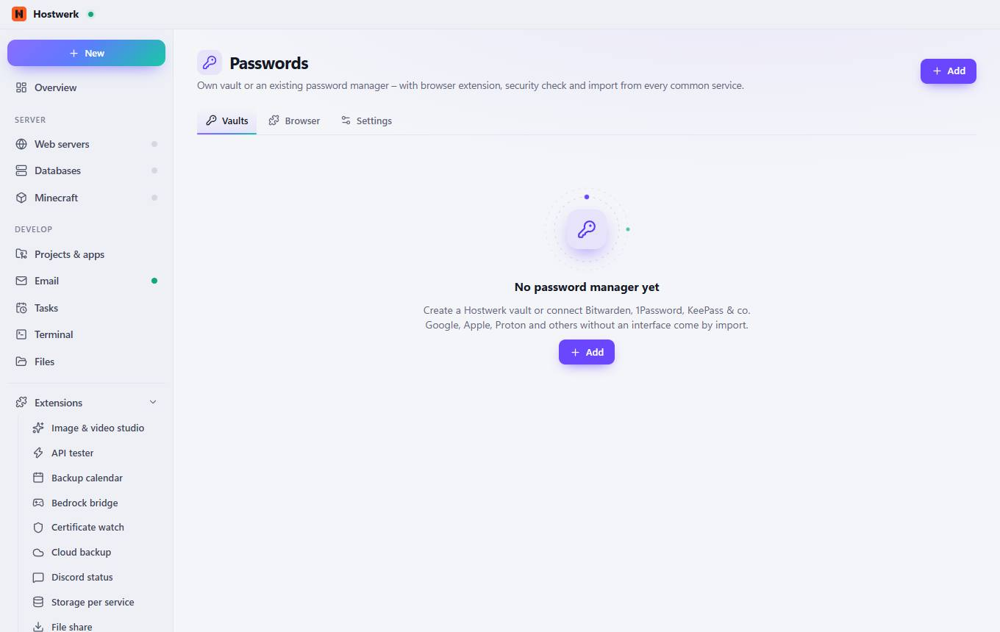
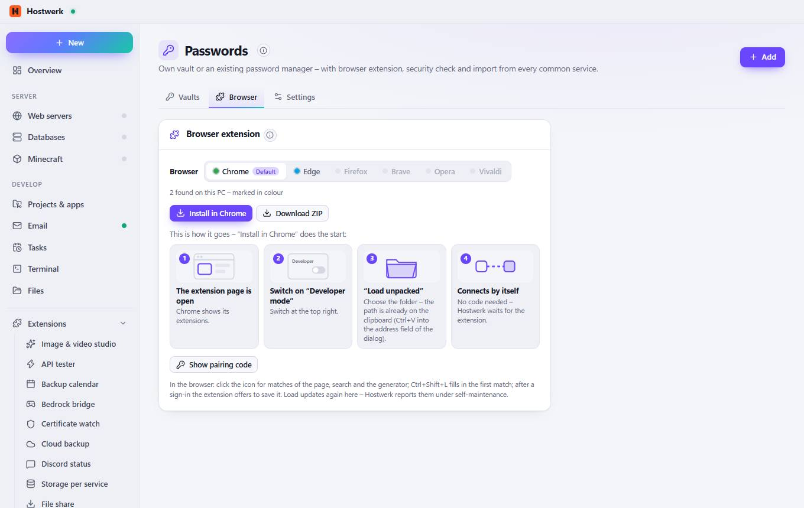
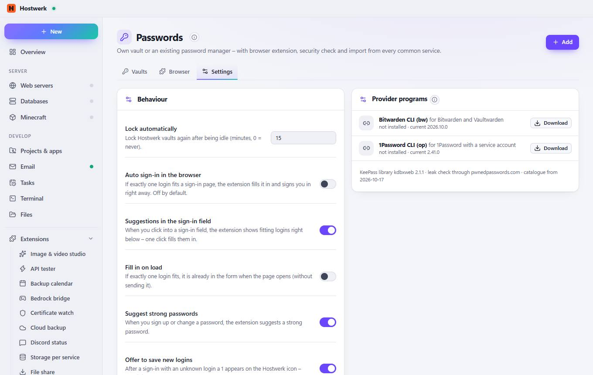

# Passwords → Vaults

[← Back to the overview](README.md)

Own vault or an existing password manager – with browser extension, security check and import from every common service.

### What you can do here

- Add

## Tabs

### Browser

> How does Hostwerk install it? If the extension is in the browser’s store, Hostwerk tells the browser about it the official way and opens the store page – one click on “Add”. Otherwise the browser loads it as an “unpacked extension” (developer mode). Either way it pairs itself, without a code.
> The extension only talks to your Hostwerk (127.0.0.1).

**Areas on this page:** Browser extension

**What you can do here:** Add · Install in Chrome · Download ZIP · Show pairing code

### Settings

> No maintenance: provider programs are checked every day and updated with a test run, new import formats and services come through the online catalogue. The AI helper has no access at all to vaults, items or vault files – neither reading nor searching.
> Self-maintenance: version check every day, update with a test run.

**Areas on this page:** Behaviour · Manage vaults · Provider programs

**What you can do here:** Add · Download

Generated on 2026-10-20 · Hostwerk 2.10.0
