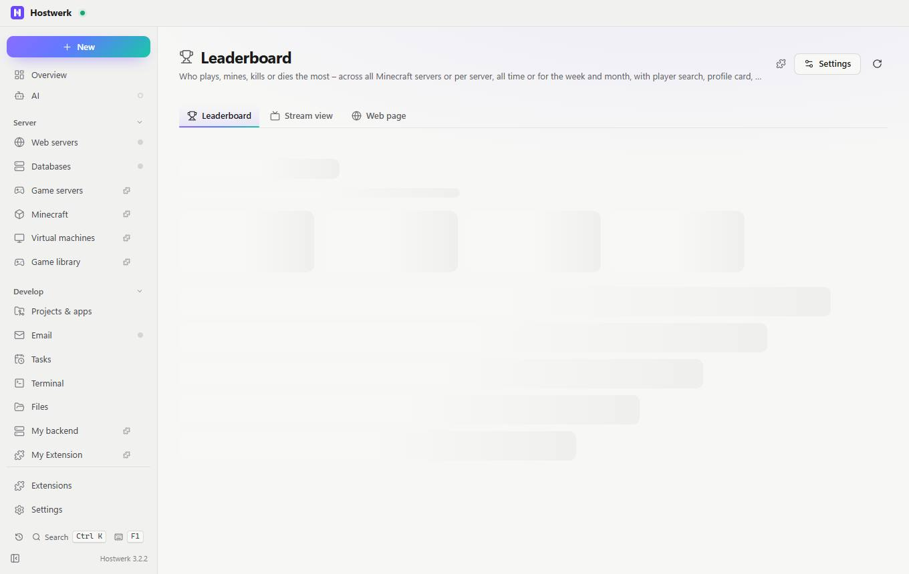
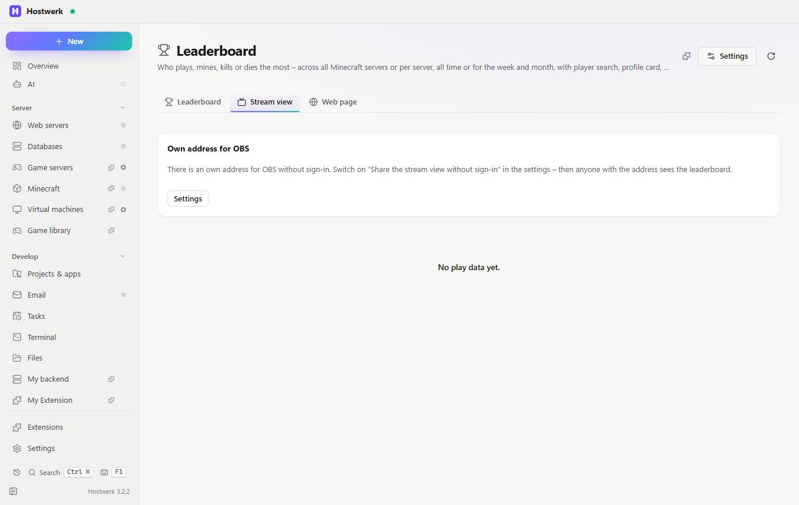
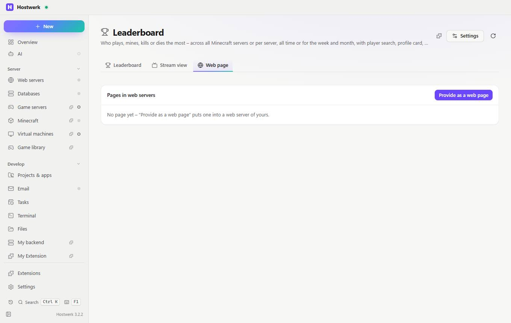

# Leaderboard → Leaderboard

[← Back to the overview](README.md)

Who plays, mines, kills or dies the most – across all Minecraft servers or per server, all time or for the week and month, with player search, profile card, badges and history. Right in the “Players” tab of every Minecraft server, as a stream view for OBS and, if you like, as an own web page in your web server.

### What you can do here

- From the extension “Leaderboard” – info
- Settings
- Reload

## Tabs

### Stream view

**What you can do here:** From the extension “Leaderboard” – info · Settings · Reload

### Web page

**What you can do here:** From the extension “Leaderboard” – info · Settings · Reload

Generated on 2026-11-20 · Hostwerk 3.2.2
