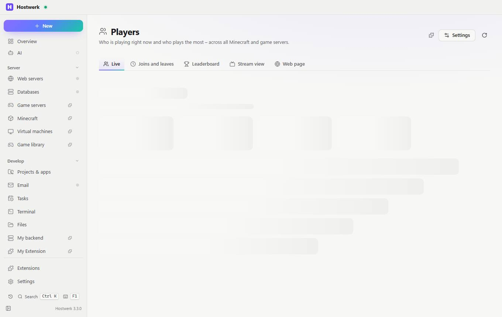
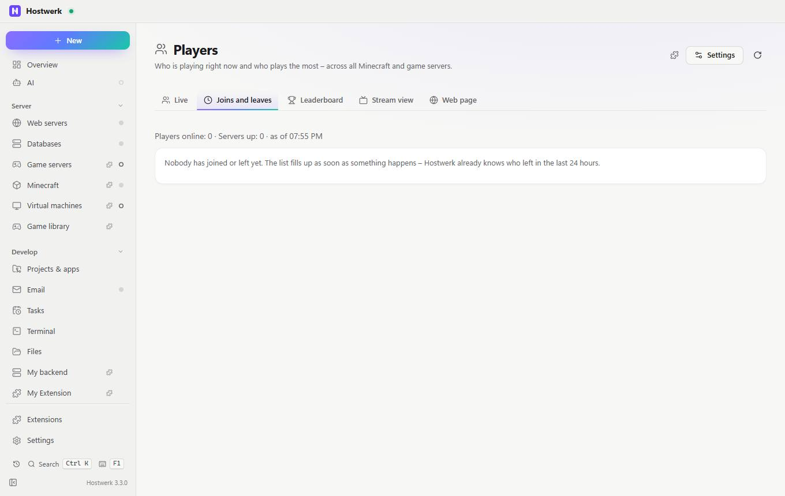
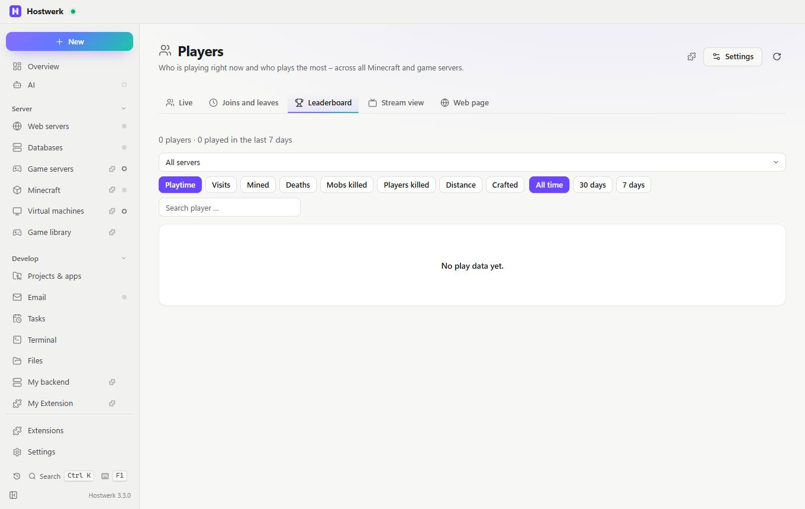
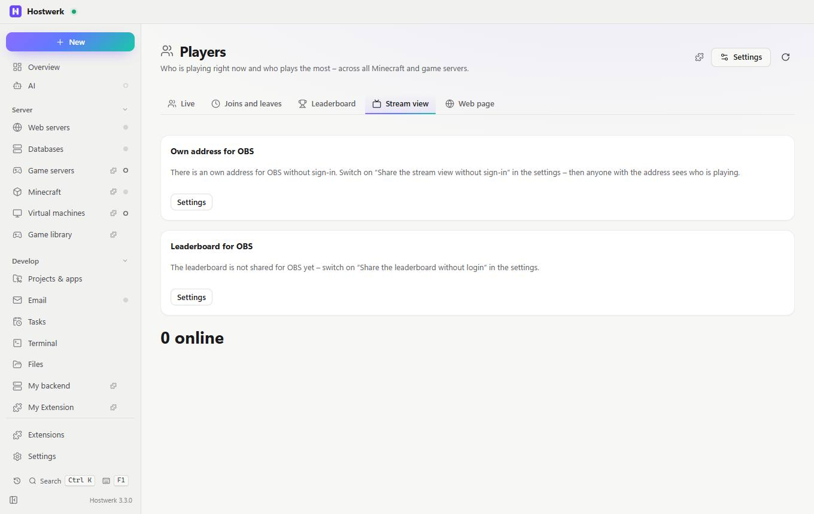
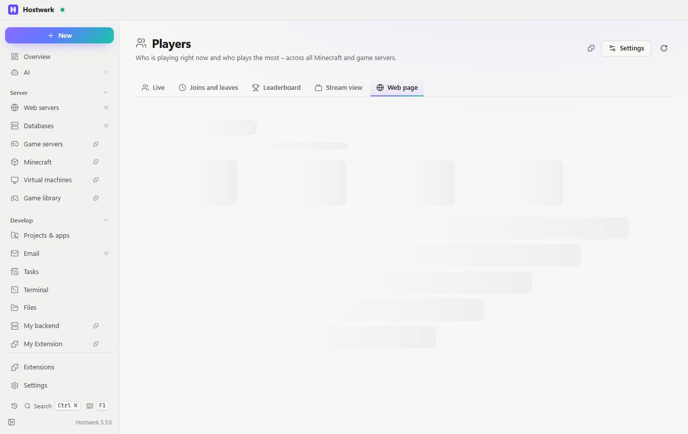

# Players → Live

[← Back to the overview](README.md)

Who is playing right now and who plays the most – across all Minecraft and game servers.

### What you can do here

- From the extension “Players” – info
- Settings
- Reload

## Tabs

### Joins and leaves

**What you can do here:** From the extension “Players” – info · Settings · Reload

### Leaderboard

**What you can do here:** From the extension “Players” – info · Settings · Reload

### Stream view

**What you can do here:** From the extension “Players” – info · Settings · Reload

### Web page

**What you can do here:** From the extension “Players” – info · Settings · Reload

Generated on 2026-11-20 · Hostwerk 3.3.0
