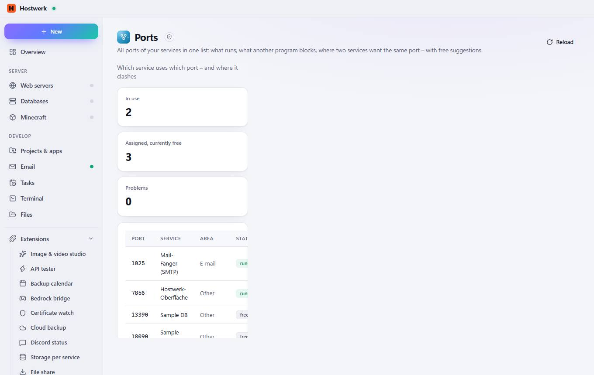

# Ports

[← Back to the overview](README.md)

All ports of your services in one list: what runs, what another program blocks, where two services want the same port – with free suggestions.

### Good to know

- Sandboxed extension by Hostwerk · v1.2.0 · read only Read system health, load and ports

### What you can do here

- Reload

Generated on 2026-10-20 · Hostwerk 2.10.0
