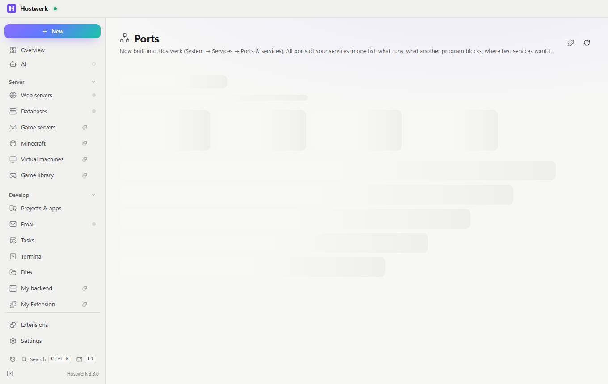

# Ports

[← Back to the overview](README.md)

Now built into Hostwerk (System → Services → Ports & services). All ports of your services in one list: what runs, what another program blocks, where two services want the same port, what the router forwards – “change port” with one click, a free check and free suggestions to copy.

### What you can do here

- From the extension “Ports” – info
- Reload

Generated on 2026-11-18 · Hostwerk 3.2.1
