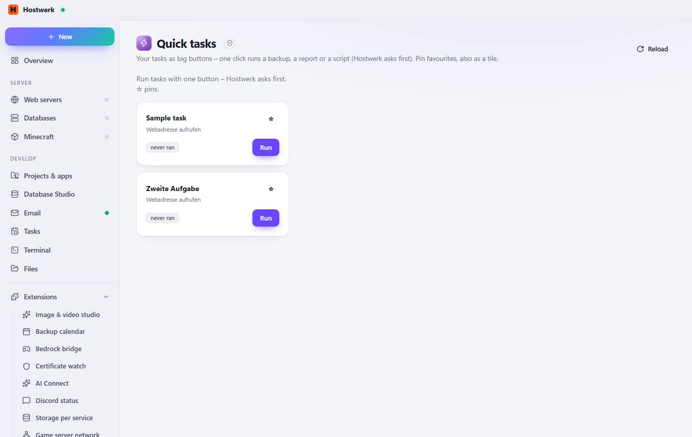

# Quick tasks

[← Back to the overview](README.md)

Your tasks as big buttons – one click runs a backup, a report or a script (Hostwerk asks first). Pin favourites, also as a tile.

### Good to know

- Sandboxed extension by Hostwerk · v1.2.0 · may change things after asking Read scheduled tasks Run scheduled tasks (asks first) Store own data (max. 256 KB)

### What you can do here

- Reload

Generated on 2026-10-19 · Hostwerk 2.9.0
