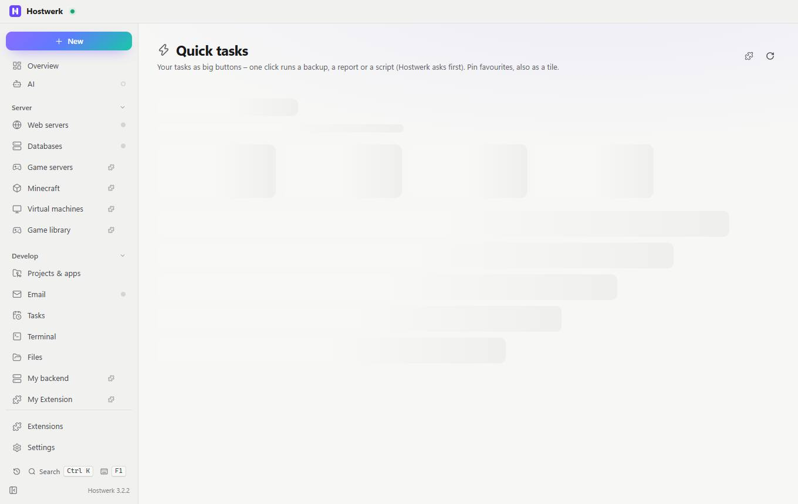

# Quick tasks

[← Back to the overview](README.md)

Your tasks as big buttons – one click runs a backup, a report or a script (Hostwerk asks first). Pin favourites, also as a tile.

### What you can do here

- From the extension “Quick tasks” – info
- Reload

Generated on 2026-11-20 · Hostwerk 3.3.0
