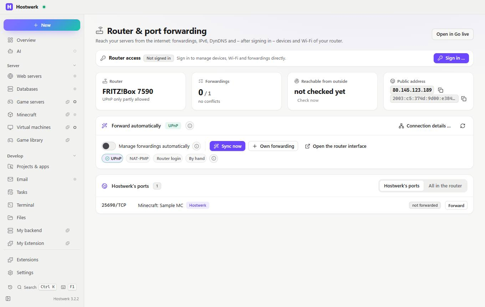

# Router & port forwarding

[← Back to the overview](README.md)

Reach your servers from the internet: forwardings, IPv6, DynDNS and – after signing in – devices and Wi-Fi of your router.

### Good to know

- Forward automatically Hostwerk forwards the ports of your public services (websites with a domain, Minecraft, mail server, remote access) in the router and keeps them up to date – also after new servers or changed ports.
- Manage forwardings automatically Checks every 30 minutes and after the start; cleans up Hostwerk forwardings that are no longer needed.
- Tip for FRITZ!Box On the FRITZ!Box under Internet → Permit Access → Port Sharing, switch on "Permit independent port sharing for this device" for this PC. Otherwise it refuses automatic forwardings. Open router

### Areas on this page

- Forward automatically
- Hostwerk's ports

### What you can do here

- Open in Go live
- Sign in …
- Check now
- Copy IPv4
- Copy IPv6
- Connection details …
- Search again
- Sync now
- Own forwarding
- Open the router interface
- Forward

Generated on 2026-11-20 · Hostwerk 3.2.2
