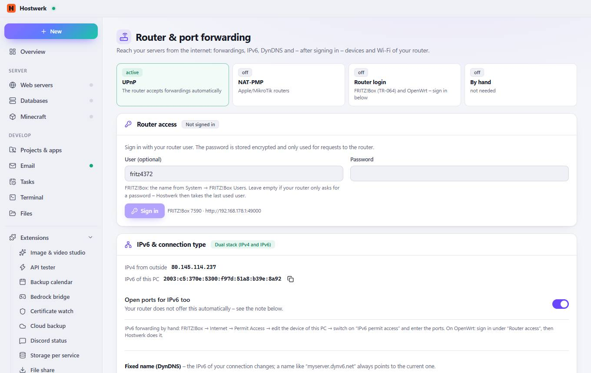

# Router & port forwarding

[← Back to the overview](README.md)

Reach your servers from the internet: forwardings, IPv6, DynDNS and – after signing in – devices and Wi-Fi of your router.

### Areas on this page

- Router access
- IPv6 & connection type
- FRITZ!Box 7590
- Forward automatically
- Hostwerk's ports
- All forwardings in the router

### What you can do here

- Sign in
- Copy
- Save
- Search again
- Open the router interface
- Sync now
- Own forwarding
- Open router
- Hide tip
- Forward

### Inputs

- User (optional)
- Password
- Open ports for IPv6 too
- Provider
- Manage forwardings automatically

Generated on 2026-10-20 · Hostwerk 2.10.0
