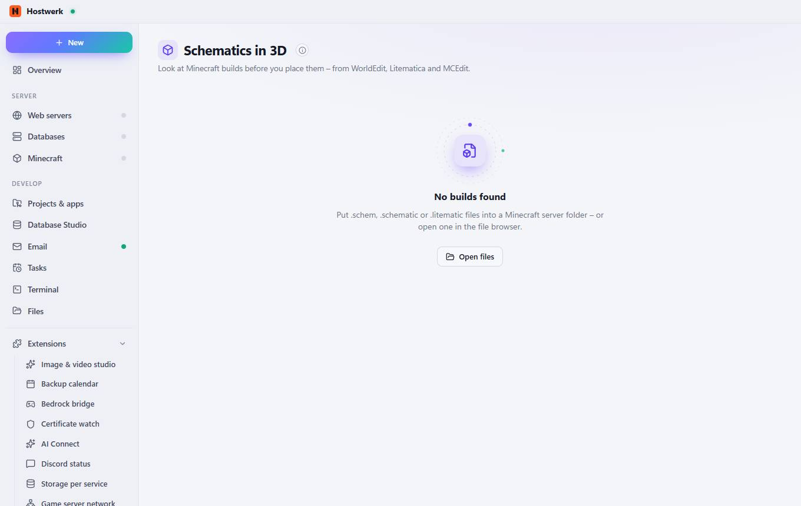

# Schematics in 3D

[← Back to the overview](README.md)

Look at Minecraft builds before you place them – from WorldEdit, Litematica and MCEdit.

### Good to know

- Where do the files come from? Hostwerk looks through the folders of your Minecraft servers (for example plugins/WorldEdit/schematics or schematics/). Any build file in the file browser opens in 3D as well.

### What you can do here

- Open files

Generated on 2026-10-19 · Hostwerk 2.9.0
