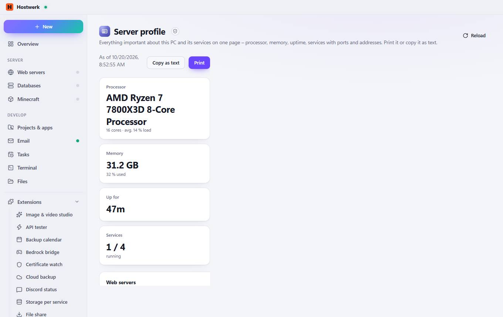

# Server profile

[← Back to the overview](README.md)

Everything important about this PC and its services on one page – processor, memory, uptime, services with ports and addresses. Print it or copy it as text.

### Good to know

- Sandboxed extension by Hostwerk · v1.2.0 · read only Read system health, load and ports See services and their state

### What you can do here

- Reload

Generated on 2026-10-20 · Hostwerk 2.10.0
