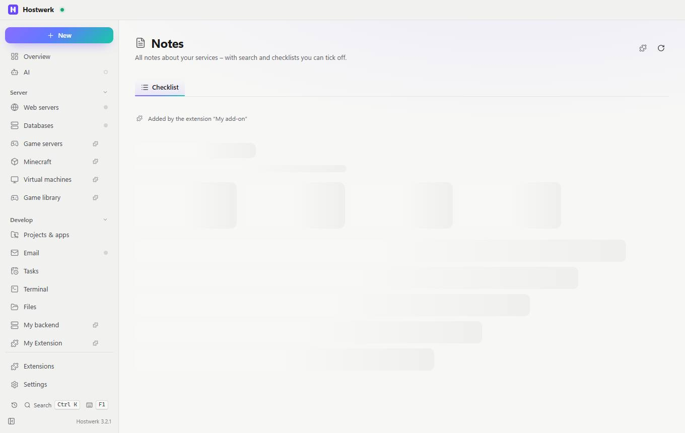

# Notes → Checklist

[← Back to the overview](README.md)

All notes about your services – with search and checklists you can tick off.

### What you can do here

- From the extension “Notes” – info
- Reload
- From the extension “My add-on” – info

Generated on 2026-11-18 · Hostwerk 3.2.1
