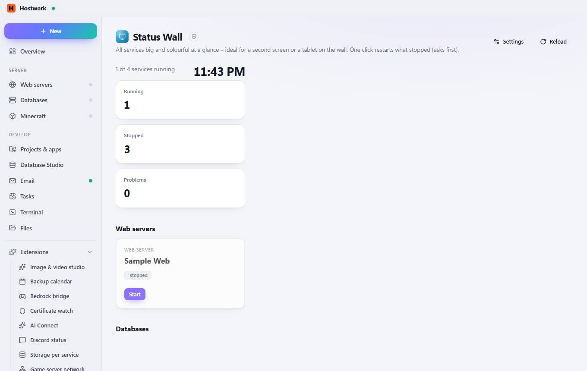

# Status Wall

[← Back to the overview](README.md)

All services big and colourful at a glance – ideal for a second screen or a tablet on the wall. One click restarts what stopped (asks first).

### Good to know

- Sandboxed extension by Hostwerk · v1.2.0 · may change things after asking See services and their state Start, stop, restart services (asks first)

### What you can do here

- Settings
- Reload

Generated on 2026-10-19 · Hostwerk 2.9.0
