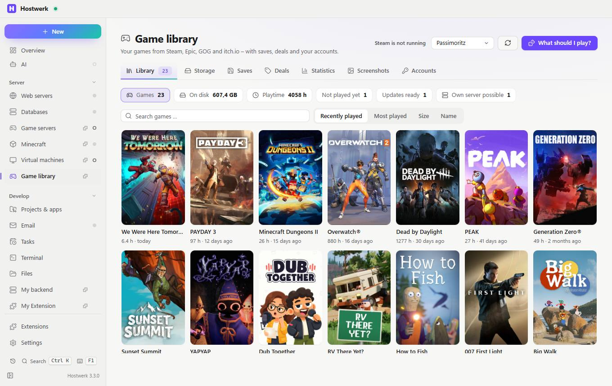
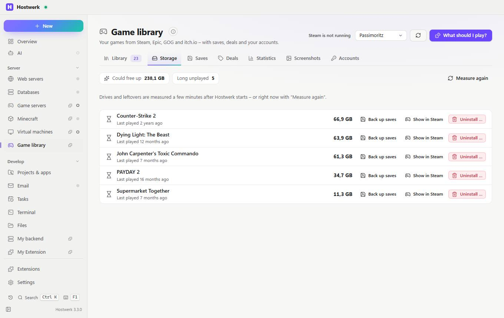
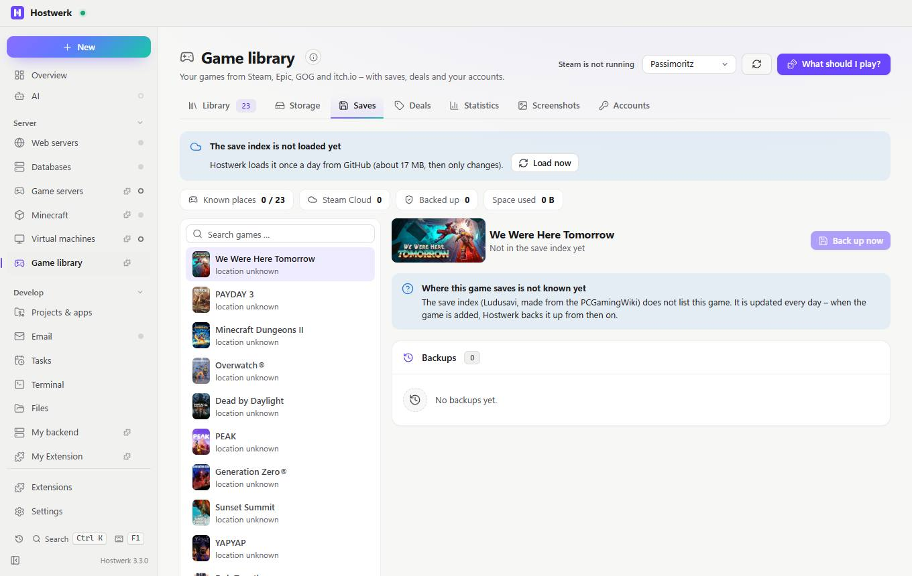
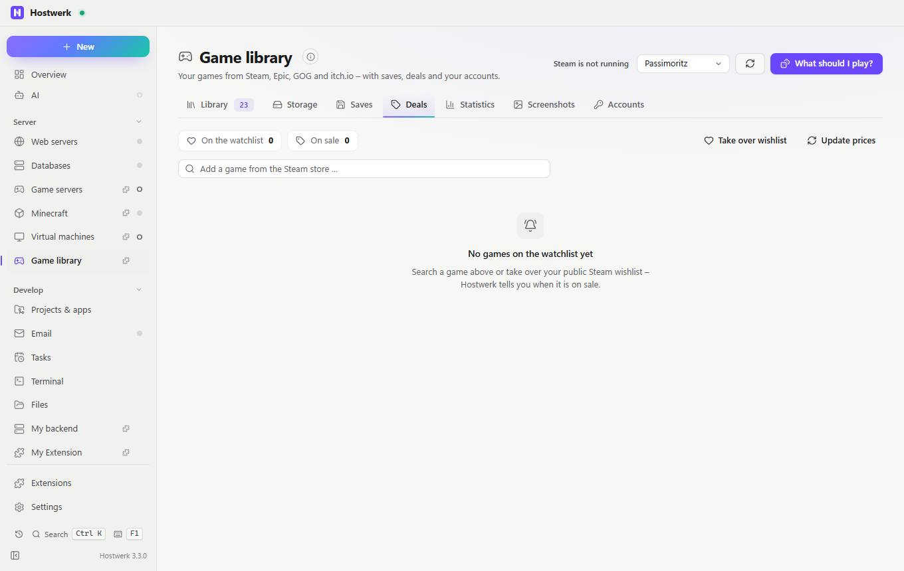
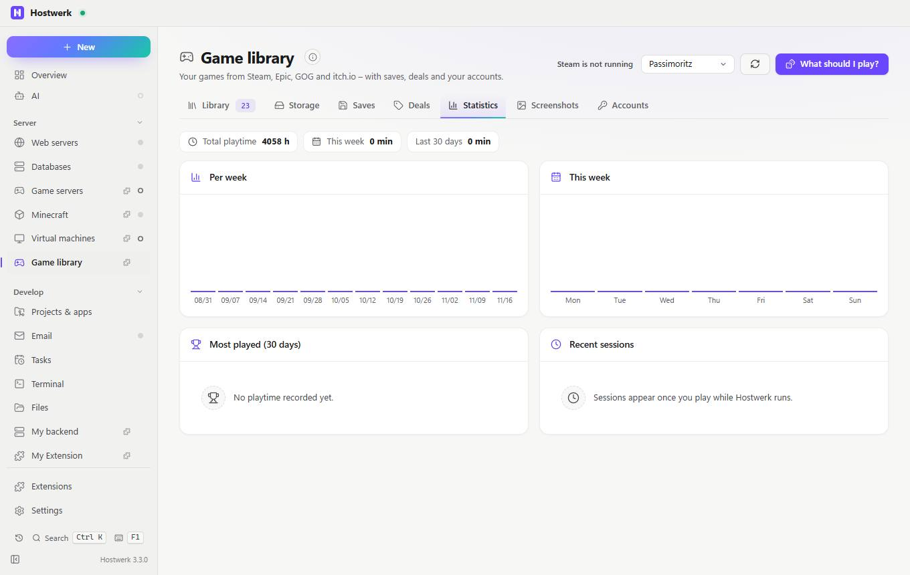
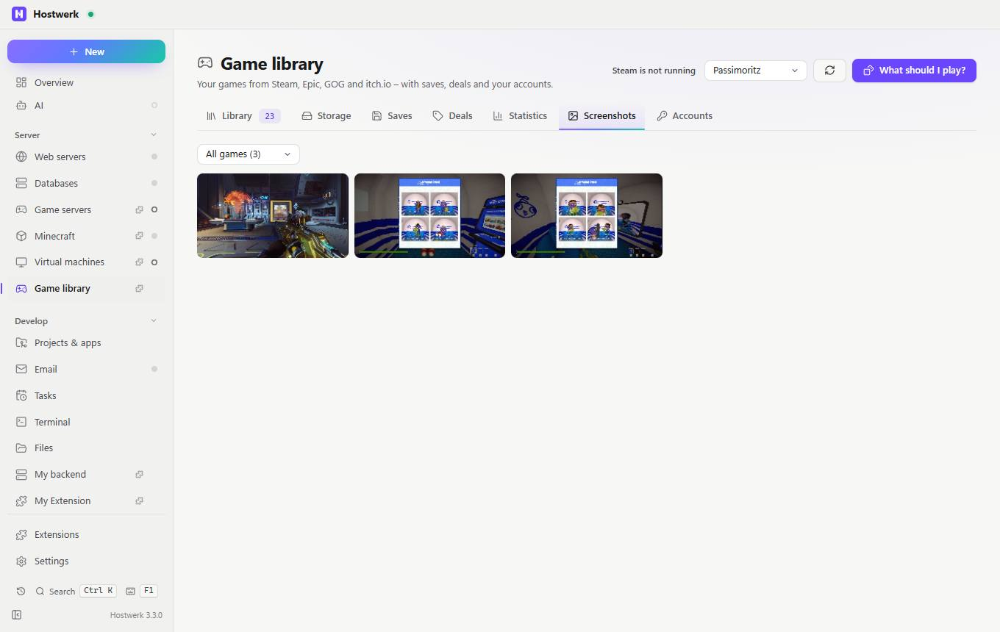
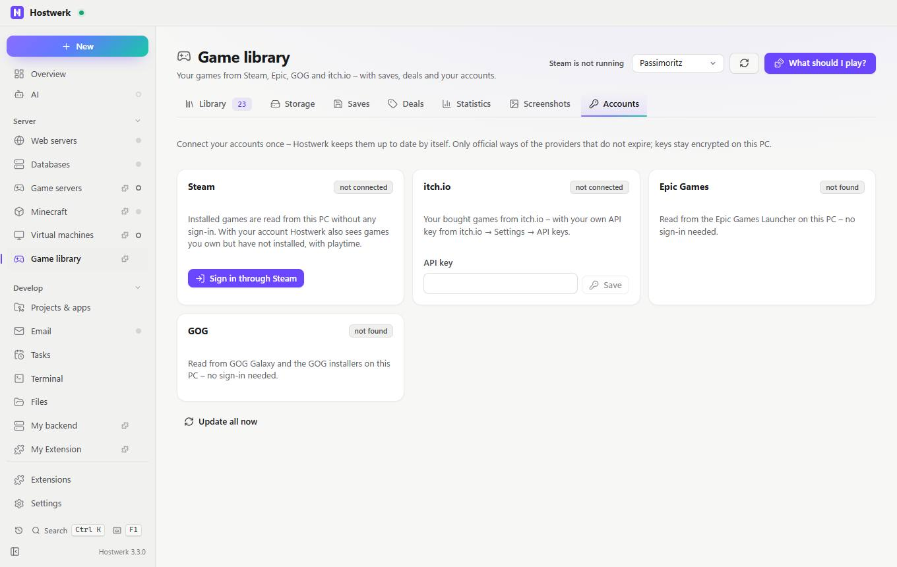

# Game library → Library

[← Back to the overview](README.md)

Your games from Steam, Epic, GOG and itch.io – with saves, deals and your accounts.

### What you can do here

- Read again
- What should I play?
- Games 23
- On disk 607,4 GB
- Playtime 4058 h
- Not played yet 1
- Updates ready 1
- Own server possible 1
- We Were Here Tomorrow 6.4 h · today
- PAYDAY 3 97 h · 12 days ago
- Minecraft Dungeons II 26 h · 15 days ago
- Overwatch® 880 h · 16 days ago
- Dead by Daylight 1277 h · 30 days ago
- PEAK 27 h · 41 days ago
- Generation Zero® 49 h · 2 months ago
- Sunset Summit 4 h · 2 months ago
- YAPYAP not played yet · 2 months ago
- Dub Together 1 min · 2 months ago
- RV There Yet? 12 h · 2 months ago
- How to Fish 6.6 h · 3 months ago
- 007 First Light 18 h · 3 months ago
- Big Walk 35 min · 3 months ago
- Wallpaper Engine 89 h · 3 months ago
- Deep Rock Galactic: Rogue Core 10 h · 4 months ago
- Just Shapes & Beats 16 h · 6 months ago
- Update ready Supermarket Together 104 h · 7 months ago
- John Carpenter's Toxic Commando 6.9 h · 7 months ago
- s&box 3.5 h · 7 months ago
- Dying Light: The Beast 7 min · 12 months ago
- PAYDAY 2 201 h · 16 months ago
- Counter-Strike 2 1225 h · 2 years ago

## Tabs

### Storage

> How the storage doctor decides Only from Steam’s own files: size, last played and playtime per game, drives (SSD or hard disk) and folders of games that are gone (workshop, shader cache, Proton, downloads). Hostwerk never deletes anything here – uninstalling and moving is done by Steam, leftovers open in the file manager. Thresholds (e.g. “long unplayed” after 180 days) are in the extension’s settings.

**What you can do here:** Read again · What should I play? · Measure again · Back up saves · Show in Steam · Uninstall …

### Saves

> How save backups work Where a game keeps its saves comes from the open Ludusavi index (made from the PCGamingWiki, updated daily) – Hostwerk keeps no list of its own. After every session (Hostwerk sees when a game ends) the saves are backed up automatically. Each file is stored once; unchanged saves cost no space. Backups show up in Hostwerk’s backup center and in the external backup.

**Areas on this page:** Backups

**What you can do here:** Read again · What should I play? · Load now · We Were Here Tomorrow location unknown · PAYDAY 3 location unknown · Minecraft Dungeons II location unknown · Overwatch® location unknown · Dead by Daylight location unknown · PEAK location unknown · Generation Zero® location unknown · Sunset Summit location unknown · YAPYAP location unknown · Dub Together location unknown · RV There Yet? location unknown · How to Fish location unknown · 007 First Light location unknown · Big Walk location unknown · Wallpaper Engine location unknown · Deep Rock Galactic: Rogue Core location unknown · Just Shapes & Beats location unknown · Supermarket Together location unknown · John Carpenter's Toxic Commando location unknown · s&box location unknown · Dying Light: The Beast location unknown · PAYDAY 2 location unknown · Counter-Strike 2 location unknown · Back up now

### Deals

> Prices and alerts Prices come from the Steam store (country DE, change it in the extension’s settings), twice a day and without a key. A new sale or your target price sends one bundled notification. Hostwerk remembers every price change and shows the lowest price it has seen.

**What you can do here:** Read again · What should I play? · Take over wishlist · Update prices

### Statistics

> Where the numbers come from Steam writes the total playtime per game to its files. Hostwerk notes every increase on the day it sees it – so the weeks fill up from the day the extension was installed. Sessions appear when Hostwerk runs while you play.

**Areas on this page:** Per week · This week · Most played (30 days) · Recent sessions

**What you can do here:** Read again · What should I play?

### Screenshots

**What you can do here:** Read again · What should I play? · Overwatch®, 16/09/2026, 22:47 · PEAK, 17/08/2026, 15:35 · PEAK, 15/08/2026, 23:02

### Accounts

**What you can do here:** Read again · What should I play? · Sign in through Steam · Save · Update all now

Generated on 2026-11-20 · Hostwerk 3.3.0
