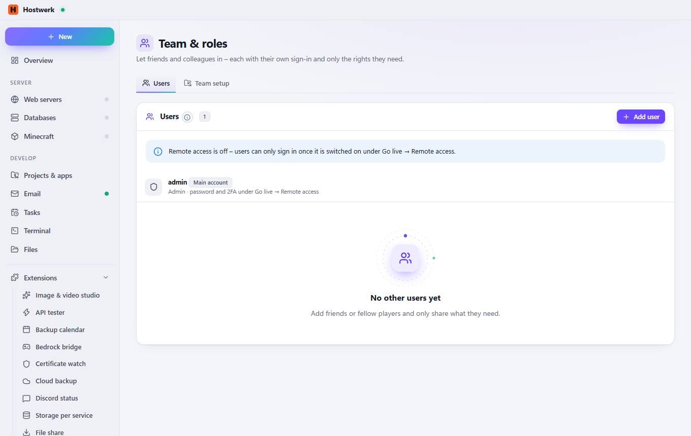
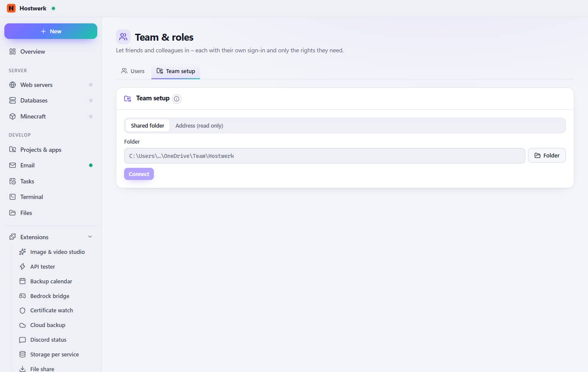

# Team & roles → Users

[← Back to the overview](README.md)

Let friends and colleagues in – each with their own sign-in and only the rights they need.

### Good to know

- How roles work Every person signs in to remote access with their own name and password (or passkey). Members only see and control the services and areas you share – for example “start the survival server and manage players”. The change log shows who did what.

### Areas on this page

- Users

### What you can do here

- Add user

## Tabs

### Team setup

> What is a team setup? One shared setup for everyone in the team: it lives in a shared folder (OneDrive, network drive, Git repository) or at an address. Hostwerk checks every 15 minutes for changes and asks before taking anything over – it only adds what is missing.

**Areas on this page:** Team setup

**What you can do here:** Folder · Connect

Generated on 2026-10-20 · Hostwerk 2.10.0
