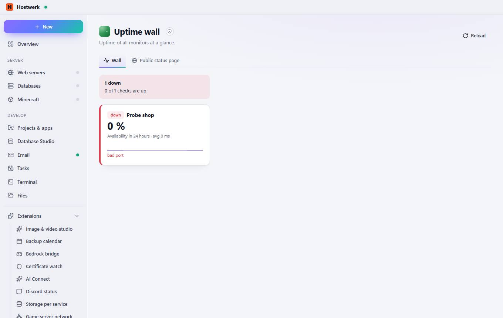
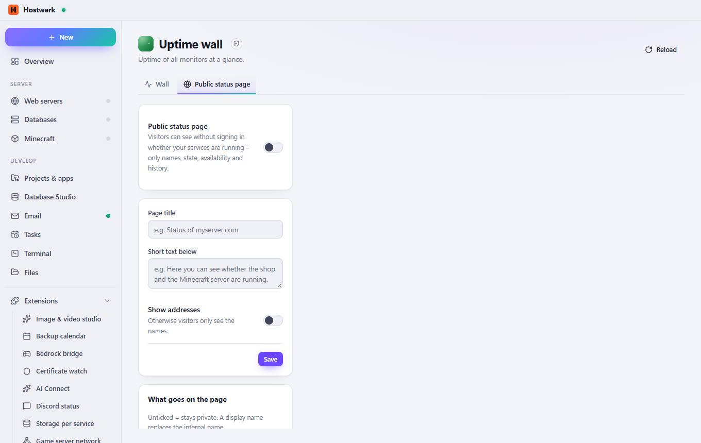

# Uptime wall → Wall

[← Back to the overview](README.md)

Uptime of all monitors at a glance.

### Good to know

- Sandboxed extension by Hostwerk · v1.2.0 · read only Read certificates and uptime checks Set up the public status page (asks first)

### What you can do here

- Reload

## Tabs

### Public status page

> Sandboxed extension by Hostwerk · v1.2.0 · read only Read certificates and uptime checks Set up the public status page (asks first)

**What you can do here:** Reload

Generated on 2026-10-19 · Hostwerk 2.9.0
