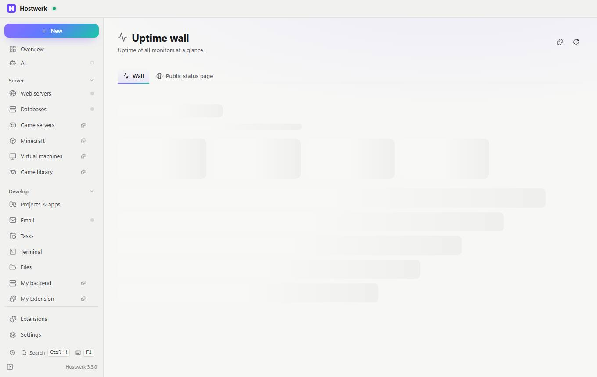
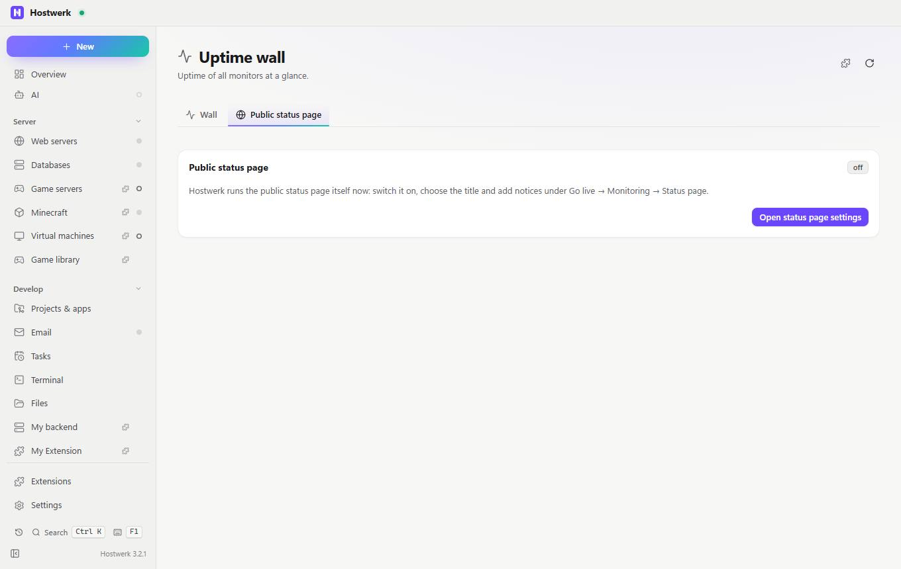

# Uptime wall → Wall

[← Back to the overview](README.md)

Uptime of all monitors at a glance.

### What you can do here

- From the extension “Uptime wall” – info
- Reload

## Tabs

### Public status page

**What you can do here:** From the extension “Uptime wall” – info · Reload

Generated on 2026-11-20 · Hostwerk 3.3.0
