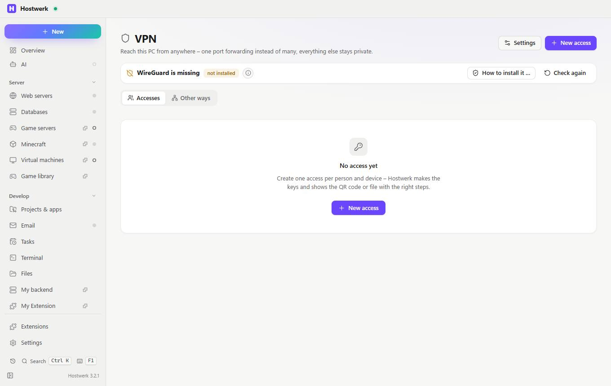

# VPN

[← Back to the overview](README.md)

Reach this PC from anywhere – one port forwarding instead of many, everything else stays private.

### Good to know

- WireGuard is missing You can already create accesses – the configurations work as soon as the tunnel runs.

### What you can do here

- Settings
- New access
- How to install it …
- Check again

Generated on 2026-11-18 · Hostwerk 3.2.1
