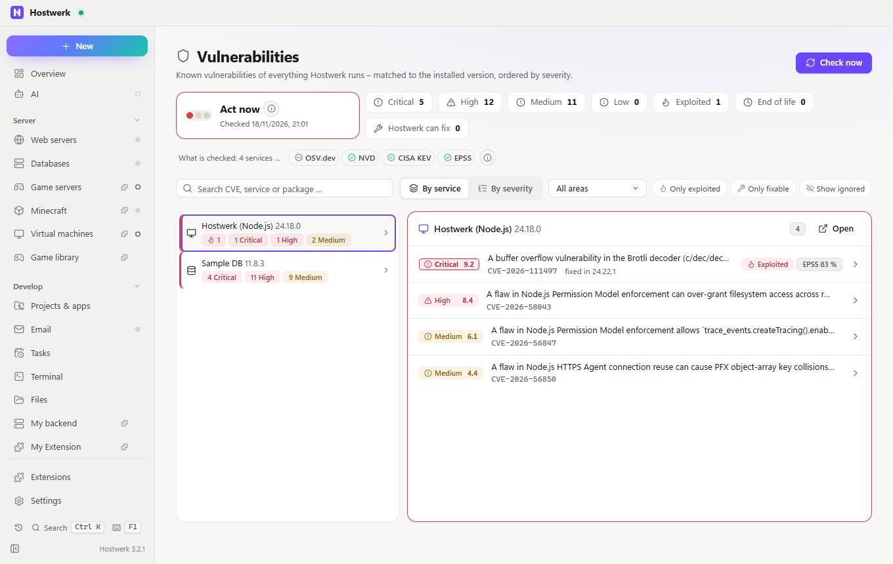

# Vulnerabilities

[← Back to the overview](README.md)

Known vulnerabilities of everything Hostwerk runs – matched to the installed version, ordered by severity.

### Good to know

- Act now There are critical or actively exploited vulnerabilities.
- Sources Free databases without a key: OSV.dev, the NVD (by CPE), CISA’s list of exploited vulnerabilities and FIRST’s EPSS. Hostwerk asks once a day, bundled and throttled, and keeps the answers – if a source is down, the last state stays. New critical or exploited findings go to Hostwerk’s notifications (Settings → Notifications).

### Areas on this page

- Hostwerk (Node.js) 24.18.0

### What you can do here

- Check now
- Critical 5
- High 12
- Medium 11
- Low 0
- Exploited 1
- End of life 0
- Hostwerk can fix 0
- What is checked: 4 services …
- Only exploited
- Only fixable
- Show ignored
- Hostwerk (Node.js) 24.18.0 1 1 Critical 1 High 2 Medium
- Sample DB 11.8.3 4 Critical 11 High 9 Medium
- Open
- High 8.4 A flaw in Node.js Permission Model enforcement can over-grant filesystem access across radix-tree prefix boundaries. CVE-2026-58043

Generated on 2026-11-18 · Hostwerk 3.2.1
