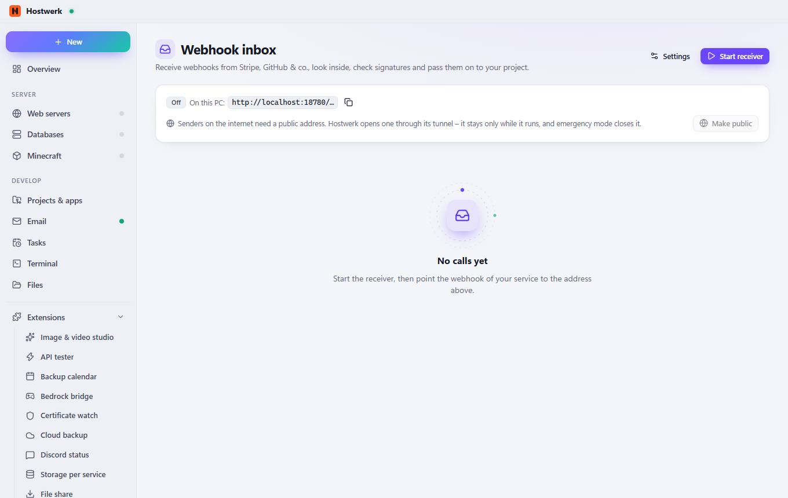

# Webhook inbox

[← Back to the overview](README.md)

Receive webhooks from Stripe, GitHub & co., look inside, check signatures and pass them on to your project.

### What you can do here

- Settings
- Start receiver
- Copy
- Make public

Generated on 2026-10-20 · Hostwerk 2.10.0
