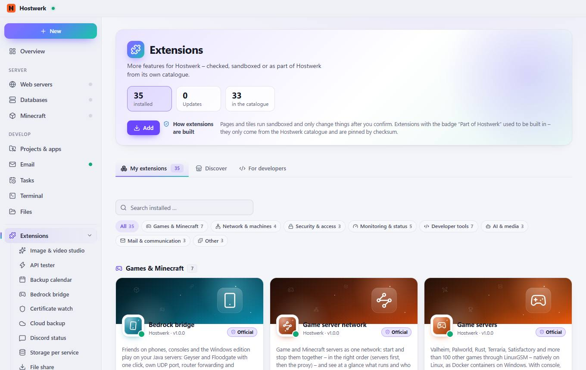
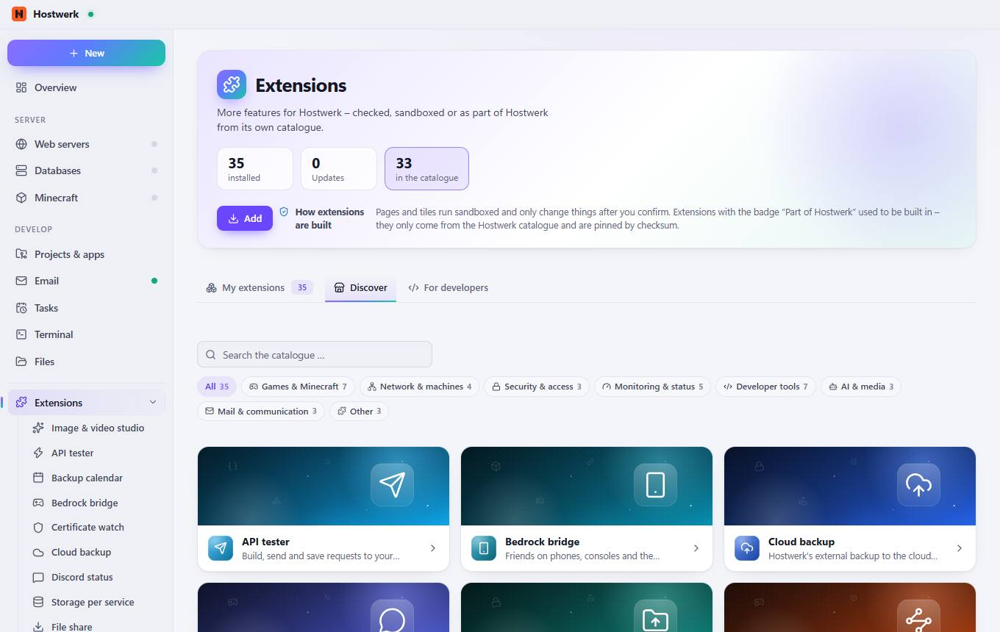
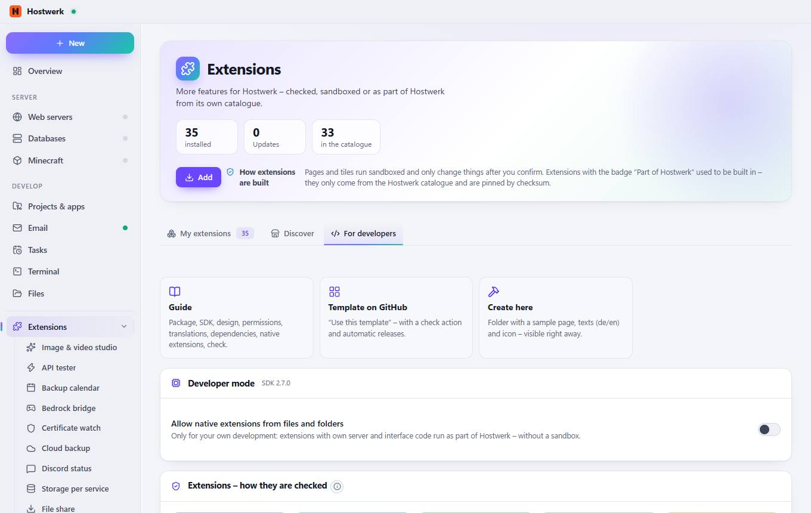

# Extensions

[← Back to the overview](README.md)

### Areas on this page

- Games & Minecraft 7
- Network & machines 4
- Security & access 3
- Monitoring & status 5
- Developer tools 7
- AI & media 3
- Mail & communication 3
- Other 3

### What you can do here

- 35 installed
- 0 Updates
- 33 in the catalogue
- Add
- All 35
- Games & Minecraft 7
- Network & machines 4
- Security & access 3
- Monitoring & status 5
- Developer tools 7
- AI & media 3
- Mail & communication 3
- Other 3
- Bedrock bridge – details
- Open
- Game server network – details
- Game servers – details
- MOTD studio – details
- Player leaderboard – details
- Player Ticker – details
- Schematics in 3D – details
- File share (SFTP) – details
- Hostwerk network – details
- Port map – details
- Router & port forwarding – details
- Certificate watch – details
- Password manager – details
- Team & roles – details
- Backup calendar – details
- Server profile – details
- Status Wall – details
- Storage per service – details
- Uptime wall – details
- API tester – details
- Page check – details
- Profiler – details
- Publish static sites – details
- Quick tasks – details
- Webhook inbox – details
- My Extension – details

## Tabs

### Discover

**Areas on this page:** Games & Minecraft 7 · Network & machines 4 · Security & access 3 · Monitoring & status 5 · Developer tools 7 · AI & media 3 · Mail & communication 3 · Other 3

**What you can do here:** 35 installed · 0 Updates · 33 in the catalogue · Add · All 35 · Games & Minecraft 7 · Network & machines 4 · Security & access 3 · Monitoring & status 5 · Developer tools 7 · AI & media 3 · Mail & communication 3 · Other 3 · Bedrock bridge – details · Open · Game server network – details · Game servers – details · MOTD studio – details · Player leaderboard – details · Player Ticker – details · Schematics in 3D – details · File share (SFTP) – details · Hostwerk network – details · Port map – details · Router & port forwarding – details · Certificate watch – details · Password manager – details · Team & roles – details · Backup calendar – details · Server profile – details · Status Wall – details · Storage per service – details · Uptime wall – details · API tester – details · Page check – details · Profiler – details · Publish static sites – details · Quick tasks – details · Webhook inbox – details · My Extension – details

### For developers

> What is an extension? An extension adds its own page, a tile for the overview and/or its own service to Hostwerk. Pages run isolated (own origin, no access to your login), only see what their permissions allow and only change things after you confirm each time. Colors and fonts come from Hostwerk – so every extension fits the design.

**Areas on this page:** Developer mode · Extensions – how they are checked

**What you can do here:** 35 installed · 0 Updates · 33 in the catalogue · Add · Guide Package, SDK, design, permissions, translations, dependencies, native extensions, check. · Template on GitHub “Use this template” – with a check action and automatic releases. · Create here Folder with a sample page, texts (de/en) and icon – visible right away. · Developer guide · Apply for verification · Manage more catalogues (sources)

Generated on 2026-10-20 · Hostwerk 2.10.0
