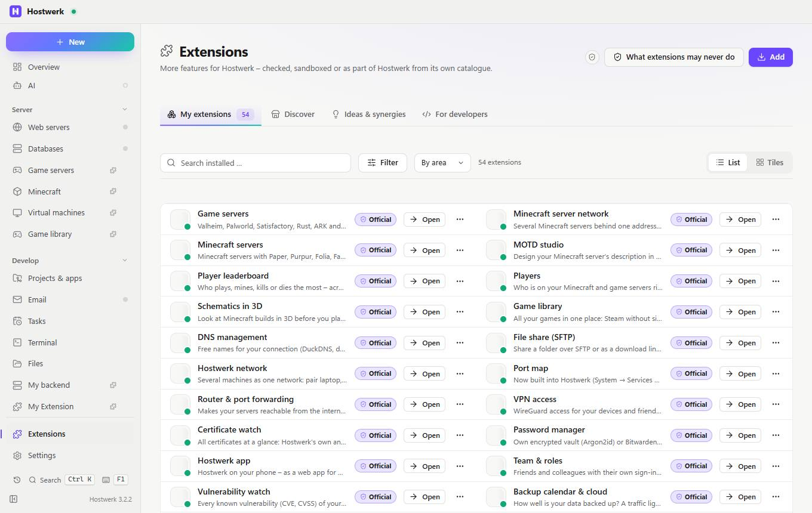
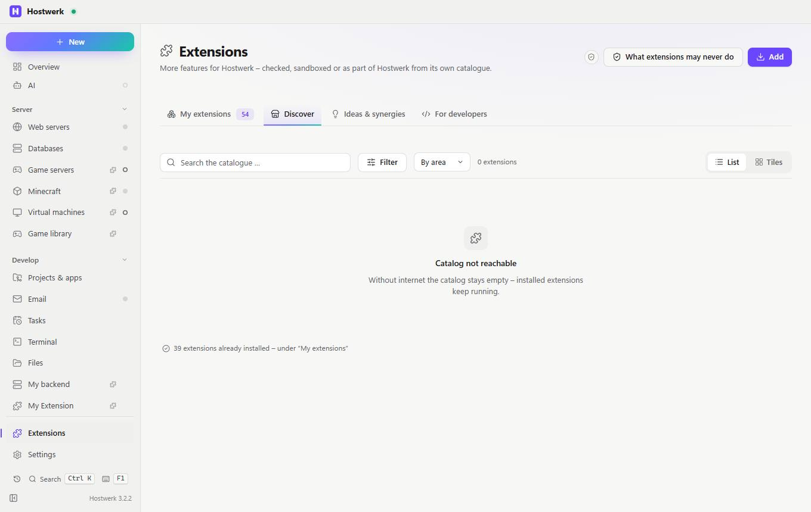
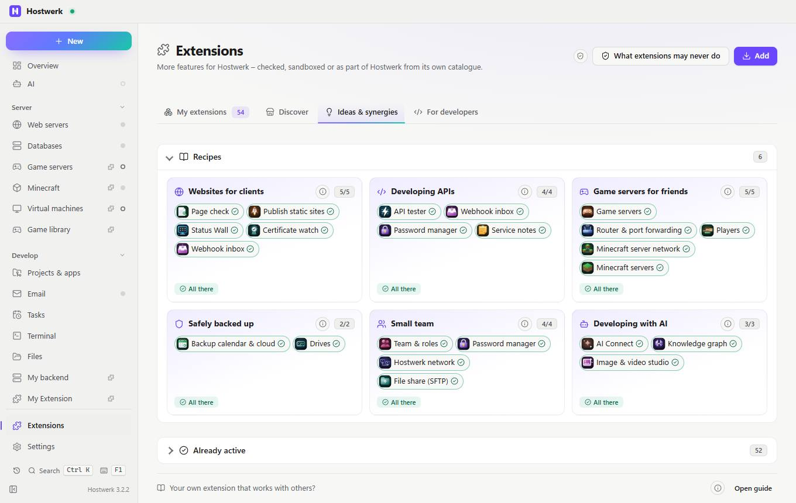
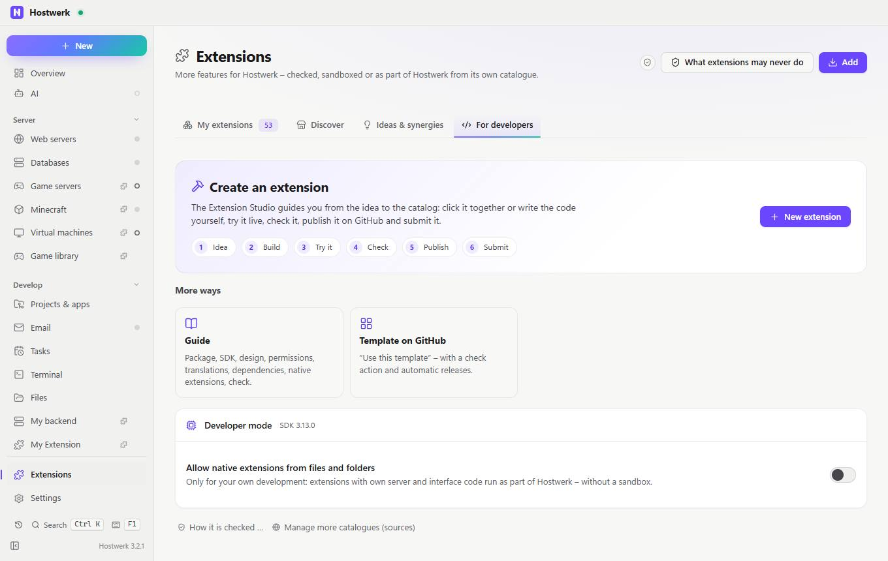

# Extensions

[← Back to the overview](README.md)

More features for Hostwerk – checked, sandboxed or as part of Hostwerk from its own catalogue.

### Good to know

- How extensions are built Extensions from other sources run sandboxed: pages in a frame, own server code in a separate process – without access to settings, passwords, keys or your home network, changes only after you confirm. Extensions with the badge “Part of Hostwerk” come from the Hostwerk catalog and are pinned by checksum.

### What you can do here

- What extensions may never do
- Add
- Filter
- Open
- Game servers – more actions
- Minecraft server network – more actions
- Minecraft servers – more actions
- MOTD studio – more actions
- Player leaderboard – more actions
- Players – more actions
- Schematics in 3D – more actions
- Game library – more actions
- DNS management – more actions
- File share (SFTP) – more actions
- Hostwerk network – more actions
- Port map – more actions
- Router & port forwarding – more actions
- VPN access – more actions
- Certificate watch – more actions
- Password manager – more actions
- Hostwerk app – more actions
- Team & roles – more actions
- Vulnerability watch – more actions
- Backup calendar & cloud – more actions
- Drives – more actions
- Storage per service How much space each service takes – data, backups, projects – and how full the drive is. With a dashboard tile.
- Storage per service – more actions
- Server profile – more actions
- Status Wall – more actions
- Uptime wall – more actions
- Visitor stats – more actions
- API tester – more actions
- Deploy log – more actions
- My backend Template for own server code: runs sandboxed in its own process, offers own routes and stores data in its own folder.
- My backend – more actions
- My Extension Starting point for your own Hostwerk extensions: page, tile, settings and translations.
- My Extension – more actions
- Page check – more actions
- Profiler – more actions
- Quick tasks Your tasks as big buttons – one click runs a backup, a report or a script (Hostwerk asks first). Pin favourites, also as a tile.

## Tabs

### Discover

> How extensions are built Extensions from other sources run sandboxed: pages in a frame, own server code in a separate process – without access to settings, passwords, keys or your home network, changes only after you confirm. Extensions with the badge “Part of Hostwerk” come from the Hostwerk catalog and are pinned by checksum.

**What you can do here:** What extensions may never do · Add · Filter · Install · Office – more actions · 38 extensions already installed – under “My extensions”

### Ideas & synergies

> How extensions are built Extensions from other sources run sandboxed: pages in a frame, own server code in a separate process – without access to settings, passwords, keys or your home network, changes only after you confirm. Extensions with the badge “Part of Hostwerk” come from the Hostwerk catalog and are pinned by checksum.
> Websites for clients Build, check, publish and keep an eye on sites.
> Developing APIs Test requests, receive webhooks, store credentials safely.
> Game servers for friends Start servers, make them reachable from outside, see players.
> Safely backed up Planned backups, an off-site copy, space at a glance.
> Small team Several machines, shared logins, file sharing.
> Developing with AI Connect Claude and give it project knowledge.
> Replay webhooks “Open in API tester” in the webhook inbox: the received call lands with headers and body in the collection “Webhook inbox” – change it there and send it to your project again.
> Reachable and good The uptime wall shows whether a page answers – the page check whether it is also fast, accessible and free of broken links.
> One view for going live Both read Hostwerk’s own live data – pinned side by side you see expiring certificates and failed pages at a glance. Warnings still come from Hostwerk’s watchers.
> Check first, then publish Run the page check before publishing to GitHub/Cloudflare Pages.
> Files between machines Turn on the file share (SFTP) in the home network on every machine paired in the Hostwerk network – the machines then reach each other by their LAN address. Set up on each machine.

**What you can do here:** What extensions may never do · Add · Open guide

### For developers

> How extensions are built Extensions from other sources run sandboxed: pages in a frame, own server code in a separate process – without access to settings, passwords, keys or your home network, changes only after you confirm. Extensions with the badge “Part of Hostwerk” come from the Hostwerk catalog and are pinned by checksum.

**Areas on this page:** Developer mode

**What you can do here:** What extensions may never do · Add · New extension · Guide Package, SDK, design, permissions, translations, dependencies, native extensions, check. · Template on GitHub “Use this template” – with a check action and automatic releases. · How it is checked … · Manage more catalogues (sources)

Generated on 2026-11-20 · Hostwerk 3.3.0
