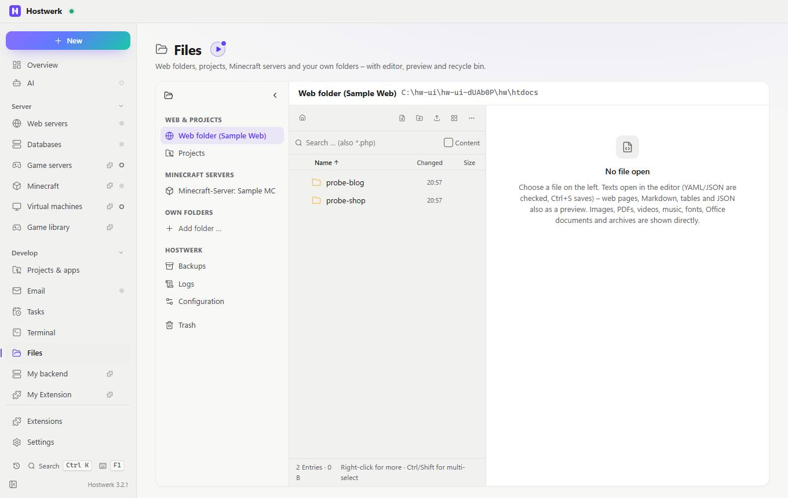

# Files

[← Back to the overview](README.md)

Web folders, projects, Minecraft servers and your own folders – with editor, preview and recycle bin.

### What you can do here

- Video
- Collapse sidebar
- Web folder (Sample Web)
- Projects
- Minecraft-Server: Sample MC
- Add folder …
- Backups
- Logs
- Configuration
- Trash
- Back
- Forward
- Move up
- Update
- Top of this area
- New
- Upload
- Cut
- Copy
- Paste
- Rename
- Move to …
- Delete
- Name
- Tiles
- More
- Date modified
- Type
- Size

Generated on 2026-11-20 · Hostwerk 3.3.0
