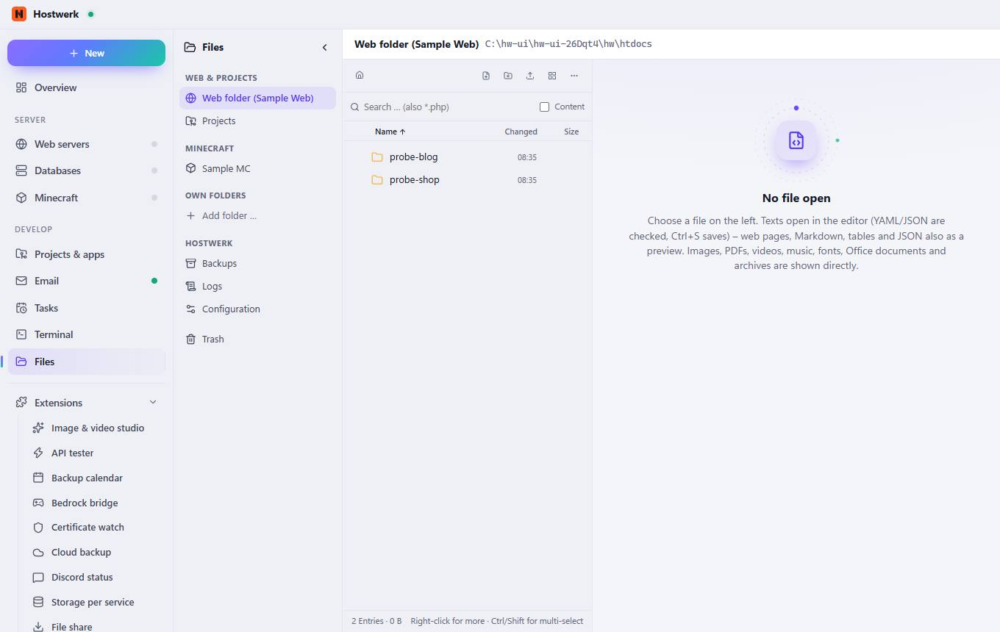

# Files

[← Back to the overview](README.md)

### What you can do here

- Collapse sidebar
- Web folder (Sample Web)
- Projects
- Sample MC
- Add folder …
- Backups
- Logs
- Configuration
- Trash
- Root
- New file
- New folder
- Tiles
- More
- Name
- Changed
- Size

Generated on 2026-10-20 · Hostwerk 2.10.0
