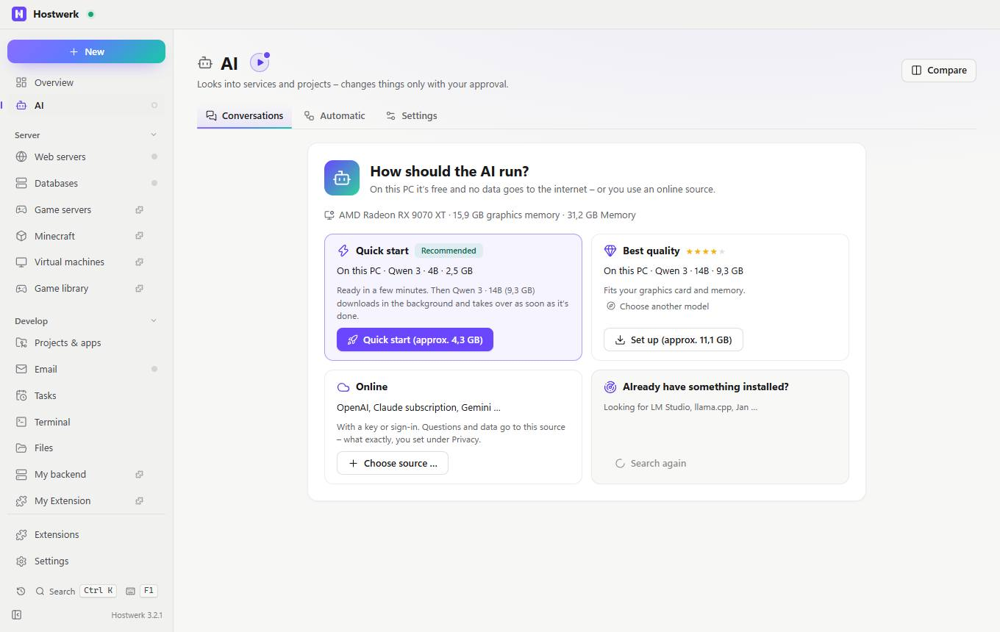
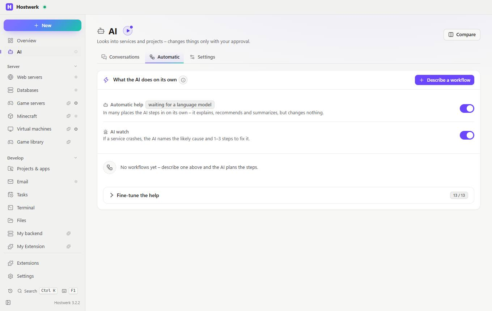
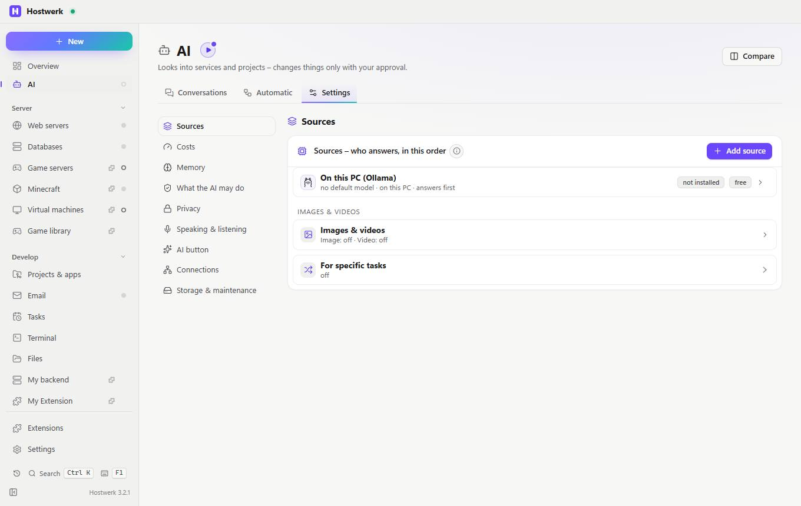

# AI

[← Back to the overview](README.md)

Looks into services and projects – changes things only with your approval.

### What you can do here

- 2 videos
- Compare
- Quick start (approx. 4,3 GB)
- Choose another model
- Set up (approx. 11,1 GB)
- Choose source …
- Search again

## Tabs

### Automatic

> Everything that happens without a conversation: help right where you are, the AI watch on crashes, your workflows (by hand, on a schedule or on an event) and suggestions from your history.

**Areas on this page:** What the AI does on its own

**What you can do here:** 2 videos · Compare · Describe a workflow

### Settings

> The first source answers. If it doesn’t answer, its quota is used up or its monthly limit is reached, the next one takes over. Change the order by dragging or with the arrows. With online sources, questions and data go to that provider – what exactly, you set under Privacy.
> Hostwerk recognises what you ask and uses the matching provider – e.g. short questions locally, code to a strong model. If it doesn’t answer, the order under “Who answers” applies as usual.

**Areas on this page:** Sources · Sources – who answers, in this order

**What you can do here:** 2 videos · Compare · Add source · On this PC (Ollama) no default model · on this PC · answers first not installed free · Images & videos Image: off · Video: off

Generated on 2026-11-20 · Hostwerk 3.3.0
