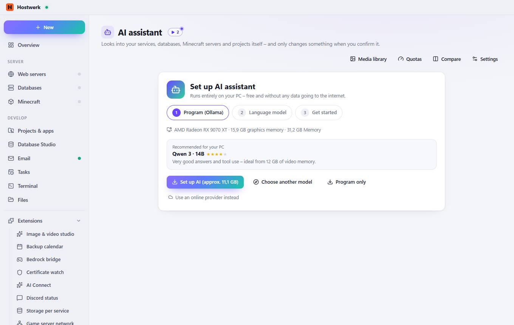

# AI assistant

[← Back to the overview](README.md)

Looks into your services, databases, Minecraft servers and projects itself – and only changes something when you confirm it.

### What you can do here

- Media library
- Quotas
- Compare
- Settings
- Set up AI (approx. 11,1 GB)
- Choose another model
- Program only
- Use an online provider instead

Generated on 2026-10-19 · Hostwerk 2.9.0
