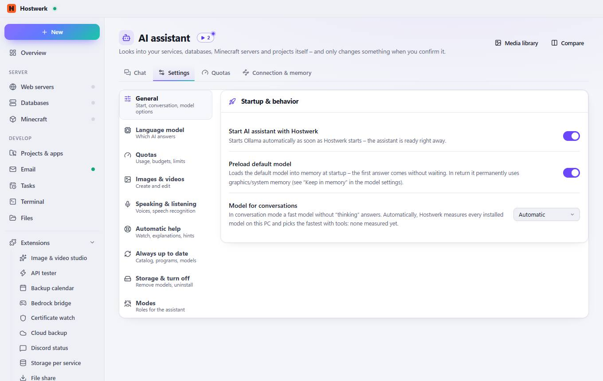
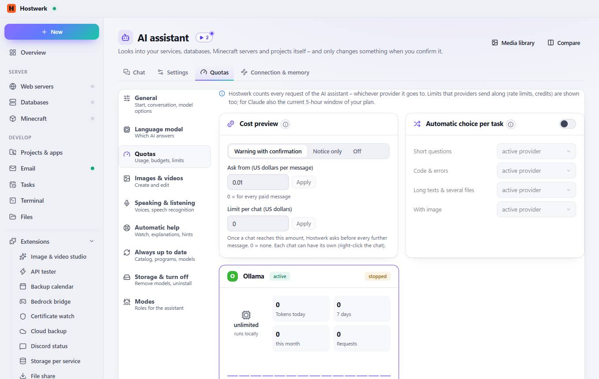
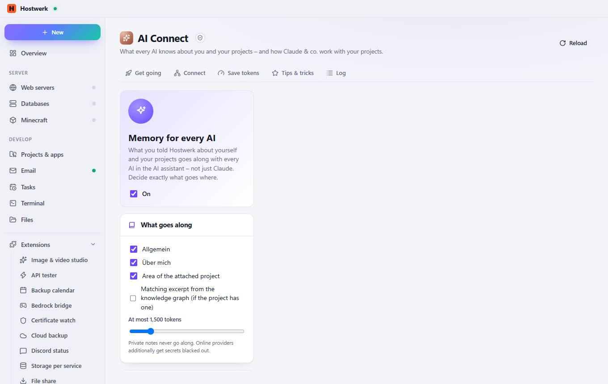

# AI assistant

[← Back to the overview](README.md)

Looks into your services, databases, Minecraft servers and projects itself – and only changes something when you confirm it.

### What you can do here

- Media library
- Compare
- Set up AI (approx. 11,1 GB)
- Choose another model
- Program only
- Use an online provider instead

## Tabs

### Settings

**Areas on this page:** Startup & behavior

**What you can do here:** Media library · Compare · General Start, conversation, model options · Language model Which AI answers · Quotas Usage, budgets, limits · Images & videos Create and edit · Speaking & listening Voices, speech recognition · Automatic help Watch, explanations, hints · Always up to date Catalog, programs, models · Storage & turn off Remove models, uninstall · Modes Roles for the assistant

### Quotas

> Before sending to a paid online provider, Hostwerk estimates tokens and cost. Prices come daily from a public model list – new models too, without a Hostwerk update.
> Hostwerk recognises what you ask and picks the matching provider – e.g. short questions locally, code to a strong model. If it does not answer, the fallback chain steps in as usual.

**Areas on this page:** Cost preview · Automatic choice per task · Ollama

**What you can do here:** Media library · Compare · General Start, conversation, model options · Language model Which AI answers · Quotas Usage, budgets, limits · Images & videos Create and edit · Speaking & listening Voices, speech recognition · Automatic help Watch, explanations, hints · Always up to date Catalog, programs, models · Storage & turn off Remove models, uninstall · Modes Roles for the assistant · Apply

### Connection & memory

> Sandboxed extension by Hostwerk · v1.2.0 · may change things after asking Read Claude status, projects, memory context, token-saving tools and usage Set up Claude: context in project files, token-saving tools (asks first) Type commands into the terminal (you confirm) Read the knowledge graph (projects, graph, report, memory, Claude status) Connect Claude and forget it again (asks first) Store own data (max. 256 KB)

**What you can do here:** Reload

Generated on 2026-10-20 · Hostwerk 2.10.0
