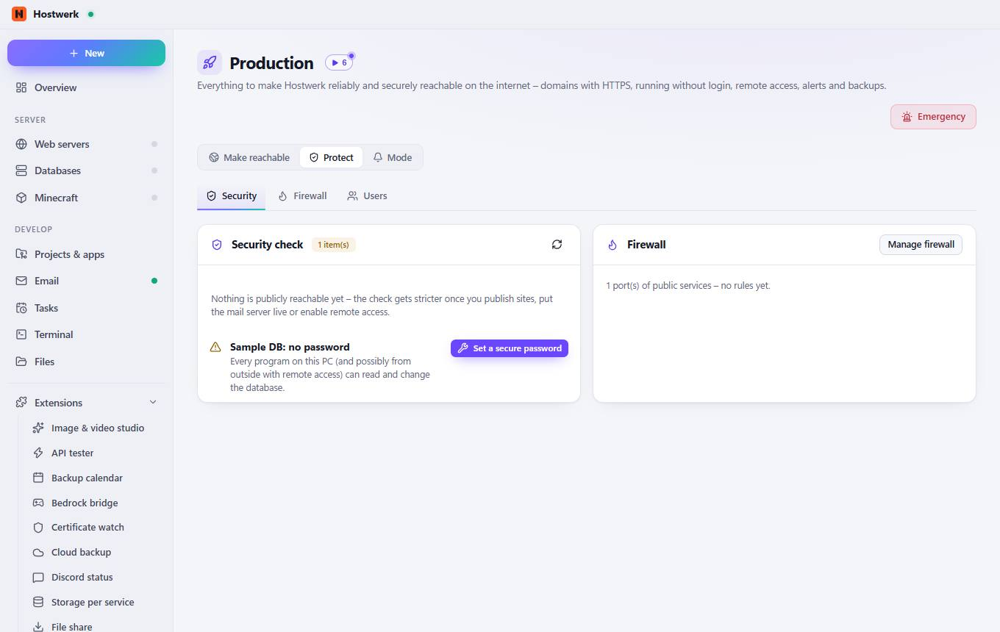
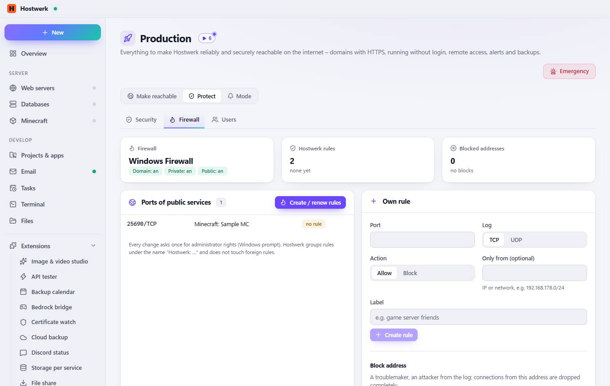
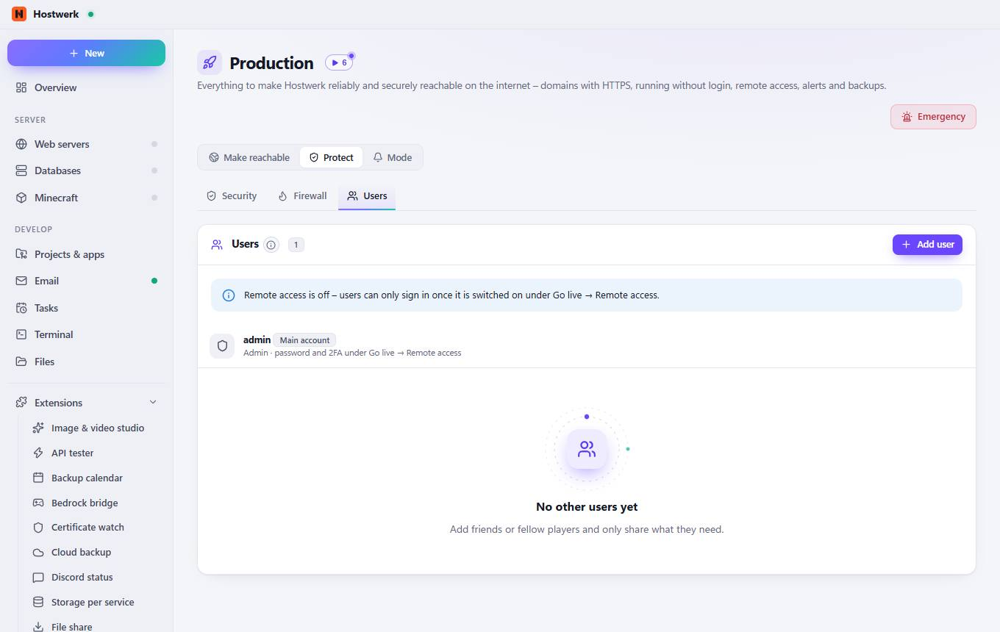

# Production → Security

[← Back to the overview](README.md)

Everything to make Hostwerk reliably and securely reachable on the internet – domains with HTTPS, running without login, remote access, alerts and backups.

### Areas on this page

- Security check
- Firewall

### What you can do here

- Emergency
- Set a secure password
- Manage firewall

## Tabs

### Firewall

**Areas on this page:** Ports of public services · Own rule · Rules by Hostwerk

**What you can do here:** Emergency · Create / renew rules · Create rule · Lock · Re-read · Remove rule

### Users

> How roles work Every person signs in to remote access with their own name and password (or passkey). Members only see and control the services and areas you share – for example “start the survival server and manage players”. The change log shows who did what.

**Areas on this page:** Users

**What you can do here:** Emergency · Add user

Generated on 2026-10-20 · Hostwerk 2.10.0
