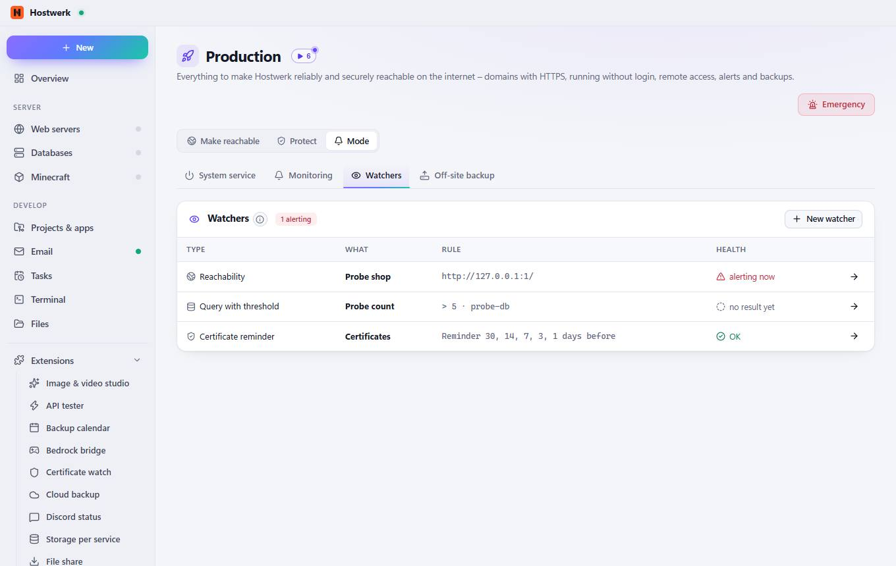
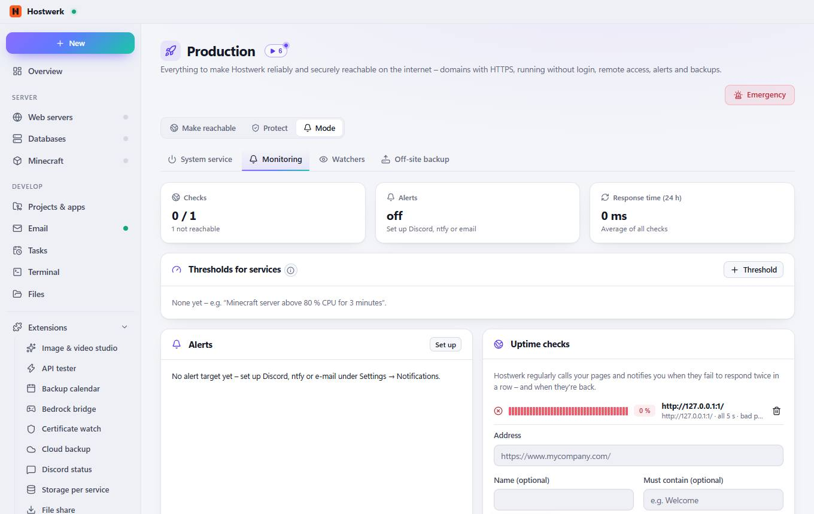
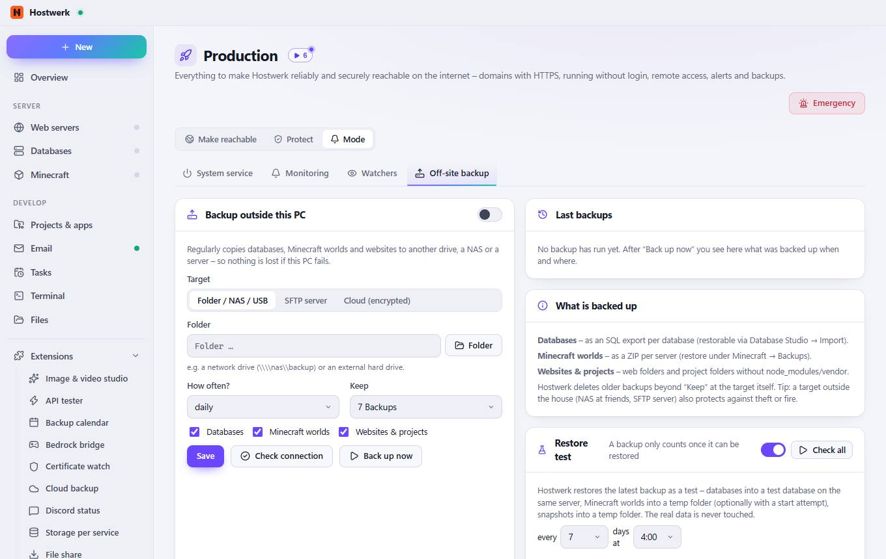

# Production → Watchers

[← Back to the overview](README.md)

Everything to make Hostwerk reliably and securely reachable on the internet – domains with HTTPS, running without login, remote access, alerts and backups.

### Good to know

- What are watchers? Everything Hostwerk watches by itself: pages, services, queries and certificates. Where alerts go is set under Settings → Notifications.

### Areas on this page

- Watchers

### What you can do here

- Emergency
- New watcher
- Edit: Probe shop
- Edit: Probe count
- Edit: Certificates

## Tabs

### Monitoring

> Hostwerk checks CPU, memory, players, TPS or response time every 30 seconds and lets you know when a value stays above or below the threshold for a while – and when it is fine again.

**Areas on this page:** Thresholds for services · Alerts · Uptime checks

**What you can do here:** Emergency · Threshold · Set up · Add check

### Off-site backup

**Areas on this page:** Backup outside this PC · Last backups · What is backed up · Restore test

**What you can do here:** Emergency · Folder · Save · Check connection · Back up now · Check all · Check

Generated on 2026-10-20 · Hostwerk 2.10.0
