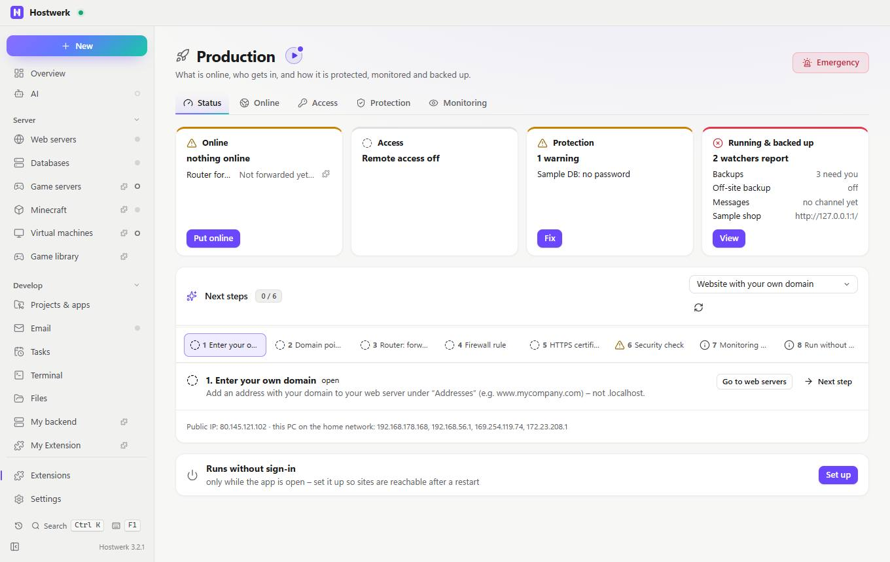
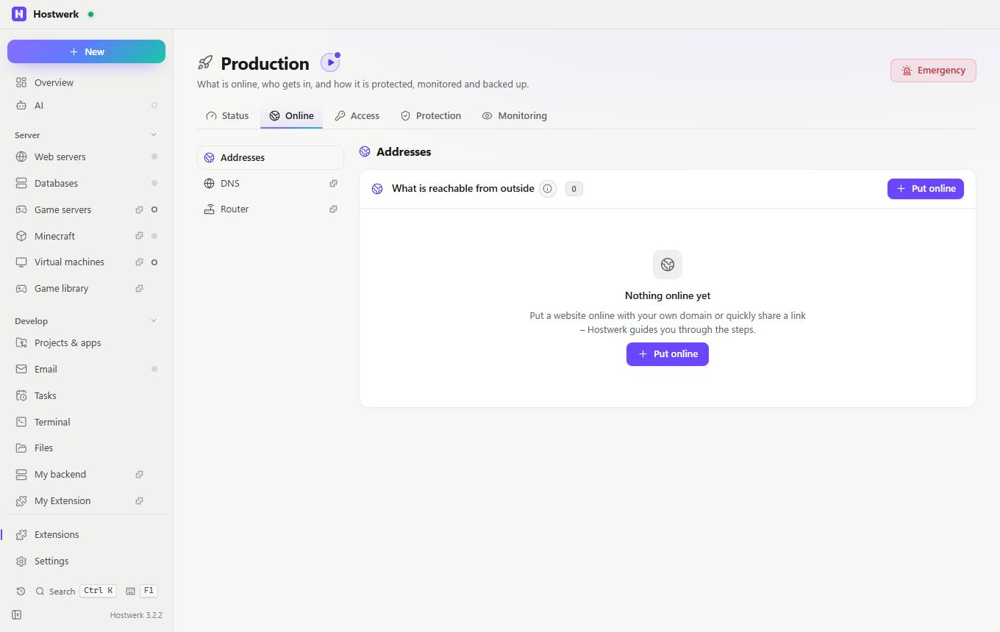
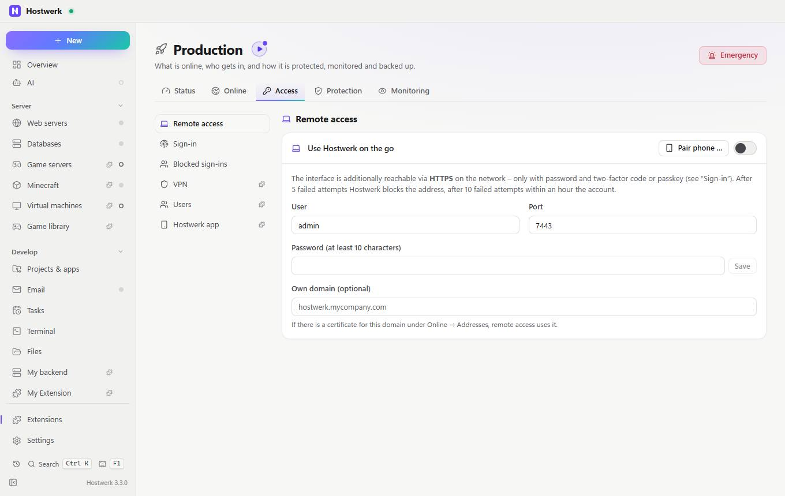
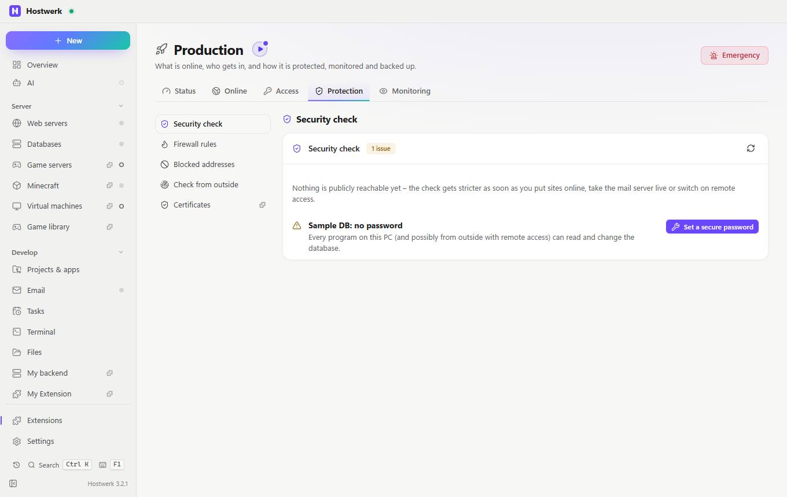
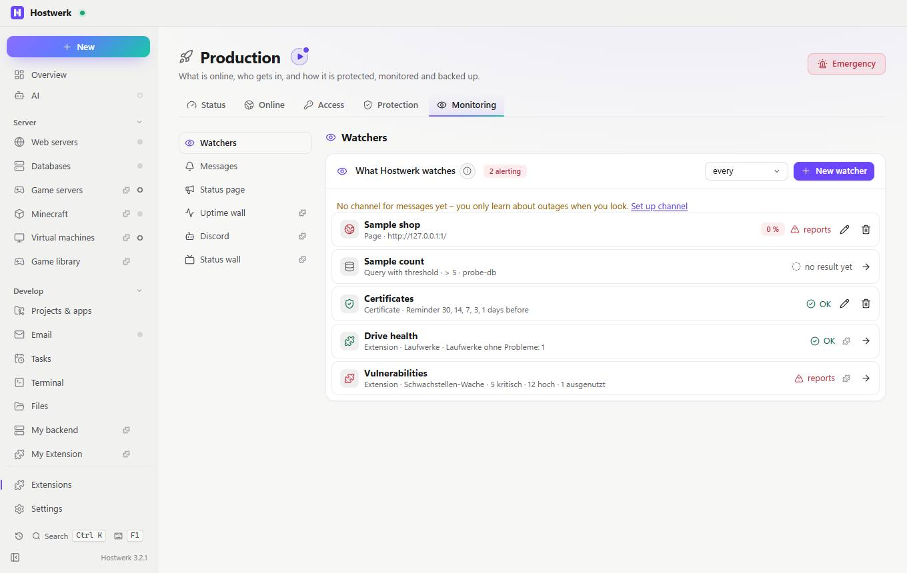

# Production

[← Back to the overview](README.md)

What is online, who gets in, and how it is protected, monitored and backed up.

### Areas on this page

- Next steps

### What you can do here

- 6 videos
- Emergency
- From the extension “router” – info
- Put online
- Fix
- View
- Check again
- 1 Enter your own domain
- 2 Domain points to this connection (DNS)
- 3 Router: forward ports 80 and 443 to this PC
- 4 Firewall rule
- 5 HTTPS certificate (Let's Encrypt)
- 6 Security check
- 7 Monitoring and alerts
- 8 Run without signing in too (system service)
- Go to web servers
- Next step
- Set up

## Tabs

### Online

> Addresses Every address under which something is reachable from the internet – your own domain, a quick link (expires) or the permanent tunnel via Cloudflare.

**Areas on this page:** Addresses · What is reachable from outside

**What you can do here:** 6 videos · Emergency · Put online

### Access

**Areas on this page:** Remote access · Use Hostwerk on the go

**What you can do here:** 6 videos · Emergency · Pair phone … · Save

### Protection

**Areas on this page:** Security check

**What you can do here:** 6 videos · Emergency · Reload · Set a secure password

### Monitoring

> Watchers Everything Hostwerk watches by itself: sites, ports, services, certificates, queries and logs. If a watcher reports a problem twice in a row, a message goes to your channels – and another one when it is over.

**Areas on this page:** Watchers · What Hostwerk watches

**What you can do here:** 6 videos · Emergency · New watcher · Edit: Sample shop · Remove: Sample shop · Edit: Sample count · Edit: Certificates · Remove: Certificates · From the extension “disk-health” – info · Edit: Drive health · From the extension “vuln-watch” – info · Edit: Vulnerabilities

Generated on 2026-11-20 · Hostwerk 3.3.0
