# Production

[← Back to the overview](README.md)

Everything to make Hostwerk reliably and securely reachable on the internet – domains with HTTPS, running without login, remote access, alerts and backups.

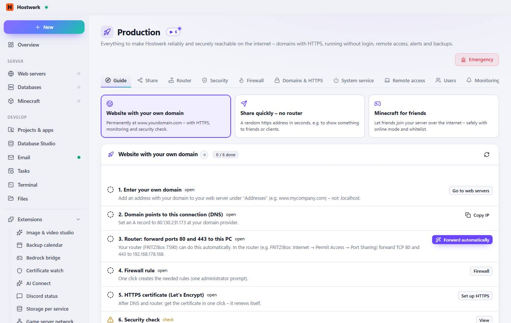

### Good to know

- Next: Enter your own domain Add an address with your domain to your web server under “Addresses” (e.g. www.mycompany.com) – not .localhost. After that: Domain points to this connection (DNS) · Router: forward ports 80 and 443 to this PC · Firewall rule · HTTPS certificate (Let's Encrypt) · Security check

### Areas on this page

- Website with your own domain

### What you can do here

- Emergency
- Website with your own domain Permanently at www.yourdomain.com – with HTTPS, monitoring and security check.
- Share quickly – no router A random https address in seconds, e.g. to show something to friends or clients.
- Minecraft for friends Let friends join your server over the internet – safely with online mode and whitelist.
- Check again
- Go to web servers
- Copy IP
- Forward automatically
- Firewall
- Set up HTTPS
- View
- Monitoring
- System service

## Tabs

### Share

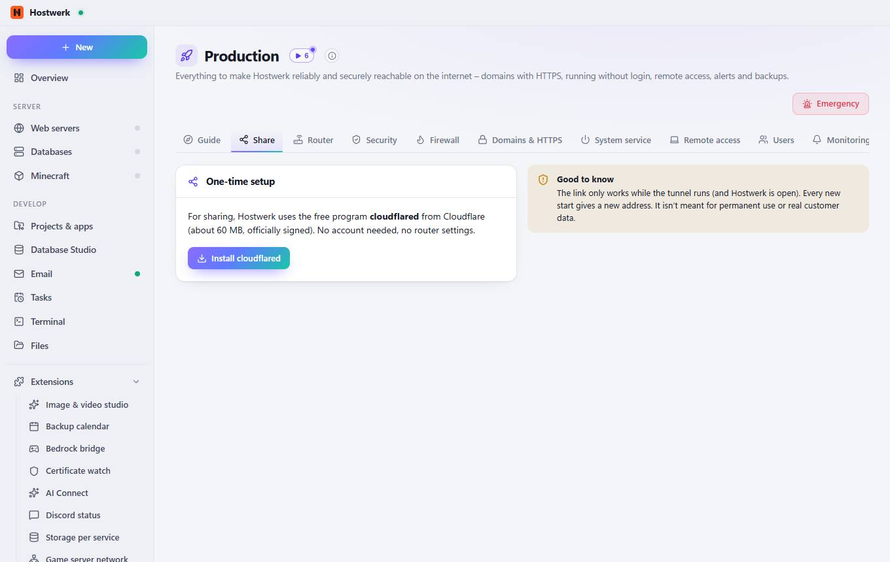

> How it works Hostwerk builds an encrypted connection to Cloudflare. There you get a random address like xyz.trycloudflare.com, which points straight at your local site – handy for showing it to someone or testing on your phone.

**Areas on this page:** One-time setup

**What you can do here:** Emergency · Install cloudflared

### Router

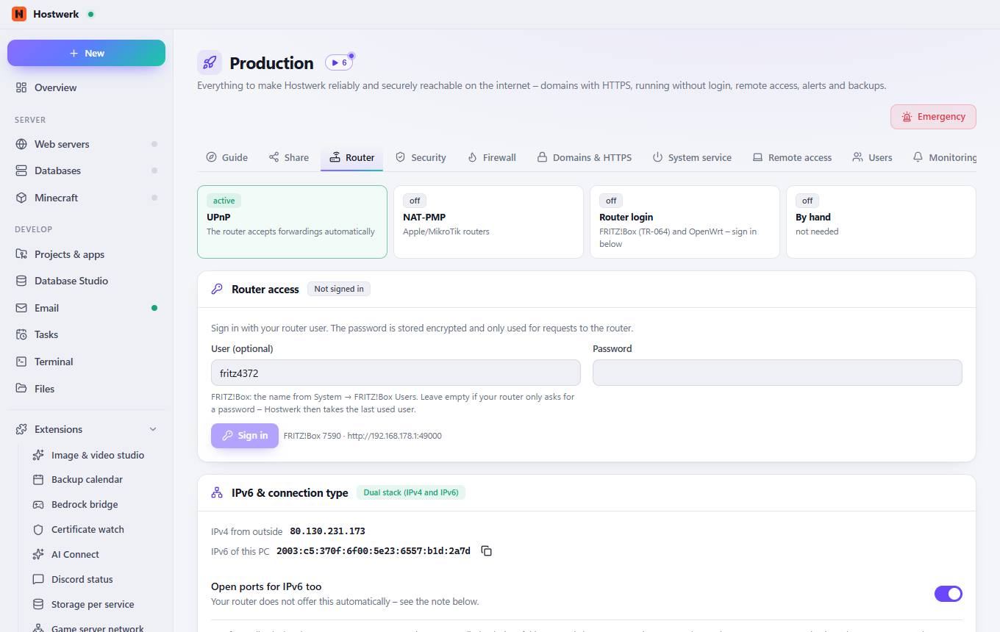

**Areas on this page:** Router access · IPv6 & connection type · FRITZ!Box 7590 · Forward automatically · Hostwerk's ports · All forwardings in the router

**What you can do here:** Emergency · Sign in · Copy · Save · Search again · Open the router interface · Sync now · Own forwarding · Open router · Hide tip · Forward

### Security

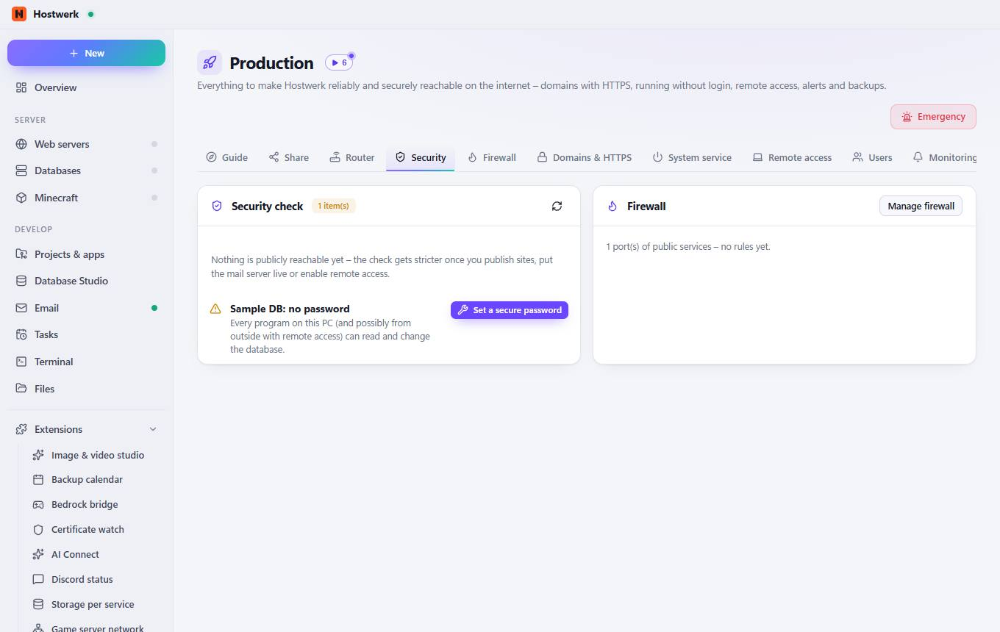

**Areas on this page:** Security check · Firewall

**What you can do here:** Emergency · Set a secure password · Manage firewall

### Firewall

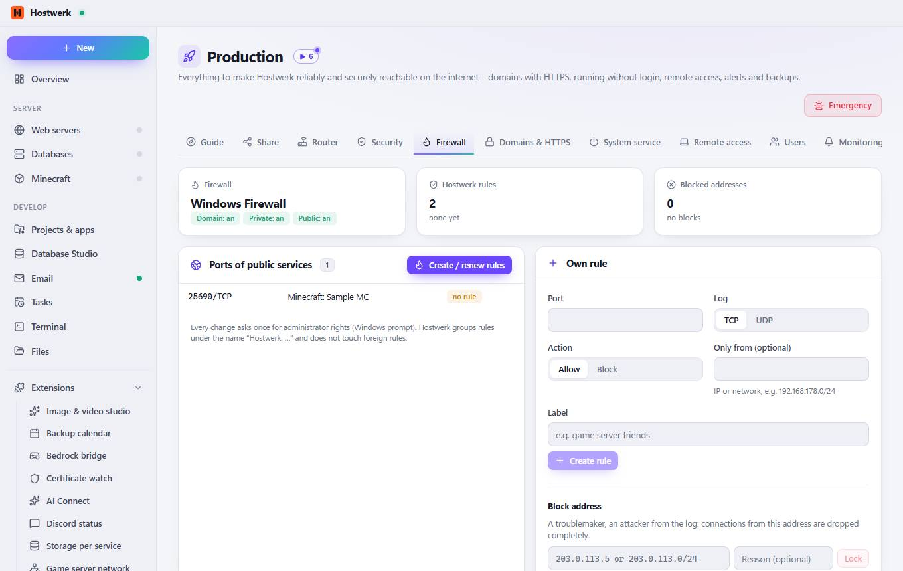

**Areas on this page:** Ports of public services · Own rule · Rules by Hostwerk

**What you can do here:** Emergency · Create / renew rules · Create rule · Lock · Re-read · Remove rule

### Domains & HTTPS

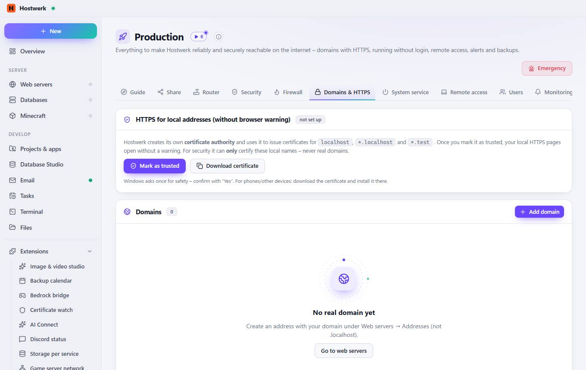

> How to make a site public 1. At your domain provider create an A record pointing to your public IP. 2. In your router forward port 80 and 443 to this PC. 3. Under Web servers → Addresses create the real domain as an address (e.g. www.mycompany.com). 4. Click “Set up HTTPS” here – Hostwerk gets a free certificate from Let's Encrypt and renews it automatically.

**Areas on this page:** HTTPS for local addresses (without browser warning) · Domains

**What you can do here:** Emergency · Mark as trusted · Download certificate · Add domain · Go to web servers

### System service

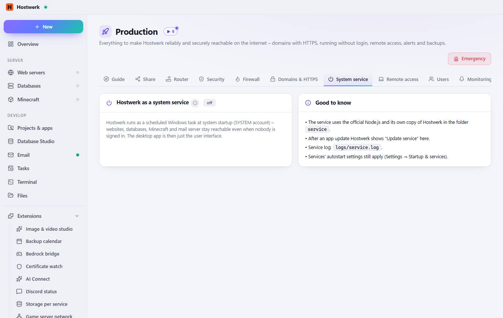

> Switching is only possible in the desktop app.

**Areas on this page:** Hostwerk as a system service · Good to know

**What you can do here:** Emergency

### Remote access

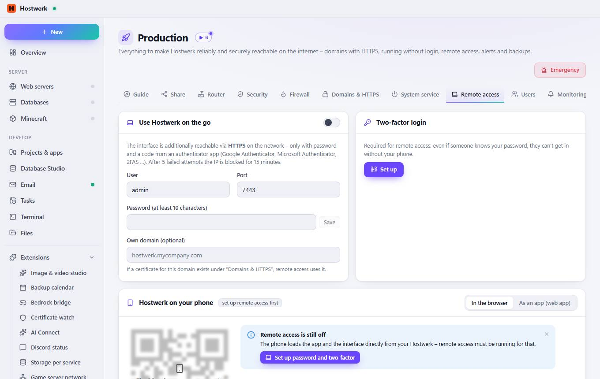

**Areas on this page:** Use Hostwerk on the go · Two-factor login · Hostwerk on your phone · Sign in with passkey

**What you can do here:** Emergency · Save · Set up · Set up password and two-factor · Hide tip · Add passkey

### Users

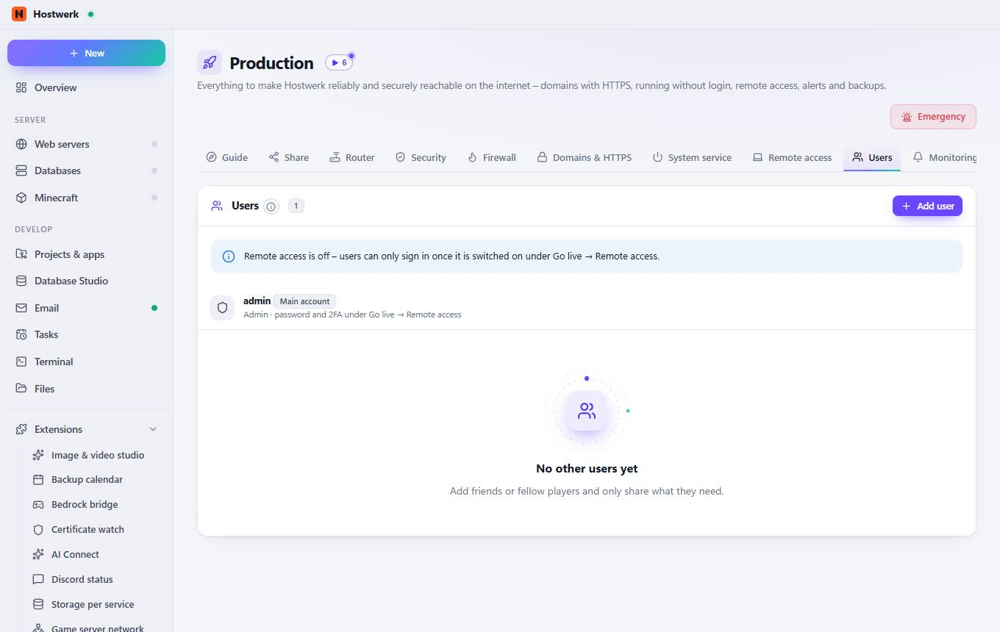

> How roles work Every person signs in to remote access with their own name and password (or passkey). Members only see and control the services and areas you share – for example “start the survival server and manage players”. The change log shows who did what.

**Areas on this page:** Users

**What you can do here:** Emergency · Add user

### Monitoring

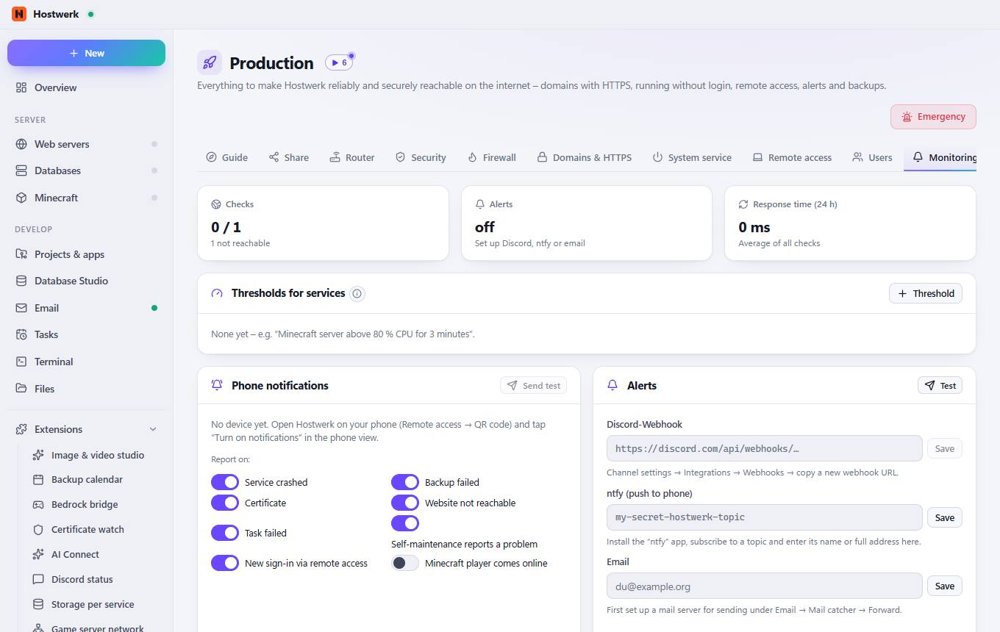

> Hostwerk checks CPU, memory, players, TPS or response time every 30 seconds and lets you know when a value stays above or below the threshold for a while – and when it is fine again.

**Areas on this page:** Thresholds for services · Phone notifications · Alerts · Uptime checks

**What you can do here:** Emergency · Threshold · Send test · Test · Save · Check now · Add check

### Off-site backup

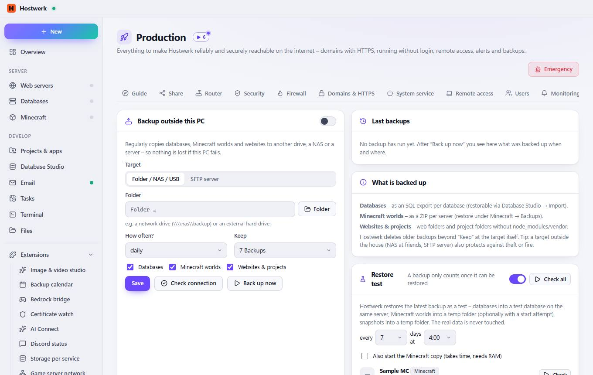

**Areas on this page:** Backup outside this PC · Last backups · What is backed up · Restore test

**What you can do here:** Emergency · Folder · Save · Check connection · Back up now · Check all · Check

Generated on 2026-10-19 · Hostwerk 2.9.0
