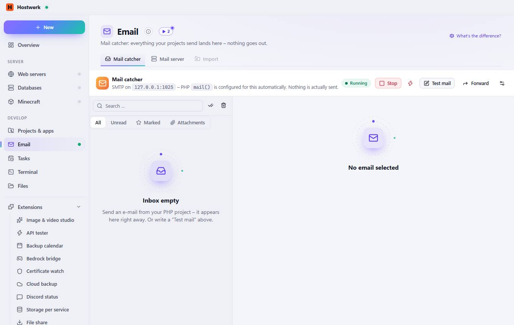
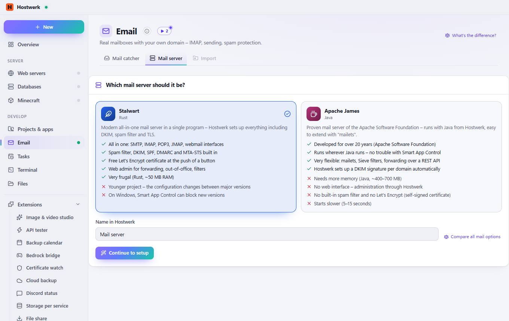

# Email

[← Back to the overview](README.md)

Mail catcher: everything your projects send lands here – nothing goes out.

### Good to know

- Mail catcher or mail server? The Mail catcher is for development: it catches every mail a project sends (registration, order confirmation …) – you read it here, nothing leaves the PC. The Mail server is for real mailboxes like info@your-domain.com with IMAP and sending to the internet (Stalwart or Apache James).

### What you can do here

- What's the difference?
- Stop
- Stop immediately (force)
- Test mail
- Forward
- Settings
- Mark all as read
- Delete all

## Tabs

### Mail server

> Mail catcher or mail server? The Mail catcher is for development: it catches every mail a project sends (registration, order confirmation …) – you read it here, nothing leaves the PC. The Mail server is for real mailboxes like info@your-domain.com with IMAP and sending to the internet (Stalwart or Apache James).

**Areas on this page:** Which mail server should it be?

**What you can do here:** What's the difference? · Compare all mail options · Continue to setup

### Import

> Mail catcher or mail server? The Mail catcher is for development: it catches every mail a project sends (registration, order confirmation …) – you read it here, nothing leaves the PC. The Mail server is for real mailboxes like info@your-domain.com with IMAP and sending to the internet (Stalwart or Apache James).

**What you can do here:** What's the difference? · Stop · Stop immediately (force) · Test mail · Forward · Settings · Mark all as read · Delete all

Generated on 2026-10-20 · Hostwerk 2.10.0
