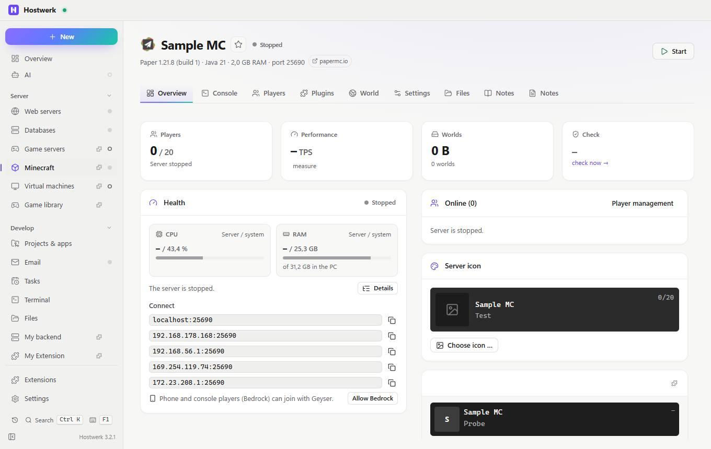
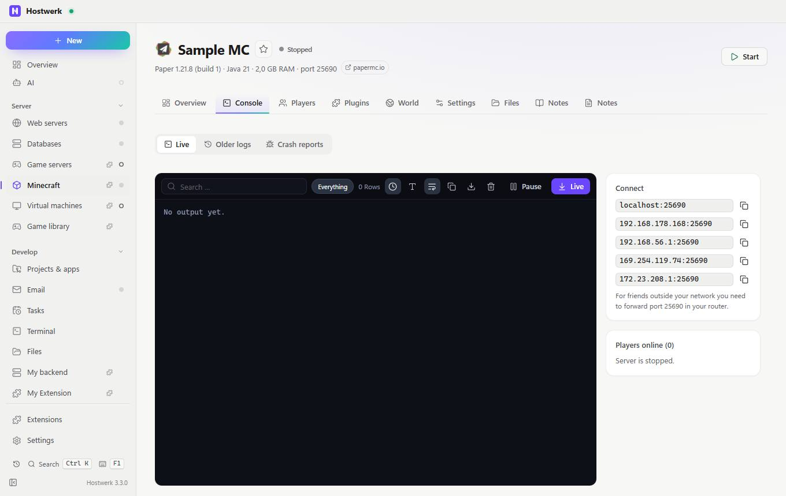
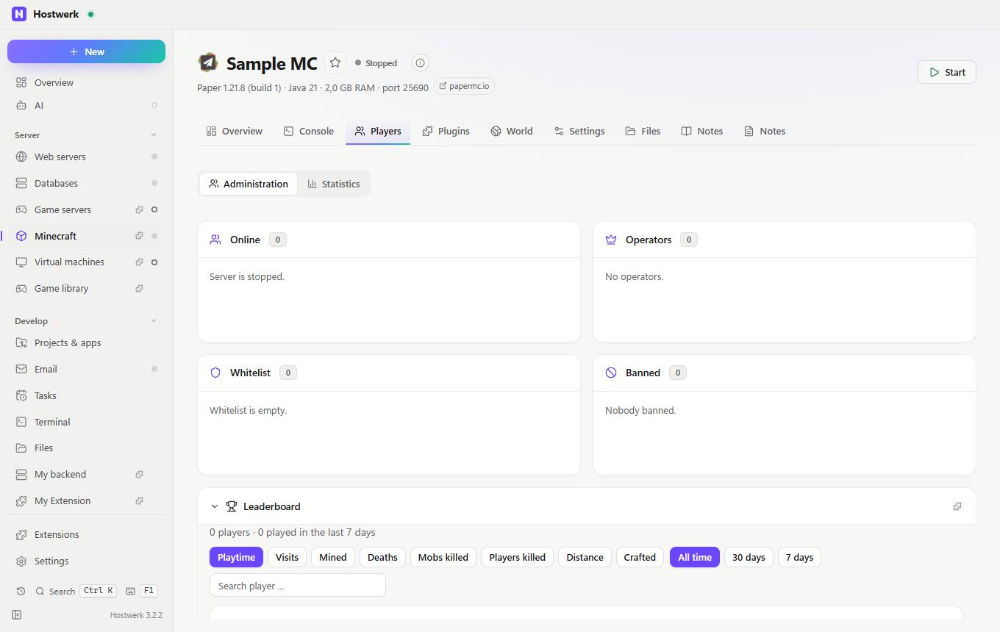
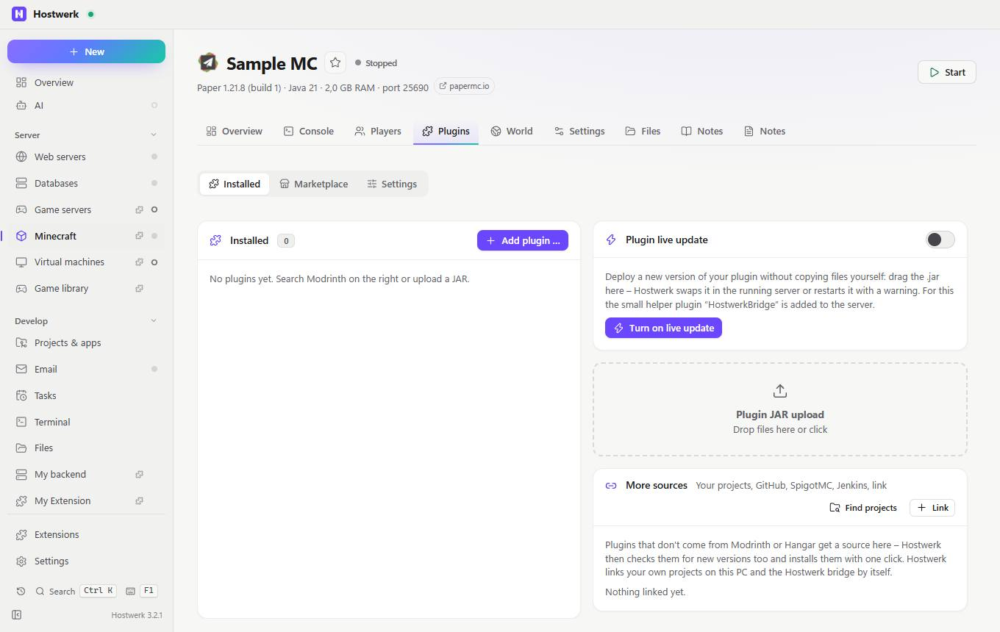
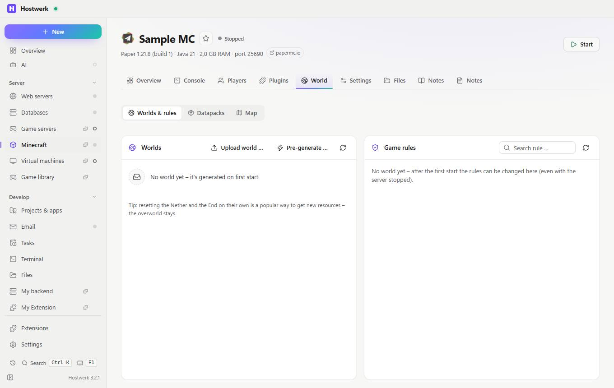
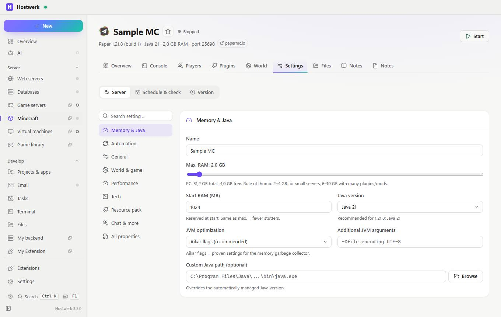
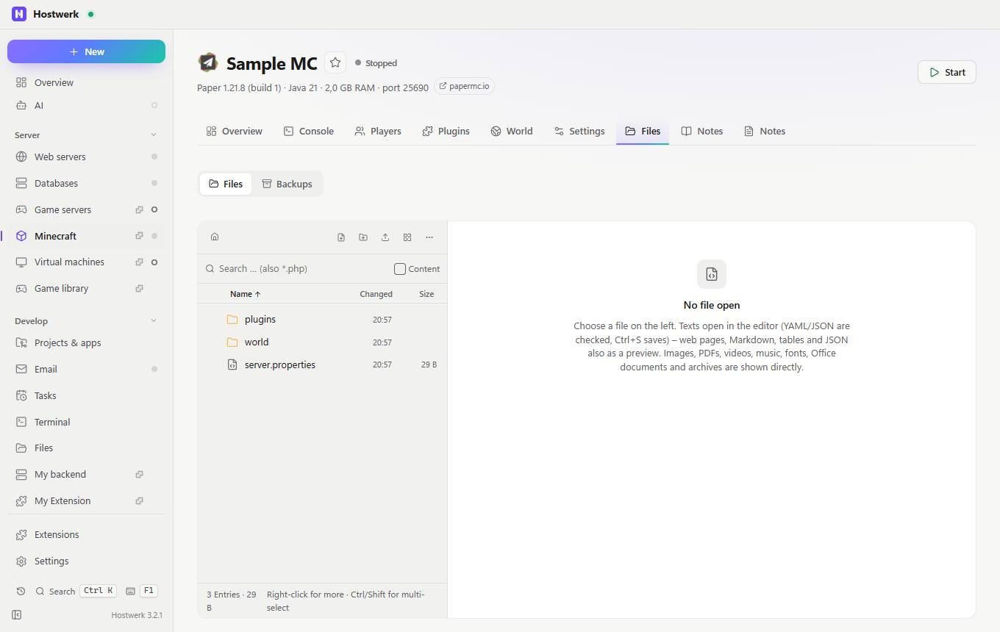
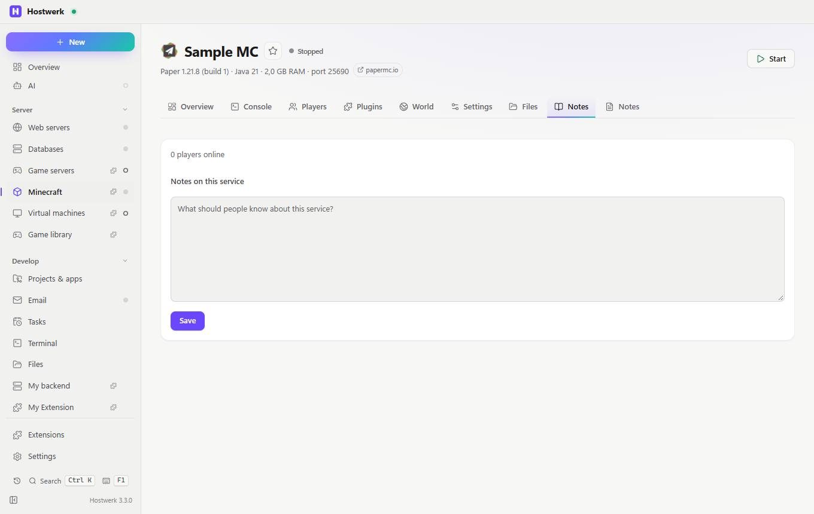

# Sample MC → Overview

[← Back to the overview](README.md)

Paper 1.21.8 (build 1) · Java 21 · 2,0 GB RAM · port 25690 papermc.io

### Areas on this page

- Health
- Online (0)
- Server icon

### What you can do here

- Change image
- Mark as favorite (then listed at the top)
- papermc.io
- Start
- measure
- Details
- Copy
- Allow Bedrock
- Player management
- Choose icon …
- From the extension “Minecraft servers” – info
- From the extension “MOTD studio” – info

## Tabs

### Console

**What you can do here:** Change image · Mark as favorite (then listed at the top) · papermc.io · Start · Everything · Show time · Larger font · Wrap long lines · Copy · Save as text file · Empty · Pause · Live

### Players

> Adding/removing players goes through the console and is therefore only possible while the server is running.

**Areas on this page:** Online · Operators · Whitelist · Banned · Leaderboard · Online now

**What you can do here:** Change image · Mark as favorite (then listed at the top) · papermc.io · Start · Leaderboard · From the extension “Player leaderboard” – info · Online now · From the extension “Players” – info

### Plugins

**Areas on this page:** Installed · Plugin live update · More sources

**What you can do here:** Change image · Mark as favorite (then listed at the top) · papermc.io · Start · Add plugin … · Turn on live update · Find projects · Link

### World

**Areas on this page:** Worlds · Game rules

**What you can do here:** Change image · Mark as favorite (then listed at the top) · papermc.io · Start · Upload world … · Pre-generate … · Reload

### Settings

**Areas on this page:** Memory & Java

**What you can do here:** Change image · Mark as favorite (then listed at the top) · papermc.io · Start · Memory & Java · Automation · General · World & game · Performance · Tech · Resource pack · Chat & more · All properties · Browse

### Files

**What you can do here:** Change image · Mark as favorite (then listed at the top) · papermc.io · Start · Back · Forward · Move up · Update · Top of this area · New · Upload · Cut · Copy · Paste · Rename · Move to … · Delete · Name · Tiles · More · Date modified · Type · Size

### Notes

**What you can do here:** Change image · Mark as favorite (then listed at the top) · papermc.io · Start

Generated on 2026-11-20 · Hostwerk 3.3.0
