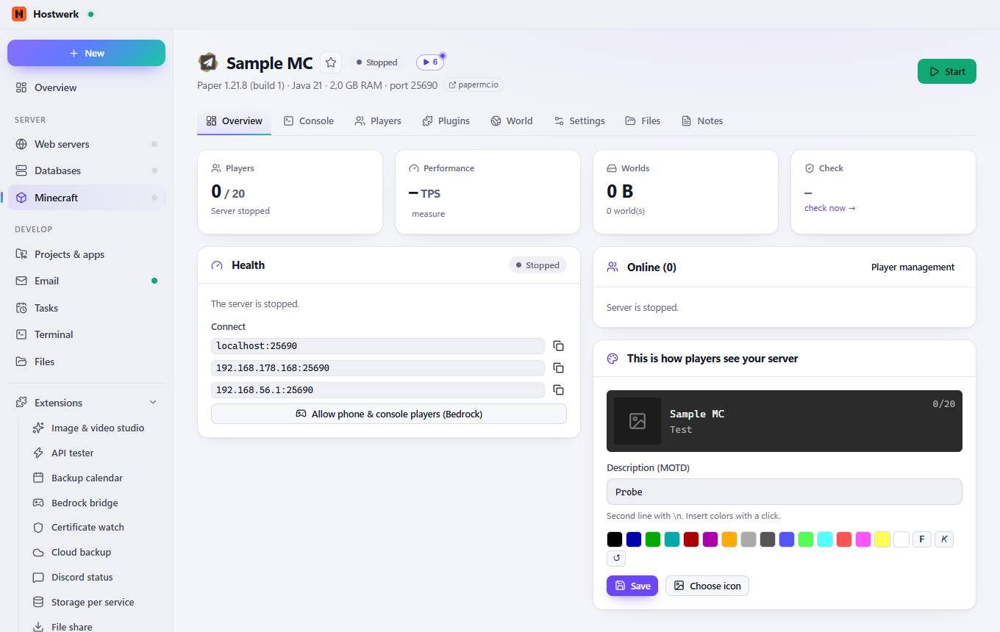
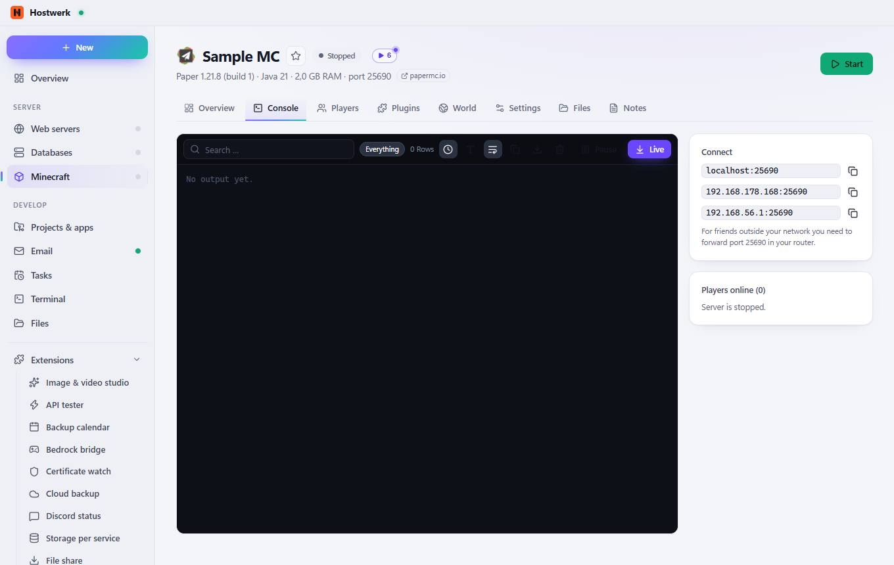
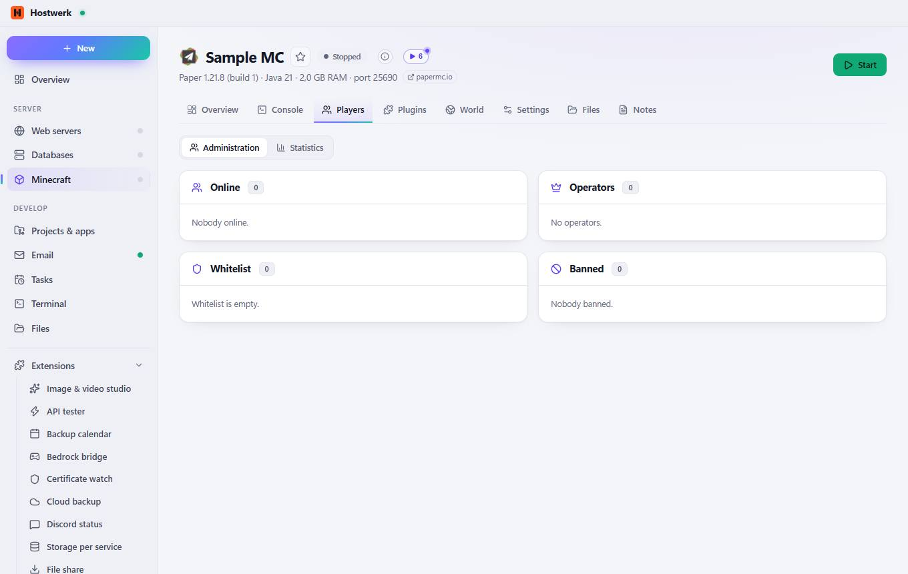
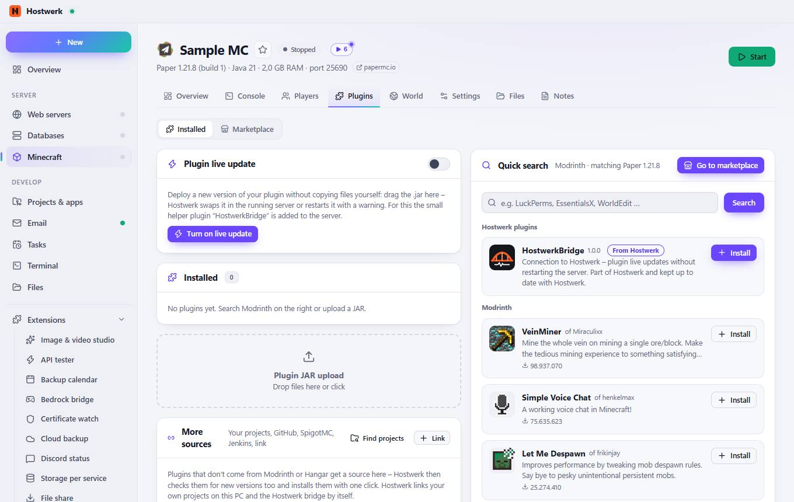
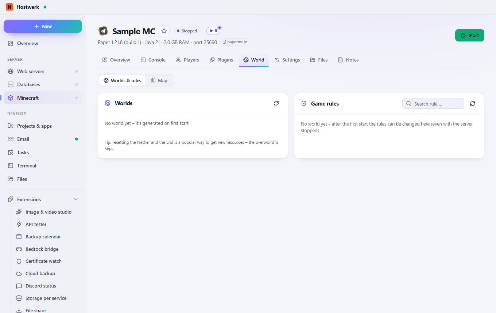
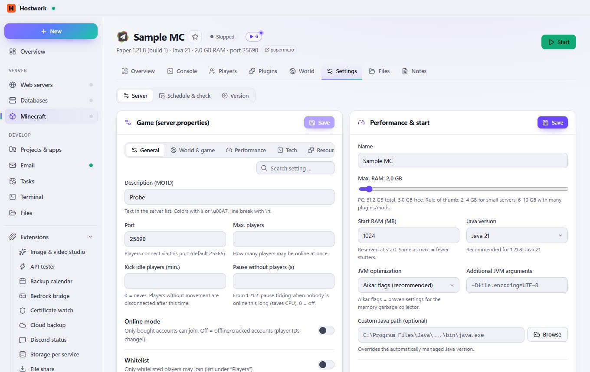
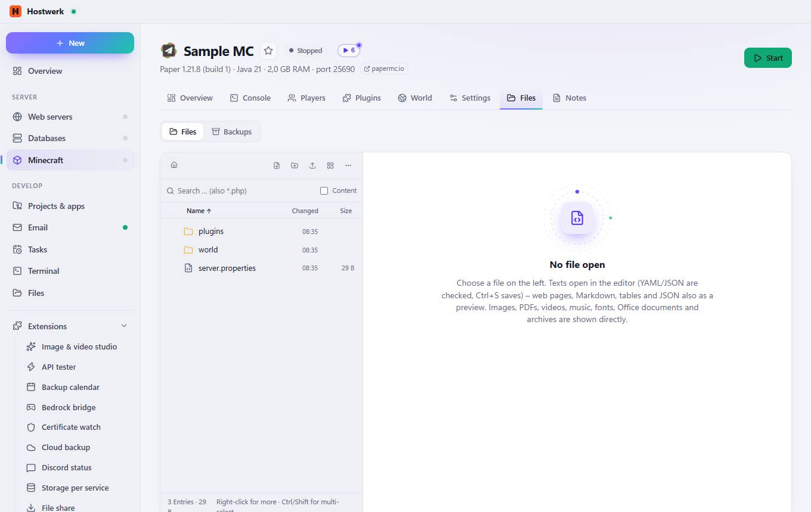
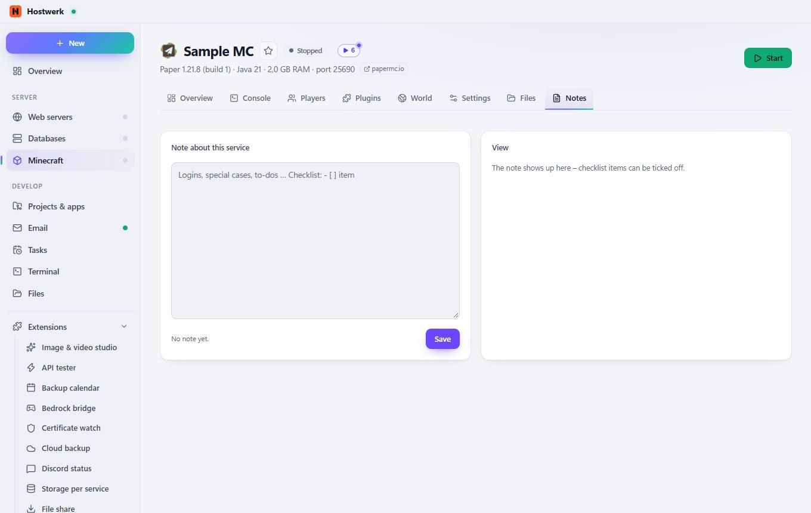

# Sample MC → Overview

[← Back to the overview](README.md)

Paper 1.21.8 (build 1) · Java 21 · 2,0 GB RAM · port 25690 papermc.io

### Areas on this page

- Health
- Online (0)
- This is how players see your server

### What you can do here

- Change image
- Mark as favorite (then listed at the top)
- papermc.io
- Start
- measure
- Copy
- Allow phone & console players (Bedrock)
- Player management
- §0
- §1
- §2
- §3
- §4
- §5
- §6
- §7
- §8
- §9
- §a
- §b
- §c
- §d
- §e
- §f
- Save
- Choose icon

### Inputs

- Description (MOTD)

## Tabs

### Console

**What you can do here:** Change image · Mark as favorite (then listed at the top) · papermc.io · Start · Everything · Show time · Larger font · Wrap long lines · Copy · Save as text file · Empty · Pause · Live

### Players

> Adding/removing players goes through the console and is therefore only possible while the server is running.

**Areas on this page:** Online · Operators · Whitelist · Banned

**What you can do here:** Change image · Mark as favorite (then listed at the top) · papermc.io · Start

### Plugins

**Areas on this page:** Plugin live update · Installed · More sources · Quick search

**What you can do here:** Change image · Mark as favorite (then listed at the top) · papermc.io · Start · Turn on live update · Find projects · Link · Go to marketplace · Search · Install

### World

**Areas on this page:** Worlds · Game rules

**What you can do here:** Change image · Mark as favorite (then listed at the top) · papermc.io · Start · Reload

### Settings

**Areas on this page:** Game (server.properties) · Performance & start · All properties

**What you can do here:** Change image · Mark as favorite (then listed at the top) · papermc.io · Start · Save · Browse · server.properties in the editor

### Files

**What you can do here:** Change image · Mark as favorite (then listed at the top) · papermc.io · Start · Root · New file · New folder · Tiles · More · Name · Changed · Size

### Notes

**What you can do here:** Change image · Mark as favorite (then listed at the top) · papermc.io · Start

Generated on 2026-10-20 · Hostwerk 2.10.0
