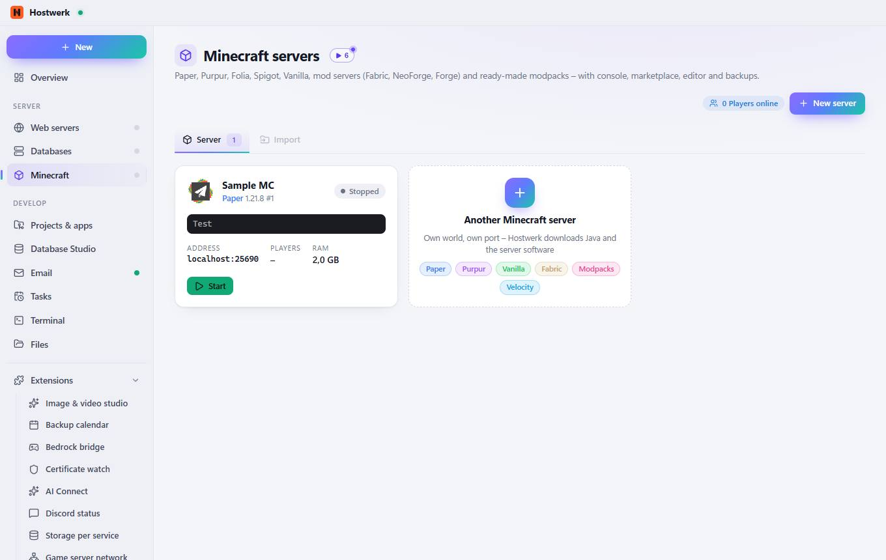

# Minecraft servers

[← Back to the overview](README.md)

Paper, Purpur, Folia, Spigot, Vanilla, mod servers (Fabric, NeoForge, Forge) and ready-made modpacks – with console, marketplace, editor and backups.

### What you can do here

- New server
- Change image
- Start
- Another Minecraft server Own world, own port – Hostwerk downloads Java and the server software Paper Purpur Vanilla Fabric Modpacks Velocity

## Tabs

### Import

**What you can do here:** New server · Change image · Start · Another Minecraft server Own world, own port – Hostwerk downloads Java and the server software Paper Purpur Vanilla Fabric Modpacks Velocity

Generated on 2026-10-19 · Hostwerk 2.9.0
