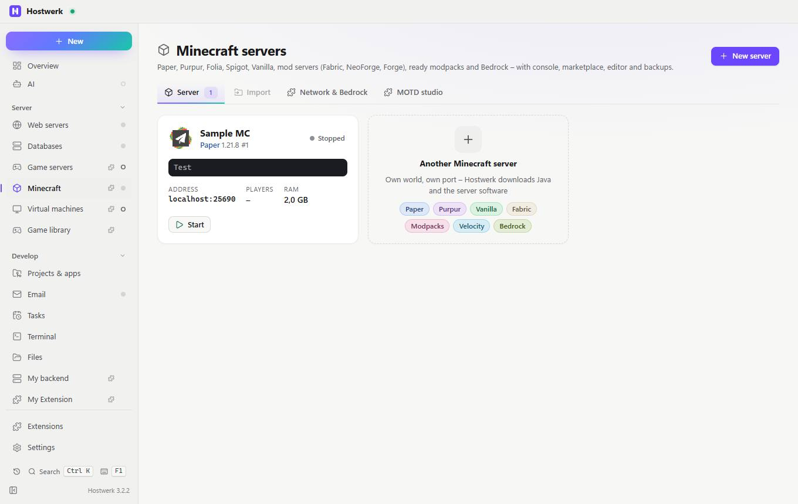
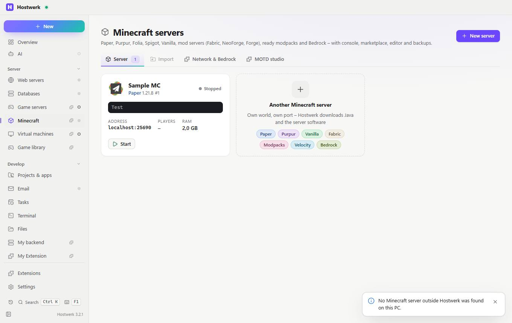
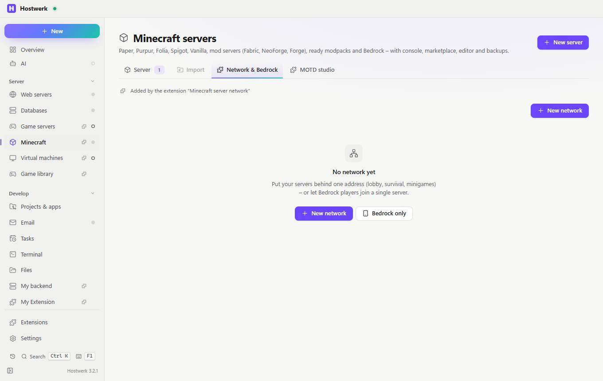
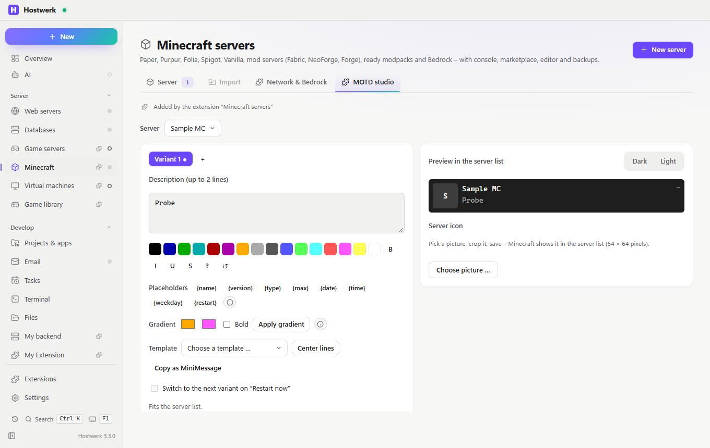

# Minecraft servers

[← Back to the overview](README.md)

Paper, Purpur, Folia, Spigot, Vanilla, mod servers (Fabric, NeoForge, Forge), ready modpacks and Bedrock – with console, marketplace, editor and backups.

### What you can do here

- New server
- Change image
- Start
- Another Minecraft server Own world, own port – Hostwerk downloads Java and the server software Paper Purpur Vanilla Fabric Modpacks Velocity Bedrock

## Tabs

### Import

**What you can do here:** New server · Change image · Start · Another Minecraft server Own world, own port – Hostwerk downloads Java and the server software Paper Purpur Vanilla Fabric Modpacks Velocity Bedrock

### Network & Bedrock

> How it fits together A proxy (Velocity) is the one address players connect to; it sends them to your servers and lets them switch with /server. Geyser on the proxy translates for Bedrock players (phone, console, Windows), Floodgate lets them in without a Java account. ViaVersion lets other Minecraft versions in. A Bedrock Dedicated Server is something else: Mojang’s own server with a separate Bedrock-only world.

**What you can do here:** New server · From the extension “Minecraft server network” – info · New network · Bedrock only

### MOTD studio

**What you can do here:** New server · From the extension “Minecraft servers” – info

Generated on 2026-11-18 · Hostwerk 3.2.1
