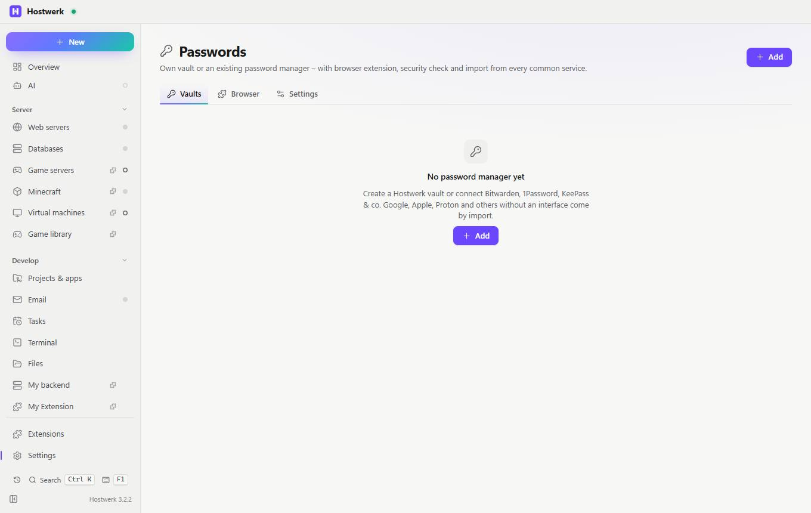
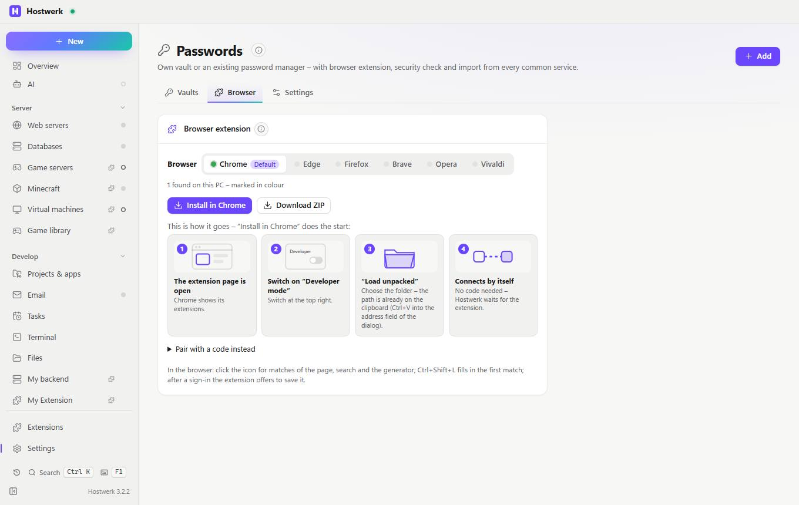
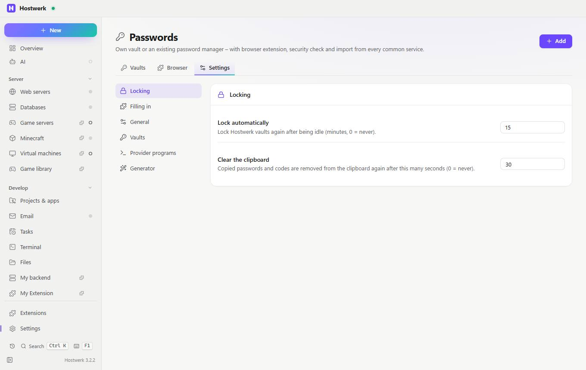

# Passwords

[← Back to the overview](README.md)

Own vault or an existing password manager – with browser extension, security check and import from every common service.

### What you can do here

- Add

## Tabs

### Browser

> How does Hostwerk install it? If the extension is in the browser’s store, Hostwerk tells the browser about it the official way and opens the store page – one click on “Add”. Otherwise the browser loads it as an “unpacked extension” (developer mode). Either way it pairs itself, without a code.
> The extension only talks to your Hostwerk (127.0.0.1). It finds Hostwerk again by itself after a restart or a port change and pairs again with the file in its folder – no code needed.

**Areas on this page:** Browser extension

**What you can do here:** Add · Install in Chrome · Download ZIP

### Settings

**Areas on this page:** Locking

**What you can do here:** Add · Locking · Filling in · General · Vaults · Provider programs · Generator

Generated on 2026-11-20 · Hostwerk 3.2.2
