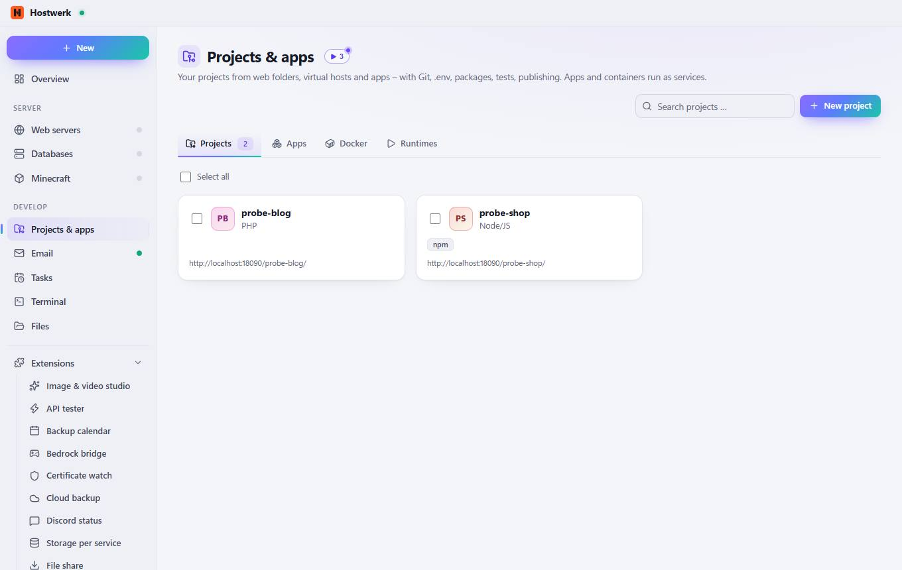
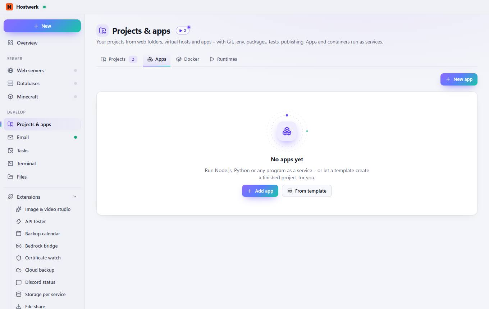
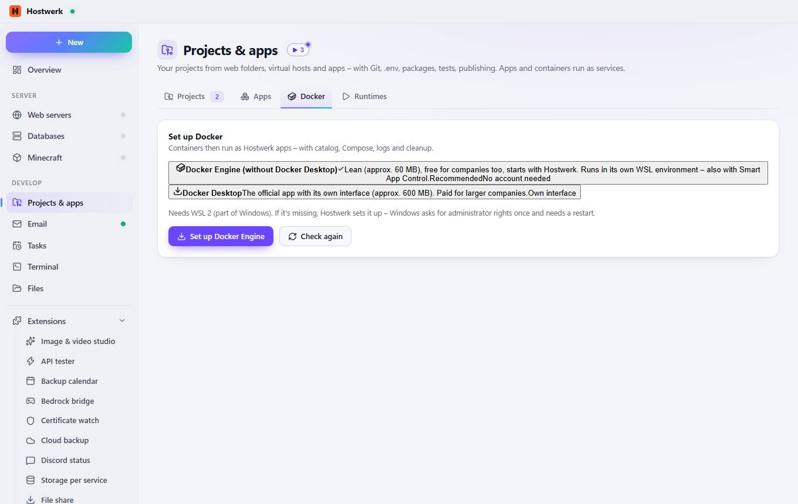
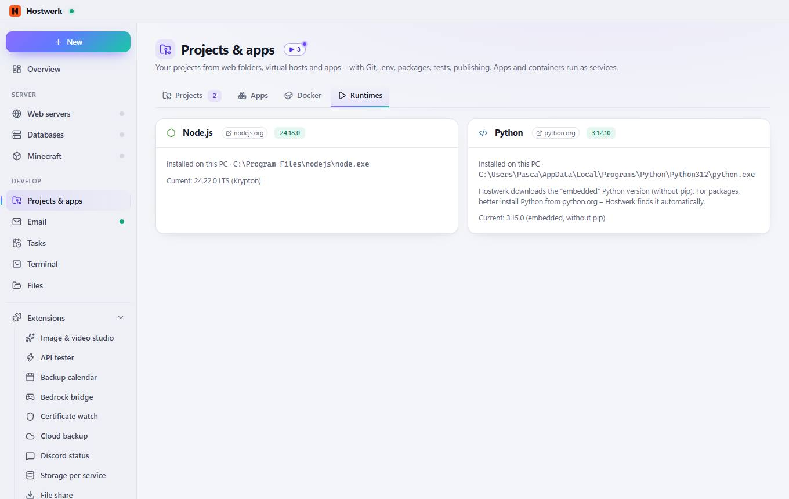

# Projects & apps

[← Back to the overview](README.md)

Your projects from web folders, virtual hosts and apps – with Git, .env, packages, tests, publishing. Apps and containers run as services.

### What you can do here

- New project
- Change image

## Tabs

### Apps

**What you can do here:** New app · Add app · From template

### Docker

**What you can do here:** Docker DesktopThe official app with its own interface (approx. 600 MB). Paid for larger companies.Own interface · Set up Docker Engine · Check again

### Runtimes

**Areas on this page:** Node.js · Python

**What you can do here:** nodejs.org · python.org

Generated on 2026-10-20 · Hostwerk 2.10.0
