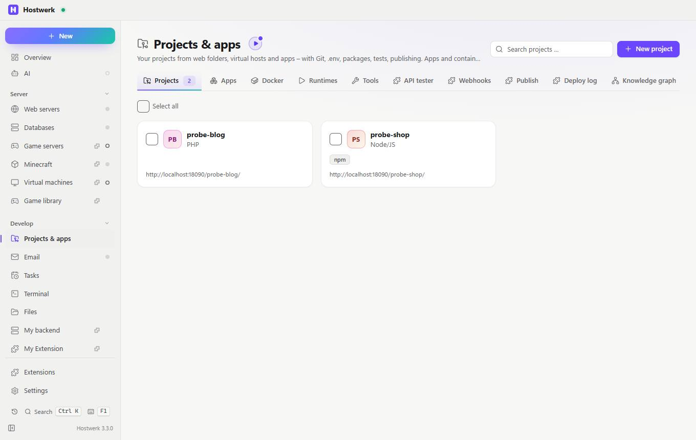
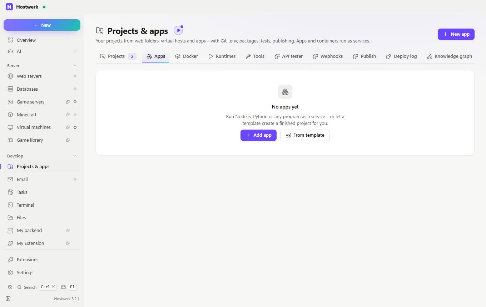
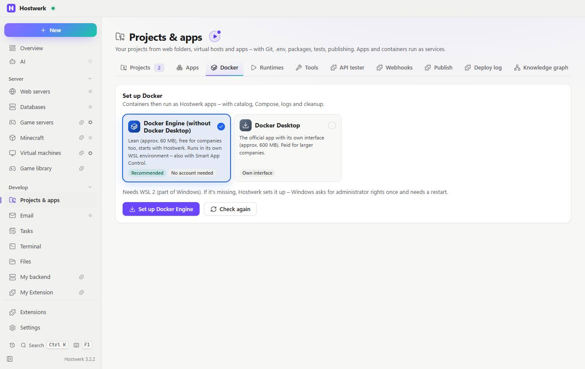
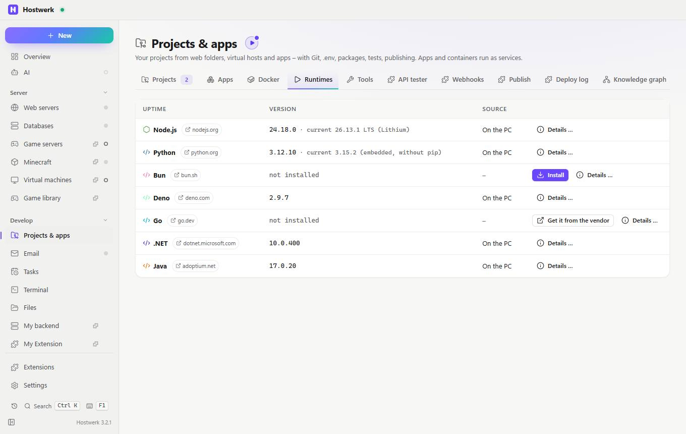
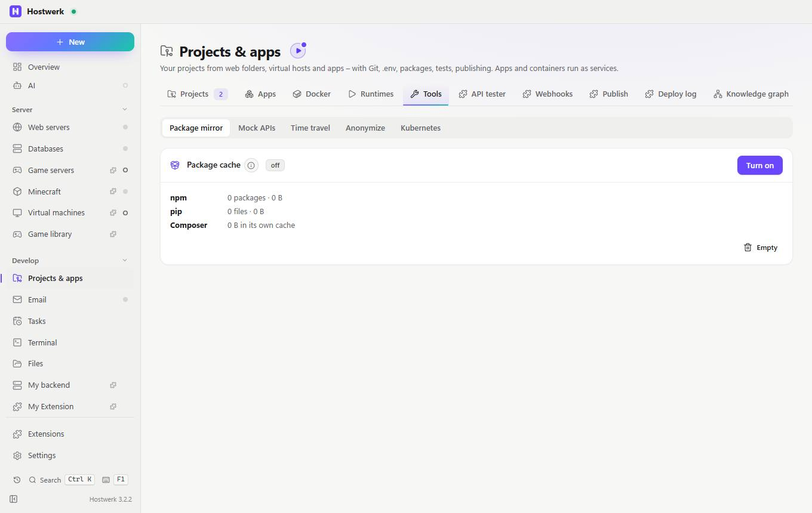
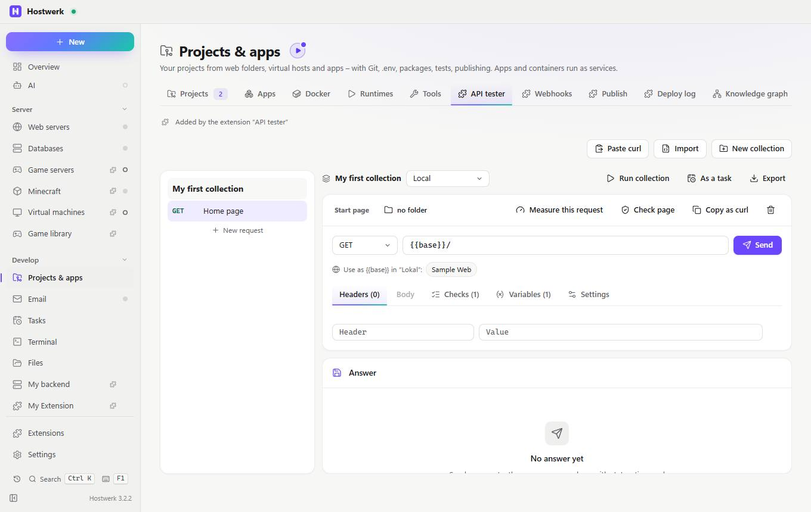
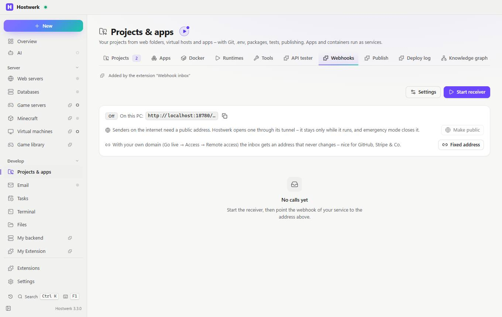
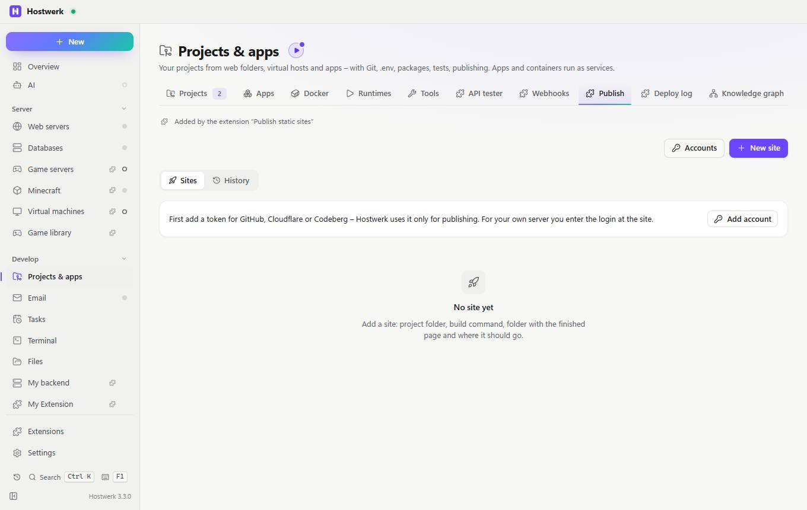
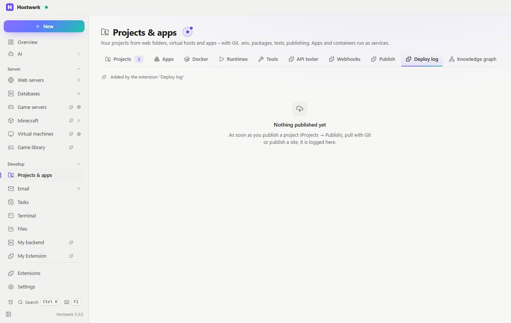
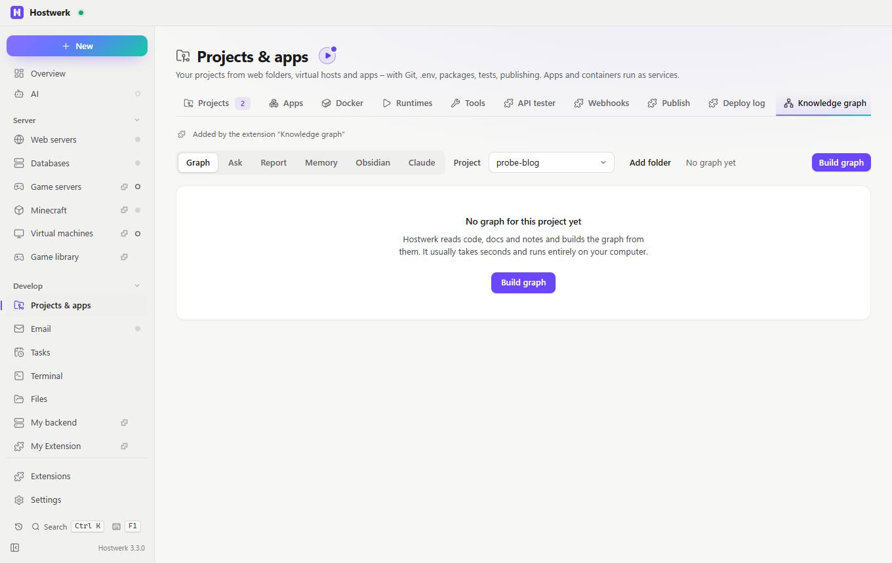

# Projects & apps

[← Back to the overview](README.md)

Your projects from web folders, virtual hosts and apps – with Git, .env, packages, tests, publishing. Apps and containers run as services.

### What you can do here

- 3 videos
- New project
- Change image

## Tabs

### Apps

**What you can do here:** 3 videos · New app · Add app · From template

### Docker

**What you can do here:** 3 videos · Docker Desktop The official app with its own interface (approx. 600 MB). Paid for larger companies. Own interface · Set up Docker Engine · Check again

### Runtimes

**What you can do here:** 3 videos · nodejs.org · Details … · python.org · bun.sh · Install · deno.com · go.dev · Get it from the vendor · dotnet.microsoft.com · adoptium.net

### Tools

> Package cache A local mirror for npm, yarn, pnpm, pip and Composer: every package comes from the internet once and then stays on this PC. Installs in all projects get faster, and everything downloaded before works offline. Composer talks https to it with a certificate of the local certificate authority – other sources are still checked as usual. Turning it off restores the previous settings.

**Areas on this page:** Package cache

**What you can do here:** 3 videos · Turn on · Empty

### API tester

> Environments Switch between local, staging and live in one go: the values of the chosen environment replace the variables of the collection – {{base}} points to the right server.

**Areas on this page:** Answer

**What you can do here:** 3 videos · From the extension “API tester” – info · Paste curl · Import · New collection · My first collection · GET Home page · New request · Run collection · As a task · Export · Start page · no folder · Measure this request · Check page · Copy as curl · Remove request · Send · Sample Web

### Webhooks

**What you can do here:** 3 videos · From the extension “Webhook inbox” – info · Settings · Start receiver · Copy · Make public · Fixed address

### Publish

**What you can do here:** 3 videos · From the extension “Publish static sites” – info · Accounts · New site · Add account

### Deploy log

**What you can do here:** 3 videos · From the extension “Deploy log” – info

### Knowledge graph

**What you can do here:** 3 videos · From the extension “Knowledge graph” – info

Generated on 2026-11-20 · Hostwerk 3.3.0
