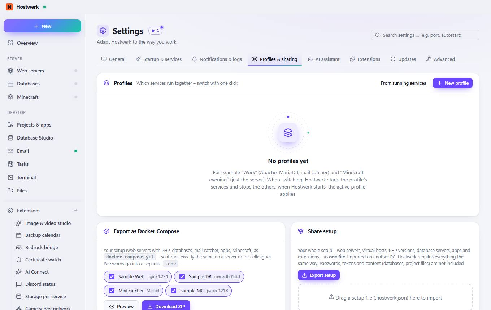
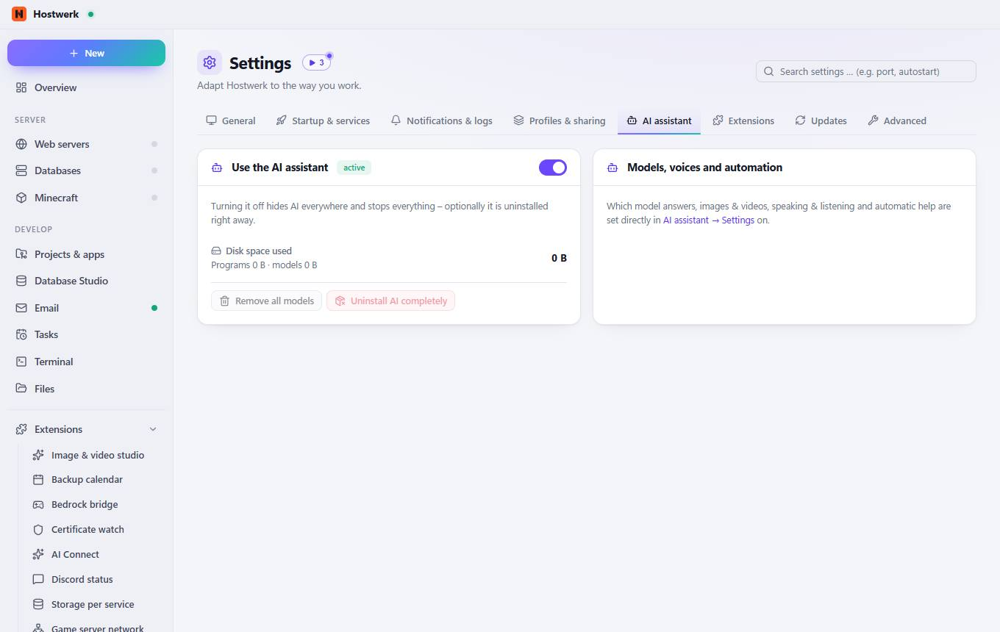
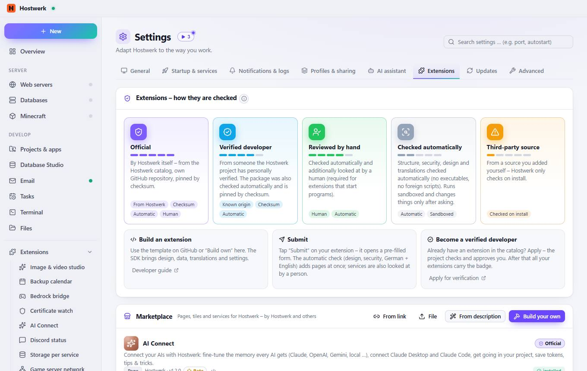

# Settings

[← Back to the overview](README.md)

Adapt Hostwerk to the way you work.

### Areas on this page

- Appearance
- Sections in the sidebar

### What you can do here

- Search again (e.g. after an installation)
- Add your own program as editor
- Hostwerk purple
- Blue
- Sky blue
- Turquoise
- Green
- Amber
- Orange
- Red
- Pink
- Show again

### Inputs

- Language · Language
- Code editor
- Accent color
- Appearance
- Start page
- Compact view
- Reduce animations
- Hidden tips
- Ask before stopping
- Show download speed
- Projects
- Apps
- Database Studio
- Email
- Tasks
- Files
- Minecraft
- AI assistant
- Claude mind map
- Production

## Tabs

### Startup & services

**Areas on this page:** When Hostwerk starts · Which services start automatically?

**What you can do here:** All · None

### Notifications & logs

**Areas on this page:** Windows notifications · Logs

### Profiles & sharing

**Areas on this page:** Profiles · Export as Docker Compose · Share setup

**What you can do here:** From running services · New profile · Preview · Download ZIP · Export setup

### AI assistant

**Areas on this page:** Use the AI assistant · Models, voices and automation

**What you can do here:** Remove all models · Uninstall AI completely

### Extensions

> What is an extension? An extension adds its own page, a tile for the overview and/or its own service to Hostwerk. Pages run isolated (own origin, no access to your login), only see what their permissions allow and only change things after you confirm each time. Colors and fonts come from Hostwerk – so every extension fits the design.

**Areas on this page:** Extensions – how they are checked · Marketplace · Installed packages · For developers

**What you can do here:** Developer guide · Apply for verification · From link · From description · Build your own · Rate · Source code · Add more catalogs (sources) · Open · Check (design, security, translations) · Access – what the extension read or changed · Keep building – the AI changes the extension the way you want · Export (ZIP) · Share (link) · Submit to the public catalog · Remove · Settings · Guide Step by step: package, SDK, design, permissions, translations, check, verification. · Template on GitHub “Use this template” – with a check action and automatic releases. · Create here Folder with a sample page, texts (de/en) and icon – visible right away.

### Updates

> Automatic updates are only available in the installed desktop app.

**Areas on this page:** App updates · Security updates

**What you can do here:** Check

### Advanced

> Only reloads the interface – services keep running undisturbed. Helps when a view hangs or looks outdated after an update.
> Hostwerk reloads everything here when needed. Projects, databases, backups and settings stay untouched.
> Every 6 hours, shortly after start and after deleting, creating or updating services: long-unused images, old video versions, old downloads and leftovers are removed – nothing that is currently needed.

**Areas on this page:** Hostwerk · Java runtimes · Cache & temporary files · Remove Hostwerk · Location & access

**What you can do here:** Reload · Delete 938,7 KB · Measure again · Clean up now · Remove Hostwerk … · Open in default browser

Generated on 2026-10-19 · Hostwerk 2.9.0
