# Settings

[← Back to the overview](README.md)

Adapt Hostwerk to the way you work.

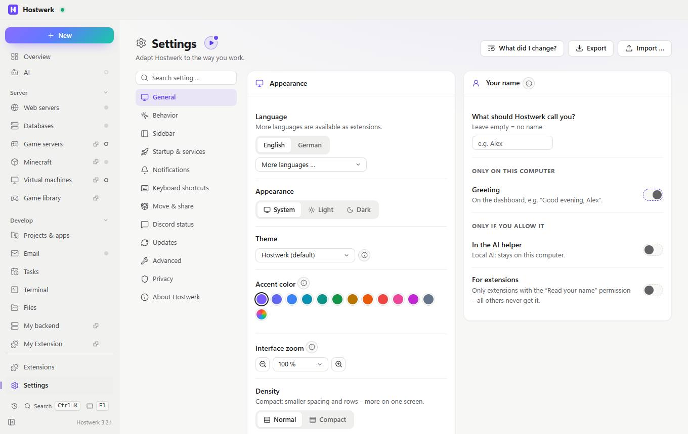

### Good to know

- Themes from extensions A theme changes colours, font, rounding and spacing – only through checked values. Hostwerk only applies it if texts and controls stay easy to read (WCAG 2.2 AA). If the extension is removed, Hostwerk’s own look returns.
- Accent color Color for buttons, marks and highlights – you see it everywhere right away. Extensions adopt it. With custom colors Hostwerk adjusts buttons and text so everything stays readable.
- Interface zoom Makes text and controls larger or smaller everywhere – up to 200 % without cutting anything off. Applies wherever you open Hostwerk – in the browser and on your phone too.
- Your name Stays in the settings on this computer – not in setup files, exports or logs; error reports replace it with “<name>”. It is only used where you turn it on below.

### Areas on this page

- Appearance
- Your name

### What you can do here

- 3 videos
- What did I change?
- Export
- Import …
- General
- Behavior
- Sidebar
- Startup & services
- Notifications
- Keyboard shortcuts
- Move & share
- Updates
- Advanced
- Privacy
- About Hostwerk
- Hostwerk purple
- Indigo
- Blue
- Cyan
- Turquoise
- Green
- Amber
- Orange
- Red
- Pink
- Fuchsia
- Slate gray
- Smaller
- Larger

### Inputs

- Language
- Appearance
- Theme
- Accent color
- Interface zoom
- Density
- Reduce animations
- What should Hostwerk call you?
- Greeting
- In the AI helper
- For extensions

## Tabs

### Behavior

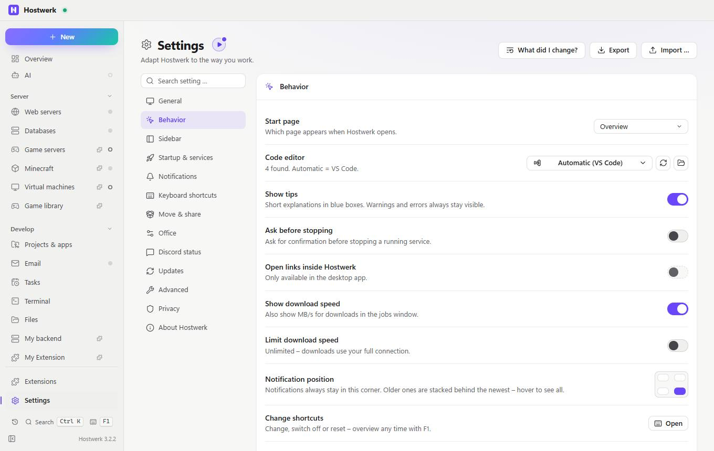

**Areas on this page:** Behavior

**What you can do here:** 3 videos · What did I change? · Export · Import … · General · Behavior · Sidebar · Startup & services · Notifications · Keyboard shortcuts · Move & share · Office · Discord status · Updates · Advanced · Privacy · About Hostwerk · Automatic (VS Code) · Search again (e.g. after an installation) · Add your own program as editor · Top left · Top right · Bottom left · Bottom right · Open

### Sidebar

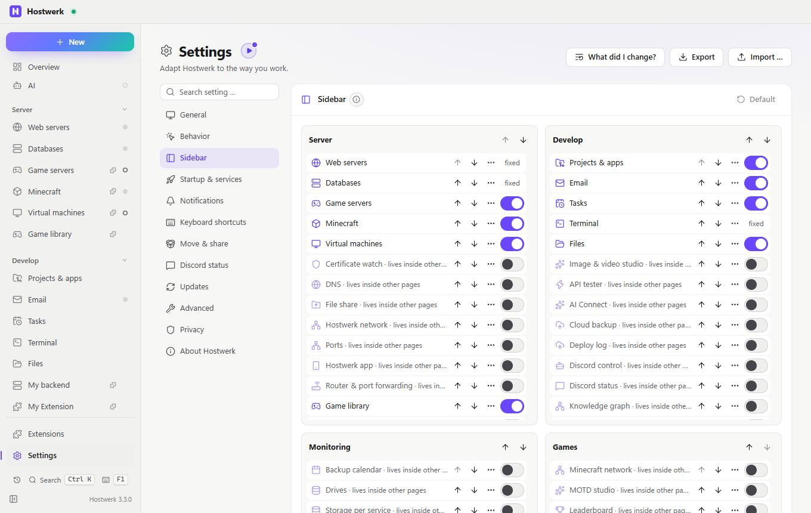

> Sidebar Order and visibility of all entries. Hidden items are not deleted – switch them back on and they return. You can also drag entries directly in the sidebar; extensions can bring their own sections.
> Without own entry These areas live inside other pages (e.g. apps under “Projects & apps”). Hidden, they also disappear from the dashboard, the New menu and the setup.

**Areas on this page:** Sidebar

**What you can do here:** 3 videos · What did I change? · Export · Import … · General · Behavior · Sidebar · Startup & services · Notifications · Keyboard shortcuts · Move & share · Office · Discord status · Updates · Advanced · Privacy · About Hostwerk · Default · Move area “Server” up · Move area “Server” down · Move “Web servers” up · Move “Web servers” down · More for “Web servers” · Move “Databases” up · Move “Databases” down · More for “Databases” · Move “Game servers” up · Move “Game servers” down · More for “Game servers” · Move “Minecraft” up · Move “Minecraft” down · More for “Minecraft” · Move “Virtual machines” up · Move “Virtual machines” down · More for “Virtual machines” · Move “Certificate watch” up · Move “Certificate watch” down · More for “Certificate watch” · Move “DNS” up · Move “DNS” down

### Startup & services

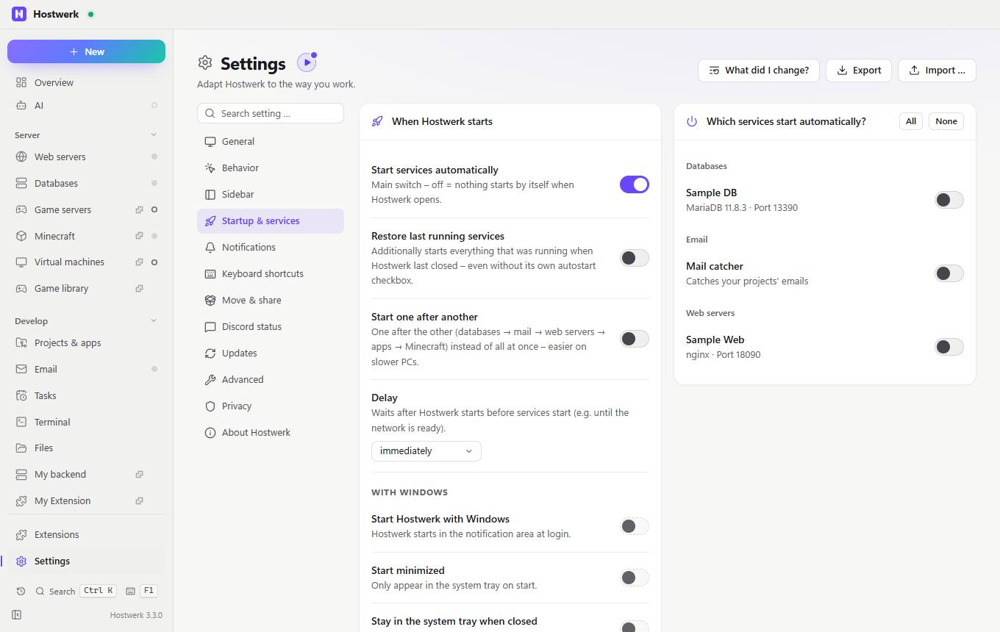

**Areas on this page:** When Hostwerk starts · Which services start automatically?

**What you can do here:** 3 videos · What did I change? · Export · Import … · General · Behavior · Sidebar · Startup & services · Notifications · Keyboard shortcuts · Move & share · Office · Discord status · Updates · Advanced · Privacy · About Hostwerk · All · None

### Notifications

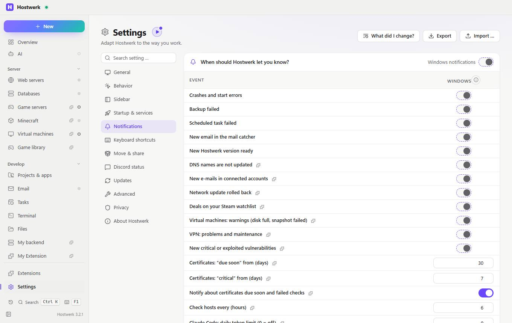

> Windows Only available in the desktop app.

**Areas on this page:** When should Hostwerk let you know? · Messages to your phone, by e-mail or chat

**What you can do here:** 3 videos · What did I change? · Export · Import … · General · Behavior · Sidebar · Startup & services · Notifications · Keyboard shortcuts · Move & share · Office · Discord status · Updates · Advanced · Privacy · About Hostwerk · From the extension “DNS management” – info · From the extension “E-mail accounts” – info · From the extension “Minecraft server network” – info · From the extension “Game library” – info · From the extension “Virtual machines” – info · From the extension “VPN access” – info · From the extension “Vulnerability watch” – info · From the extension “Certificate watch” – info · From the extension “AI Connect” – info · From the extension “Drives” – info · Set up messages → Live operation

### Keyboard shortcuts

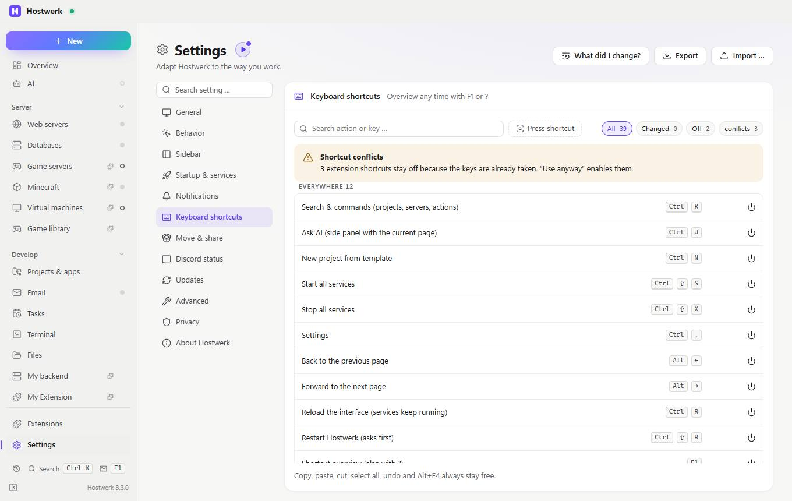

**Areas on this page:** Keyboard shortcuts

**What you can do here:** 3 videos · What did I change? · Export · Import … · General · Behavior · Sidebar · Startup & services · Notifications · Keyboard shortcuts · Move & share · Office · Discord status · Updates · Advanced · Privacy · About Hostwerk · Press shortcut · All 44 · Changed 0 · Off 6 · conflicts 3 · Ctrl K · Switch off shortcut for “Search & commands (projects, servers, actions)” · Ctrl J · Switch off shortcut for “Ask AI (side panel with the current page)” · Ctrl N · Switch off shortcut for “New project from template” · Ctrl ⇧ S · Switch off shortcut for “Start all services” · Ctrl ⇧ X · Switch off shortcut for “Stop all services” · Ctrl , · Switch off shortcut for “Settings” · Alt ← · Switch off shortcut for “Back to the previous page” · Alt → · Switch off shortcut for “Forward to the next page” · Ctrl R · Switch off shortcut for “Reload the interface (services keep running)”

### Move & share

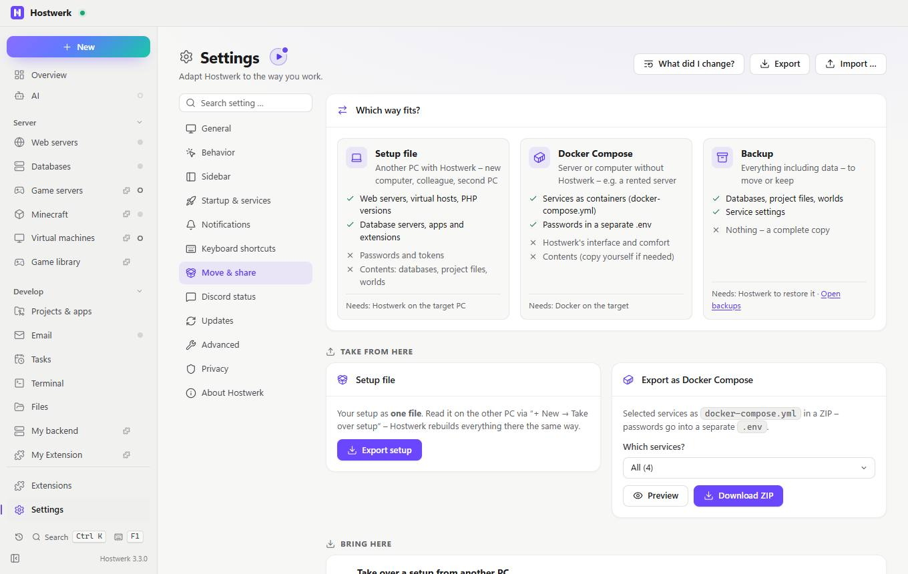

**Areas on this page:** Which way fits? · TAKE FROM HERE · Setup file · Export as Docker Compose · BRING HERE

**What you can do here:** 3 videos · What did I change? · Export · Import … · General · Behavior · Sidebar · Startup & services · Notifications · Keyboard shortcuts · Move & share · Office · Discord status · Updates · Advanced · Privacy · About Hostwerk · Export setup · All (4) · Preview · Download ZIP · Read setup file …

### Updates

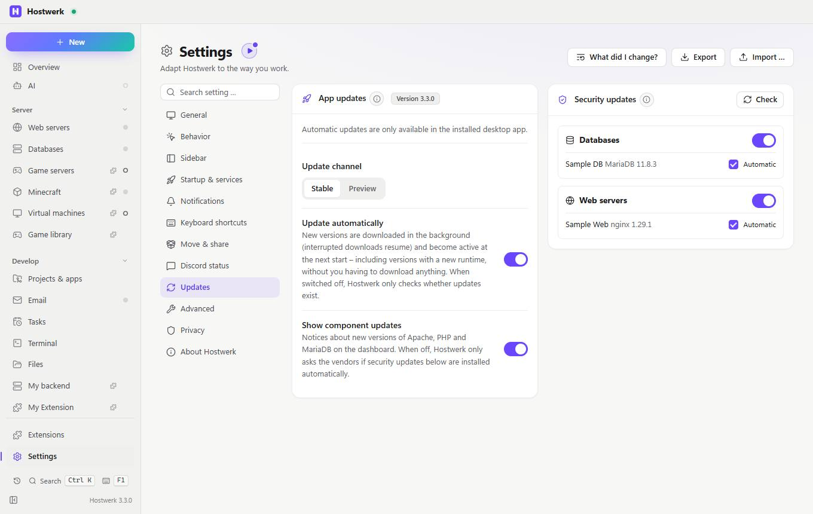

> “Stable” only gets finished versions, and new versions arrive step by step – first for a few, then for everyone. “Preview” also gets test versions right away as soon as they appear. You can switch back to “Stable” at any time; an installed test version stays until a newer stable one arrives.
> Small updates within the same version (e.g. PHP 8.4.11 → 8.4.12). Hostwerk downloads the new version next to the old one, switches over and quickly checks that everything runs. If it doesn’t, the old version stays active. Hostwerk never makes big version jumps on its own.

**Areas on this page:** App updates · Security updates

**What you can do here:** 3 videos · What did I change? · Export · Import … · General · Behavior · Sidebar · Startup & services · Notifications · Keyboard shortcuts · Move & share · Office · Discord status · Updates · Advanced · Privacy · About Hostwerk · Check

### Advanced

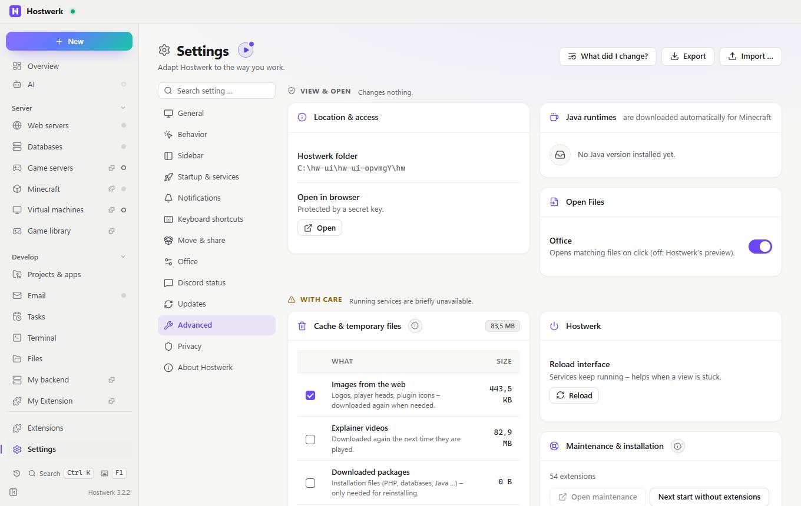

> Cache Hostwerk reloads everything here when needed. Projects, databases, backups and settings stay untouched.
> Maintenance Maintenance runs as its own window and loads no extension – so none can interfere. There you turn extensions off, roll them back or remove them, and update, repair or remove Hostwerk. If Hostwerk no longer starts: Start menu → “Hostwerk – Maintenance” or press F8 while it starts.

**Areas on this page:** Location & access · Java runtimes · Open Files · Cache & temporary files · Hostwerk · Maintenance & installation

**What you can do here:** 3 videos · What did I change? · Export · Import … · General · Behavior · Sidebar · Startup & services · Notifications · Keyboard shortcuts · Move & share · Office · Discord status · Updates · Advanced · Privacy · About Hostwerk · Open · Delete 623,4 KB · Measure again · Clean up now · Reload · Open maintenance · Next start without extensions

### Privacy

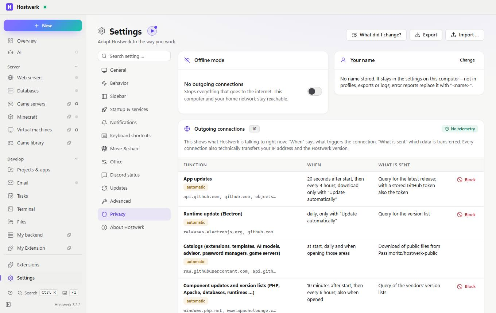

**Areas on this page:** Offline mode · Your name · Outgoing connections

**What you can do here:** 3 videos · What did I change? · Export · Import … · General · Behavior · Sidebar · Startup & services · Notifications · Keyboard shortcuts · Move & share · Office · Discord status · Updates · Advanced · Privacy · About Hostwerk · Change · Block

### About Hostwerk

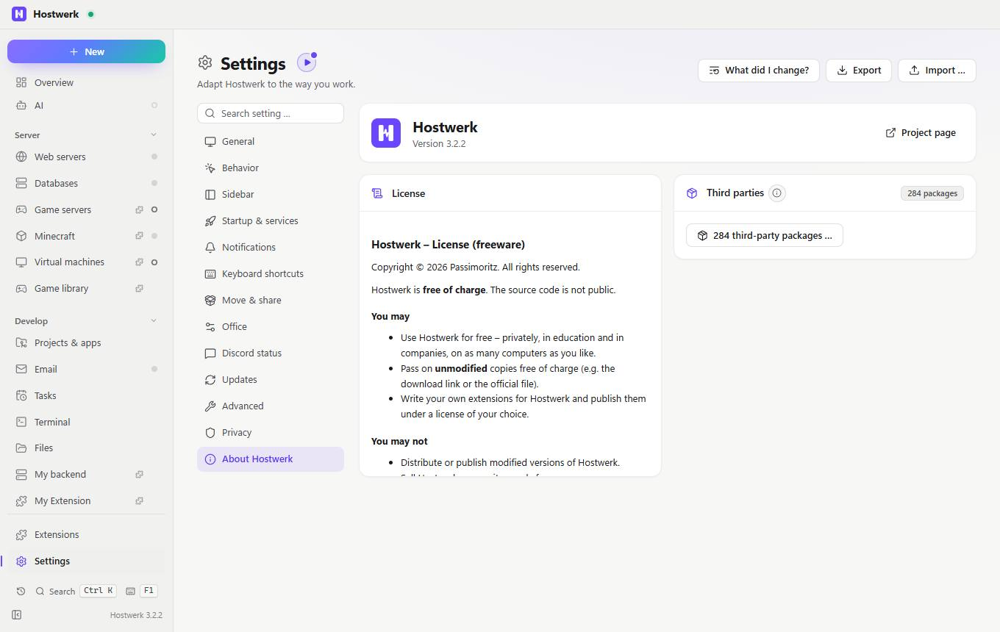

> Libraries from other projects that are part of Hostwerk – each under its own license. The list is generated automatically during the build.

**Areas on this page:** License · Third parties

**What you can do here:** 3 videos · What did I change? · Export · Import … · General · Behavior · Sidebar · Startup & services · Notifications · Keyboard shortcuts · Move & share · Office · Discord status · Updates · Advanced · Privacy · About Hostwerk · Project page · 284 third-party packages …

Generated on 2026-11-20 · Hostwerk 3.2.2
