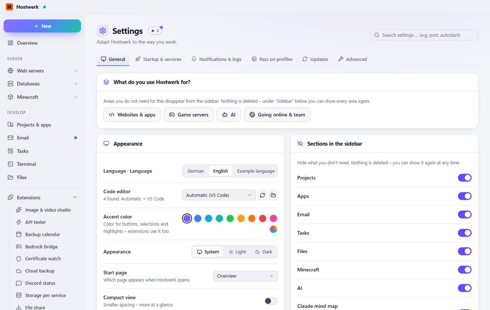
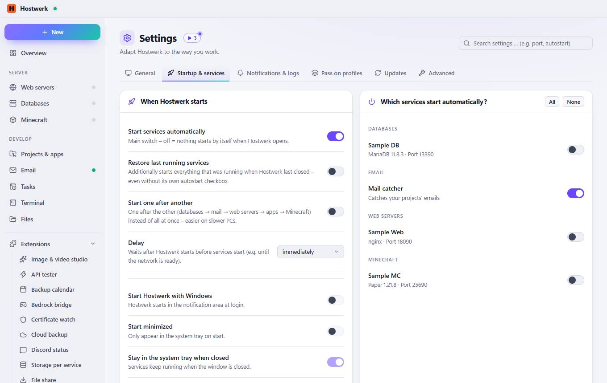
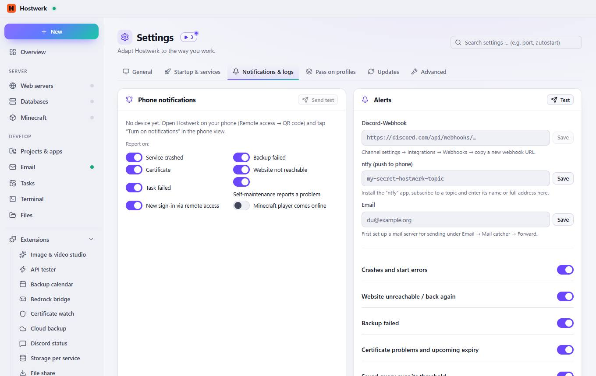
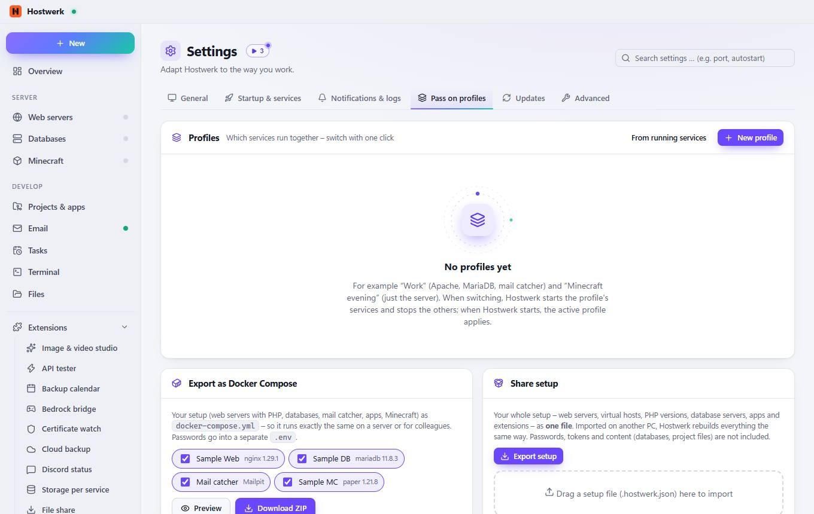
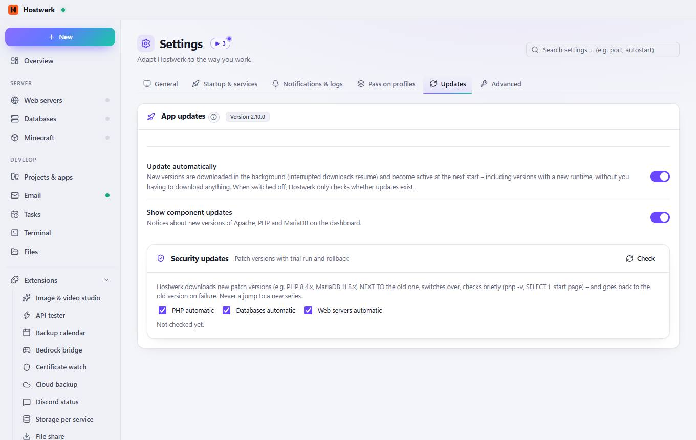
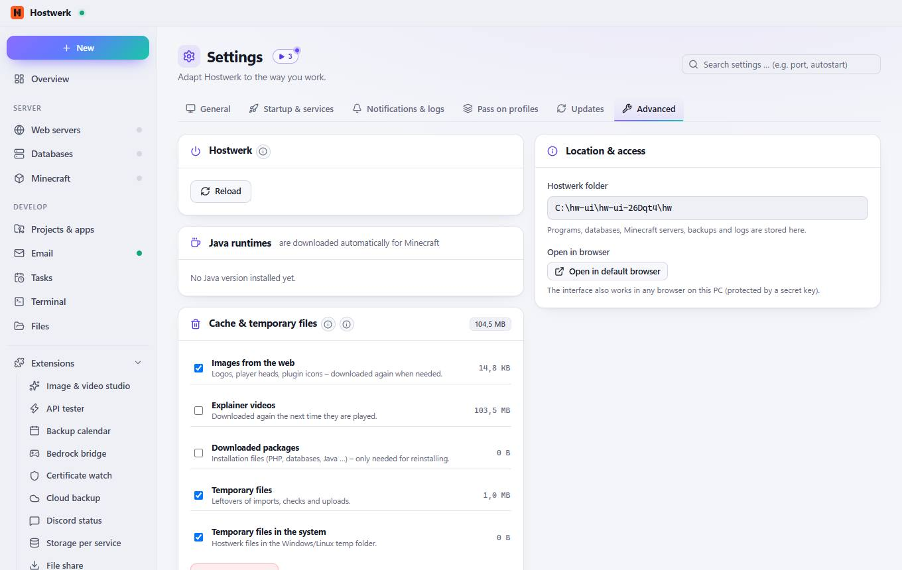

# Settings

[← Back to the overview](README.md)

Adapt Hostwerk to the way you work.

### Areas on this page

- What do you use Hostwerk for?
- Appearance
- Sections in the sidebar

### What you can do here

- Websites & apps
- Game servers
- AI
- Going online & team
- Search again (e.g. after an installation)
- Add your own program as editor
- Hostwerk purple
- Blue
- Sky blue
- Turquoise
- Green
- Amber
- Orange
- Red
- Pink
- Show again

### Inputs

- Language · Language
- Code editor
- Accent color
- Appearance
- Start page
- Compact view
- Reduce animations
- Hidden tips
- Ask before stopping
- Show download speed
- Projects
- Apps
- Email
- Tasks
- Files
- Minecraft
- AI
- Claude mind map
- Production
- Backups

## Tabs

### Startup & services

**Areas on this page:** When Hostwerk starts · Which services start automatically?

**What you can do here:** All · None

### Notifications & logs

**Areas on this page:** Phone notifications · Alerts · Windows notifications · Logs

**What you can do here:** Send test · Test · Save · Check now

### Pass on profiles

**Areas on this page:** Profiles · Export as Docker Compose · Share setup

**What you can do here:** From running services · New profile · Preview · Download ZIP · Export setup

### Updates

> Automatic updates are only available in the installed desktop app.

**Areas on this page:** App updates · Security updates

**What you can do here:** Check

### Advanced

> Only reloads the interface – services keep running undisturbed. Helps when a view hangs or looks outdated after an update.
> Hostwerk reloads everything here when needed. Projects, databases, backups and settings stay untouched.
> Every 6 hours, shortly after start and after deleting, creating or updating services: long-unused images, old video versions, old downloads and leftovers are removed – nothing that is currently needed.

**Areas on this page:** Hostwerk · Java runtimes · Cache & temporary files · Remove Hostwerk · Location & access

**What you can do here:** Reload · Delete 1,0 MB · Measure again · Clean up now · Remove Hostwerk … · Open in default browser

Generated on 2026-10-20 · Hostwerk 2.10.0
