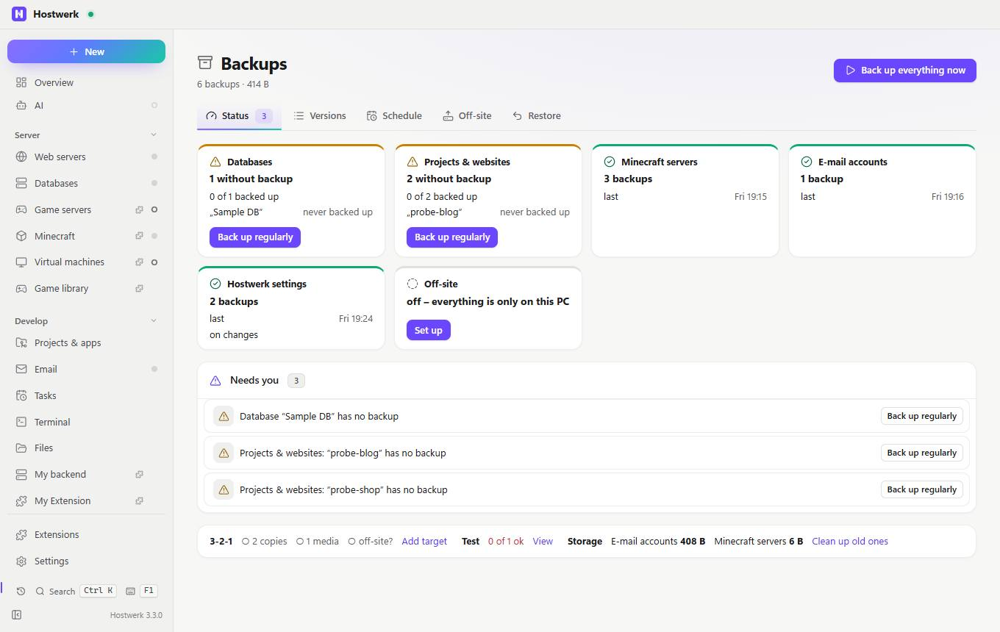
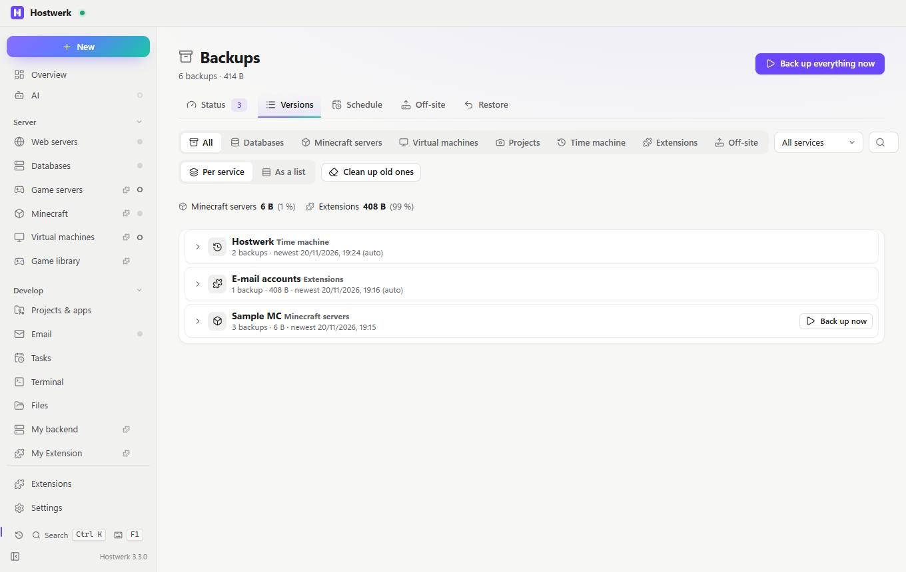
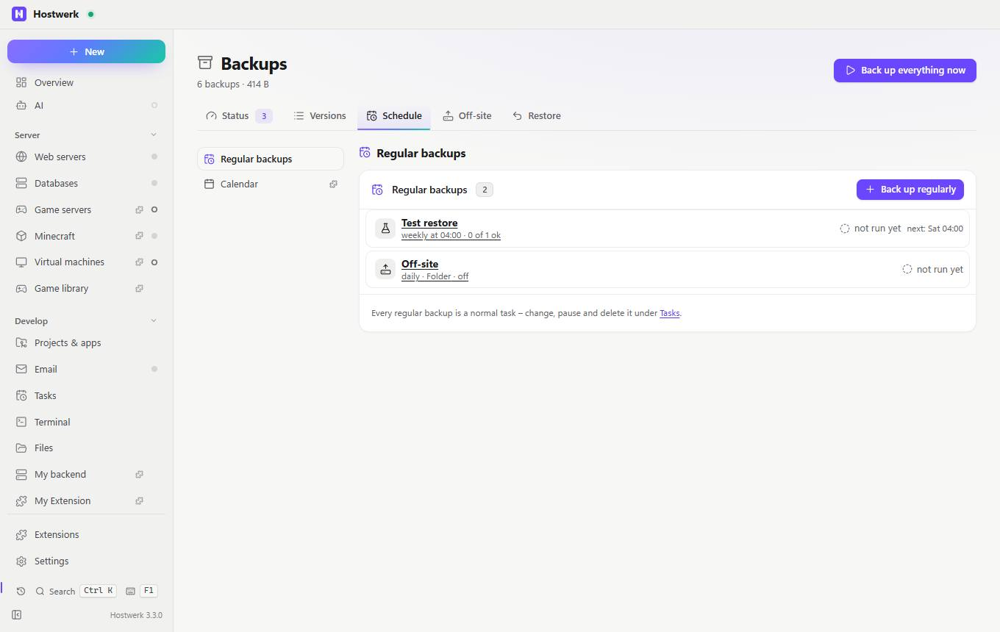
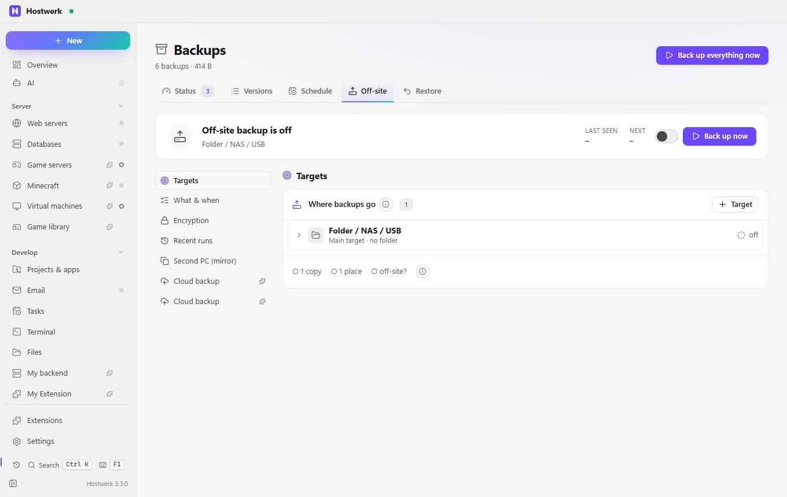
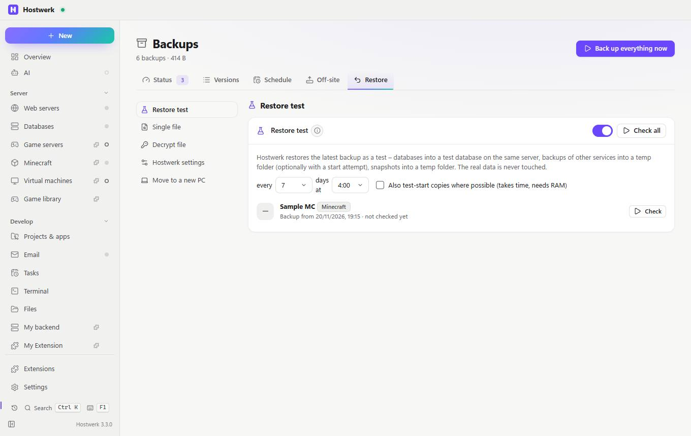

# Backups

[← Back to the overview](README.md)

6 backups · 414 B

### Areas on this page

- Needs you

### What you can do here

- Back up everything now
- Back up regularly
- Set up

## Tabs

### Versions

**Areas on this page:** All versions

**What you can do here:** Back up everything now · Clean up old ones · Hostwerk Time machine 2 backups · newest 20/11/2026, 19:24 (auto) · E-mail accounts Extensions 1 backup · 408 B · newest 20/11/2026, 19:16 (auto) · Sample MC Minecraft servers 3 backups · 6 B · newest 20/11/2026, 19:15 · Back up now

### Schedule

**Areas on this page:** Regular backups

**What you can do here:** Back up everything now · Back up regularly

### Off-site

> 3-2-1 rule Three copies, on two different kinds of storage, one of them off-site. Every target gets the same backup; the main target is just the first one.
> Off-site A folder can be a NAS in the same building. Against theft or fire, a target somewhere else helps – an SFTP server, a NAS at a friend’s place or the cloud.

**Areas on this page:** Targets · Where backups go

**What you can do here:** Back up everything now · Back up now · Target · Folder / NAS / USB Main target · no folder

### Restore

> A backup only counts once it can be restored

**Areas on this page:** Restore test

**What you can do here:** Back up everything now · Check all · Check

Generated on 2026-11-20 · Hostwerk 3.3.0
