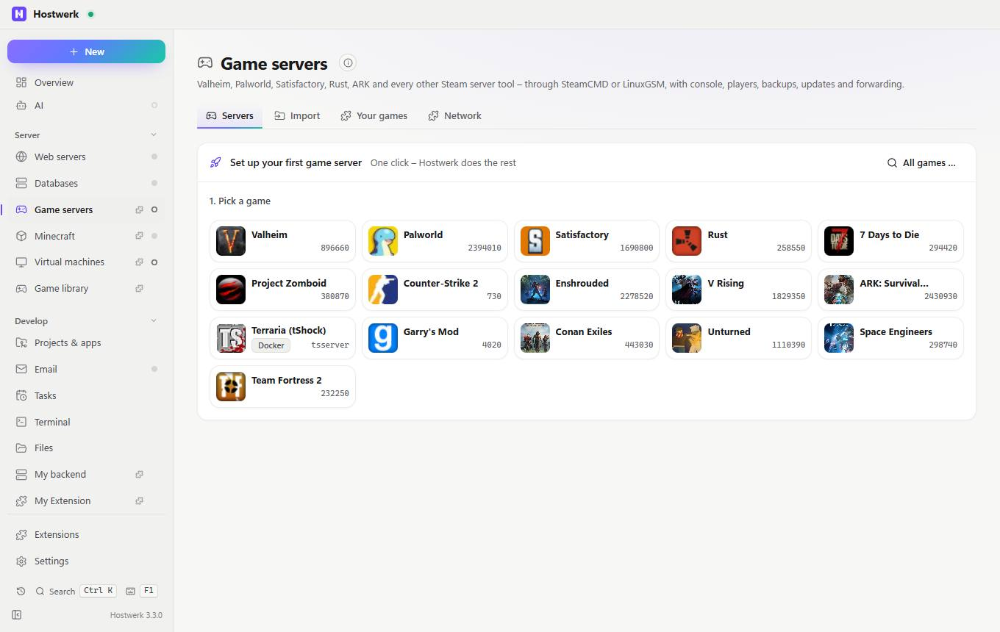
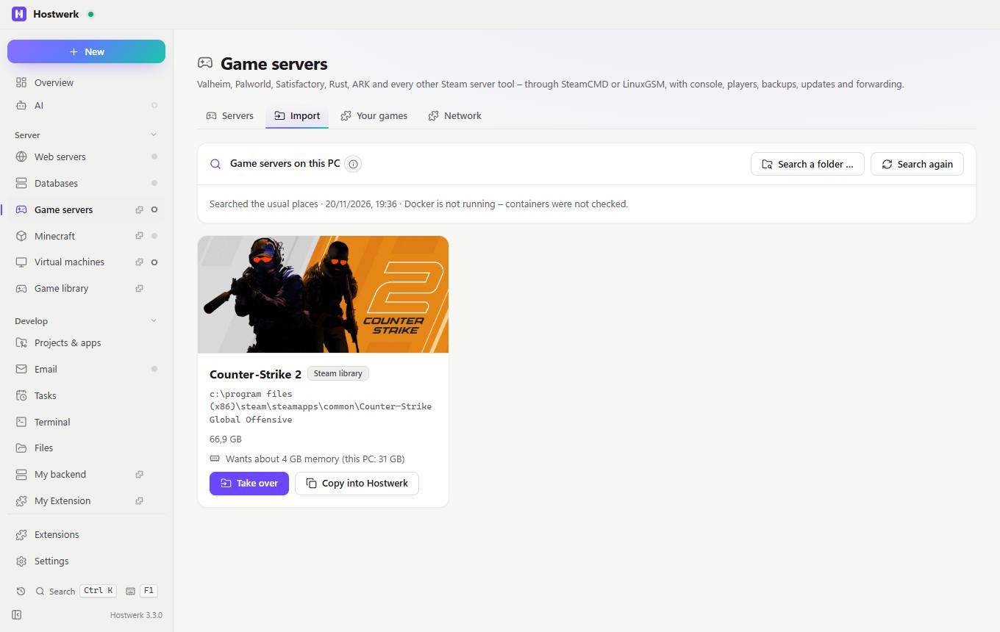
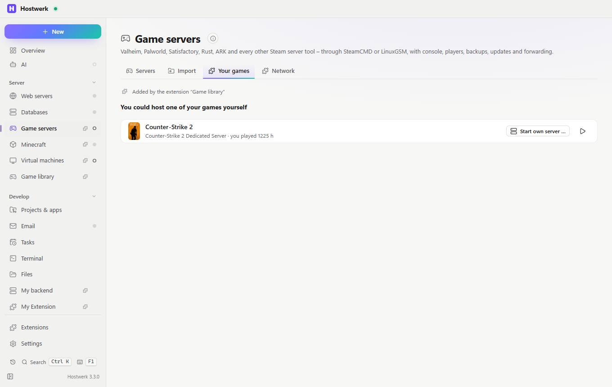
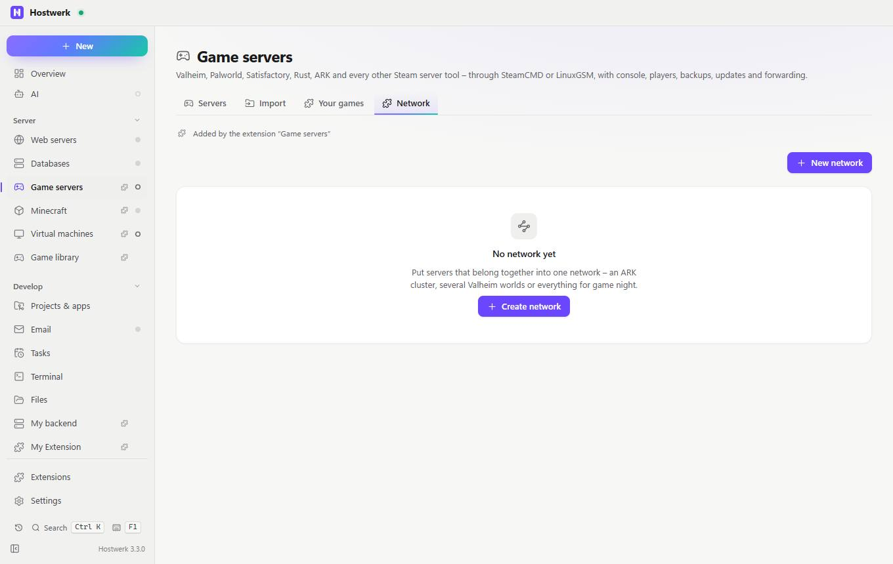

# Game servers

[← Back to the overview](README.md)

Valheim, Palworld, Satisfactory, Rust, ARK and every other Steam server tool – through SteamCMD or LinuxGSM, with console, players, backups, updates and forwarding.

### Good to know

- Two ways on Windows Steam server tools run right on this PC (most games have a Windows version). Games that only exist for Linux – and every LinuxGSM game – run in Hostwerk’s own Docker engine; the setup installs it for you when needed.

### Areas on this page

- Set up your first game server

### What you can do here

- All games …
- Valheim 896660
- Palworld 2394010
- Satisfactory 1690800
- Rust 258550
- 7 Days to Die 294420
- Project Zomboid 380870
- Counter-Strike 2 730
- Enshrouded 2278520
- V Rising 1829350
- ARK: Survival Ascended 2430930
- Terraria (tShock) Docker tsserver
- Garry's Mod 4020
- Conan Exiles 443030
- Unturned 1110390
- Space Engineers 298740
- Team Fortress 2 232250

## Tabs

### Import

> Import – take over game servers you already have Hostwerk looks in your Steam libraries, in SteamCMD folders, for LinuxGSM instances (Linux) and for Docker containers of game server images – and in a folder you choose. Searching only reads; nothing changes before you confirm. Take over where it is (nothing moves) or copy it into Hostwerk – port, players and the start line come along where Hostwerk finds them.

**Areas on this page:** Game servers on this PC

**What you can do here:** Search a folder … · Search again · Take over · Copy into Hostwerk

### Your games

> Own server for your games Found by comparing your installed Steam games with the server tools from “Game servers”. One click sets up the server through SteamCMD; friends join with the address shown on the server page.

**What you can do here:** From the extension “Game library” – info · Start own server … · Play Counter-Strike 2

### Network

> What belongs in a network? A cluster (ARK, Conan Exiles), several instances of one game, or everything for game night. Starting waits until each server answers the server query before the next one starts.

**What you can do here:** From the extension “Game servers” – info · New network · Create network

Generated on 2026-11-20 · Hostwerk 3.3.0
