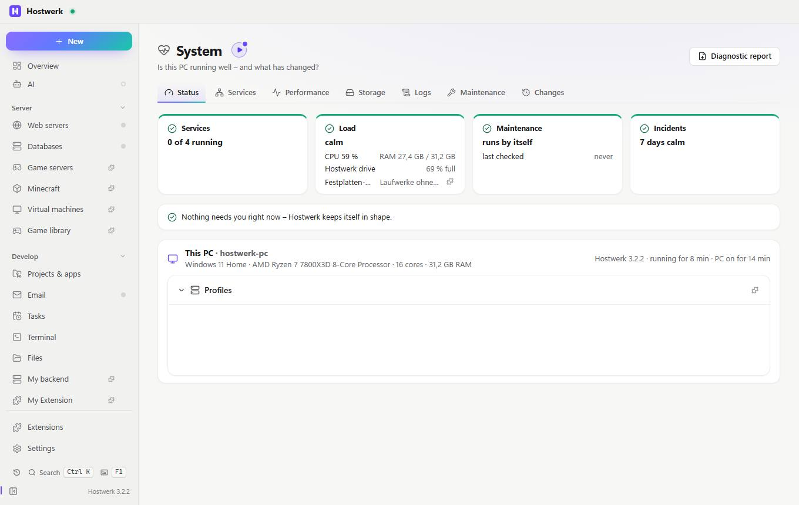
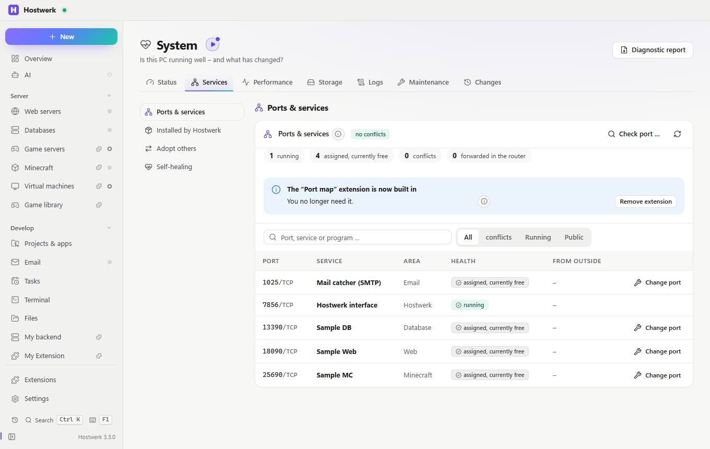
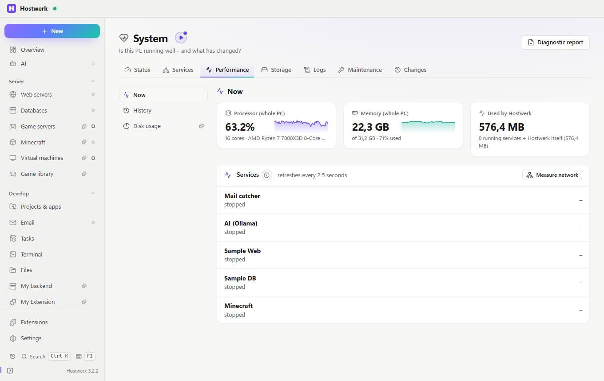
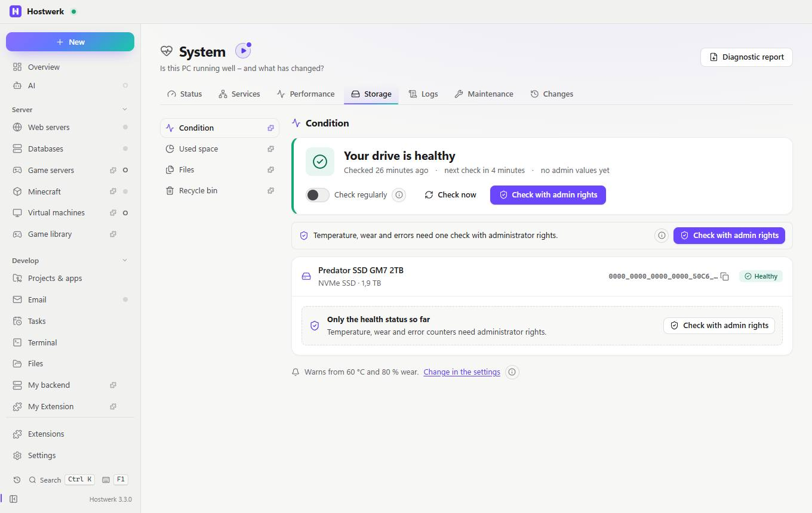
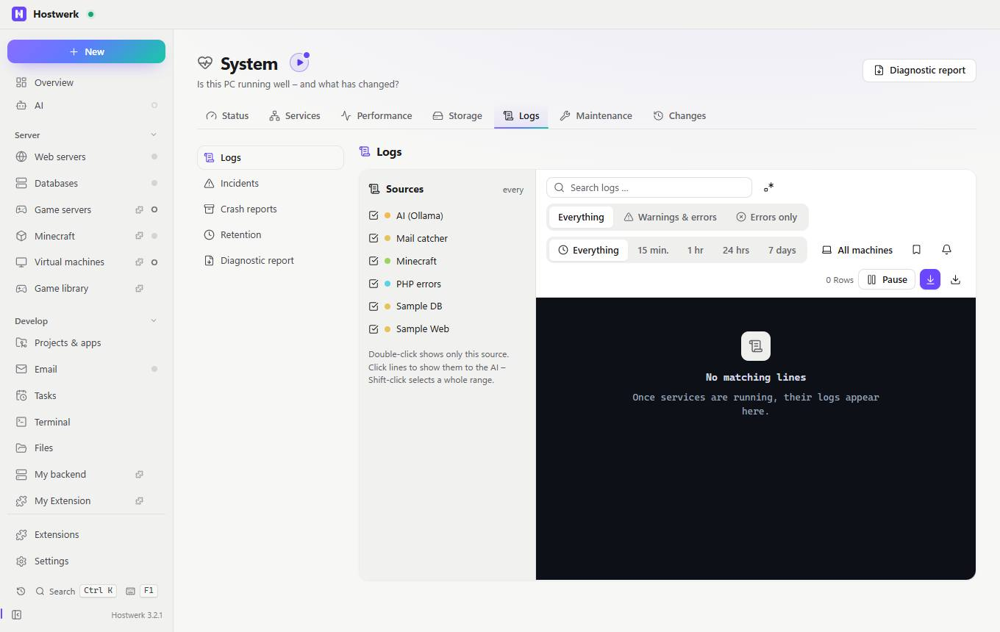
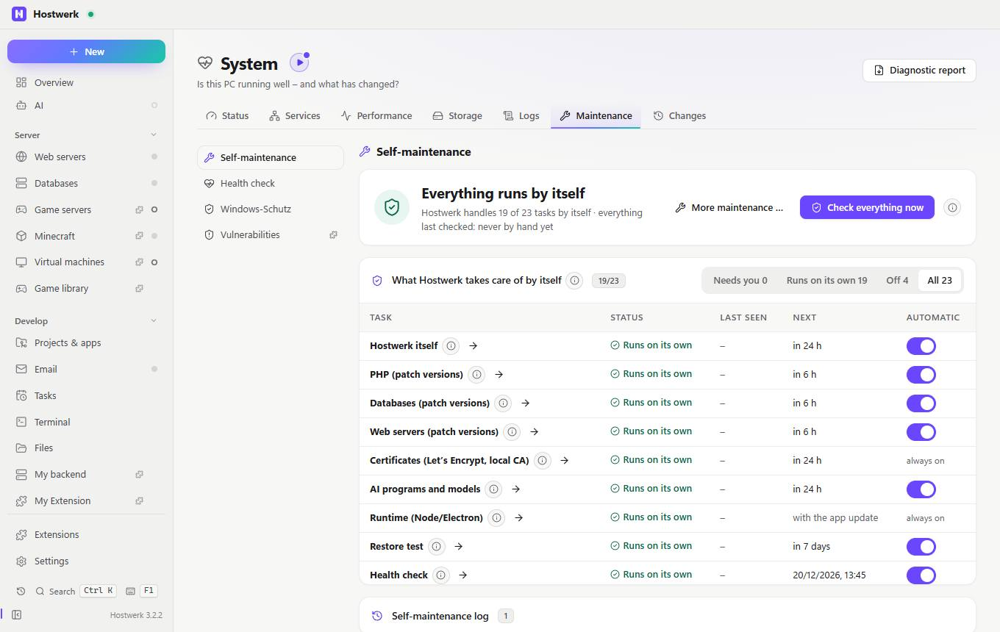
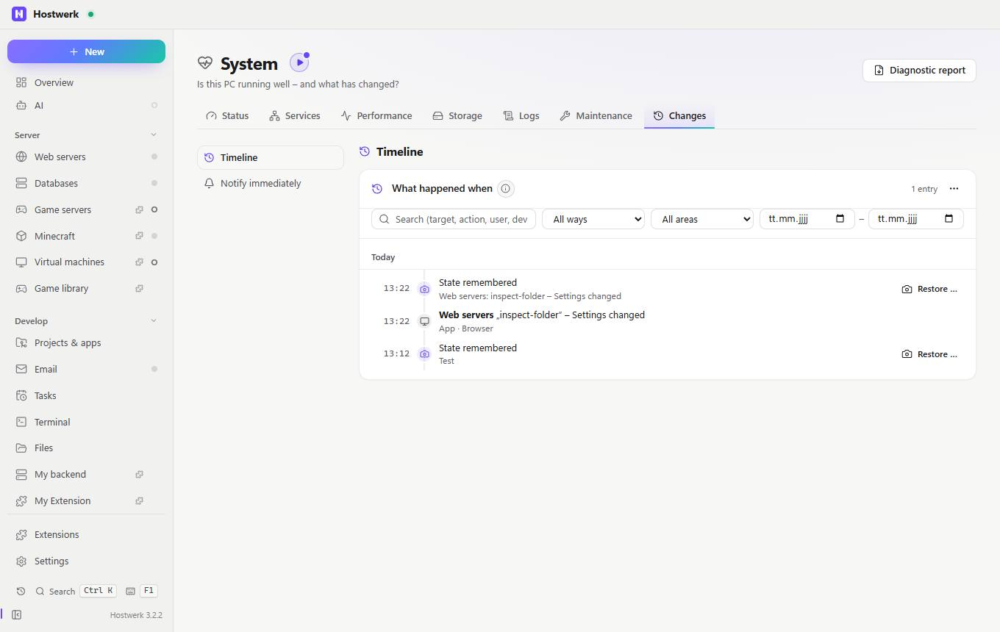

# System

[← Back to the overview](README.md)

Is this PC running well – and what has changed?

### Areas on this page

- Profiles

### What you can do here

- 3 videos
- Diagnostic report
- From the extension “disk-health” – info
- Profiles
- From the extension “Server profile” – info

## Tabs

### Services

> Every service needs its own “door number” (port). If another program uses it or two services want the same one, one cannot start. “Change port” gives a stopped service a port that is really free – a specific one if you like. Right-click a row for more.
> Port overview Everything it could do is here. You no longer need the extension – removing it is safe, Hostwerk services and ports stay unchanged.

**Areas on this page:** Ports & services

**What you can do here:** 3 videos · Diagnostic report · Check port … · Check again · Remove extension · Change port

### Performance

> Disk and network Disk: Windows counts all input and output of the program here – files, but also network and devices. Network: needs administrator rights on Windows – set it up once with “Measure network”.

**Areas on this page:** Now · Services

**What you can do here:** 3 videos · Diagnostic report · Measure network

### Storage

> Drives Hostwerk reads the S.M.A.R.T. values of every drive – temperature, wear, errors – and tells you when something gets worse, and shows how full the drive is and who uses the space. Nothing on a drive is ever changed.
> Check regularly with admin rights Hostwerk sets up a Windows task that reads the values every hour with administrator rights. Windows asks for permission once. The task only reads and removes itself when you uninstall the extension.
> Why administrator rights? Without administrator rights Windows only shows whether a drive is healthy. Temperature, wear and error counters are read in a single check – Windows asks for permission once. Hostwerk itself keeps running without admin rights.
> Notifications Warnings go to Hostwerk’s notifications (push, Discord, ntfy, mail) and appear under Go live → Monitoring → Watchers.

**Areas on this page:** Drives · Predator SSD GM7 2TB

**What you can do here:** 3 videos · Diagnostic report · Drives · From the extension “Drives” – info · Check now · Check with admin rights · 0000_0000_0000_0000_50C6_8E52_7150_2160

### Logs

**Areas on this page:** Logs

**What you can do here:** 3 videos · Diagnostic report · every · Regular expression · All machines · Save filter · Log watch · Pause · Scroll to bottom automatically · Save as text file

### Maintenance

> Hostwerk keeps itself up to date without a new version: updates of other programs only go live after a trial run, on errors the last working version stays. If a download source disappears, Hostwerk takes a replacement source. “Check everything now” starts all checks right away (up to a minute) – otherwise they run on schedule.
> Per task: whether it currently runs by itself, when something last happened and roughly when next. The switch is the same as in the settings. The ⓘ per row explains what exactly happens and what you can do yourself.
> Hostwerk itself New versions are downloaded in the background and become active on the next start (incl. runtime). Hostwerk checks daily for new versions, downloads them in the background and swaps them on the next start. If the new version doesn’t start cleanly, the previous one keeps running automatically. What you can do: Nothing – unless you want to skip versions (Settings → Updates).
> PHP (patch versions) Security updates with a trial run and rollback. Every 6 hours Hostwerk looks for security updates within your PHP series (e.g. 8.3.x). The new version is installed next to the old one, tested with a trial run and only then activated. If the test fails, the old one stays. What you can do: You decide on bigger jumps (8.3 → 8.4) yourself – Hostwerk only suggests them.
> Databases (patch versions) Security updates with a trial run and rollback. Like PHP: patch versions of MariaDB, MySQL and PostgreSQL are checked, installed with a trial run and rolled back on errors. What you can do: You switch major versions yourself in the database area.
> Web servers (patch versions) Security updates with a trial run. Apache, nginx and Caddy get security updates within their series – with a trial run; the old version stays as a way back. What you can do: Nothing.
> Certificates (Let’s Encrypt, local CA) Renewed after 1/3 of the lifetime or on expiry. HTTPS certificates (Let’s Encrypt and Hostwerk’s local certificate authority) are renewed in time. What you can do: Nothing – Hostwerk reports any error.
> AI programs and models Ollama, sd.cpp, whisper, Pocket TTS and models with a trial run; catalogs daily. Ollama, image models, speech recognition and voices are updated with a trial run; the model catalogs arrive online daily. What you can do: If AI is turned off, there is nothing to do here.
> Runtime (Node/Electron) Self-test before swapping, rollback on error. Node.js and Electron, which Hostwerk runs on, are swapped with the app update – after a self-test. What you can do: Nothing.
> Restore test Test-restore every 7 days. The latest backup is regularly restored into a throwaway environment and checked. That way a broken backup is noticed before you need it. What you can do: Nothing.
> Health check Monthly report on all computers with workflow suggestions. A report on all computers: services, backups, certificates, storage, OS updates – with a score and suggestions. What you can do: Turn on the schedule (daily, weekly or monthly) or use “Check now” when needed.
> Cleanup (leftovers, cache, trash) Daily: installation leftovers, old downloads, trash after 30 days. Hostwerk cleans up installation leftovers and old downloads daily; the trash is emptied after 30 days. What you can do: Nothing.

**Areas on this page:** Self-maintenance · What Hostwerk takes care of by itself · Self-maintenance log

**What you can do here:** 3 videos · Diagnostic report · More maintenance … · Check everything now · Open area: Hostwerk itself · Open area: PHP (patch versions) · Open area: Databases (patch versions) · Open area: Web servers (patch versions) · Open area: Certificates (Let’s Encrypt, local CA) · Open area: AI programs and models · Open area: Runtime (Node/Electron) · Open area: Restore test · Open area: Health check · Open area: Cleanup (leftovers, cache, trash) · Open area: Self-healing (restart services) · Open area: Download sources · Open area: Logs · Open area: Disk space · Open area: Extensions · Open area: Docker engine and images · Open area: Signing / Windows app (MSIX) · Open area: Geyser/Floodgate · Open area: Router port forwards & DynDNS · Open area: Backups · Open area: End of life of versions · Open area: Minecraft plugins/mods · Open area: Operating system updates

### Changes

> Every change to services, shares and settings – whether in the app, via remote access, from another computer, the AI or a task. Entries with “Undo” can be reverted one by one. The camera icon marks a state you can return to under Backups → Restore. Kept for 90 days.

**Areas on this page:** Timeline · What happened when

**What you can do here:** 3 videos · Diagnostic report · More actions · Restore …

Generated on 2026-11-18 · Hostwerk 3.2.1
