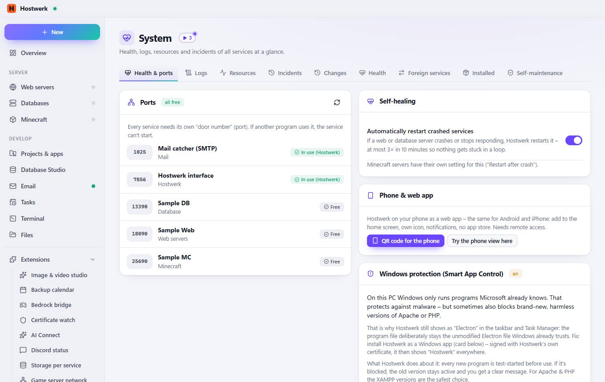
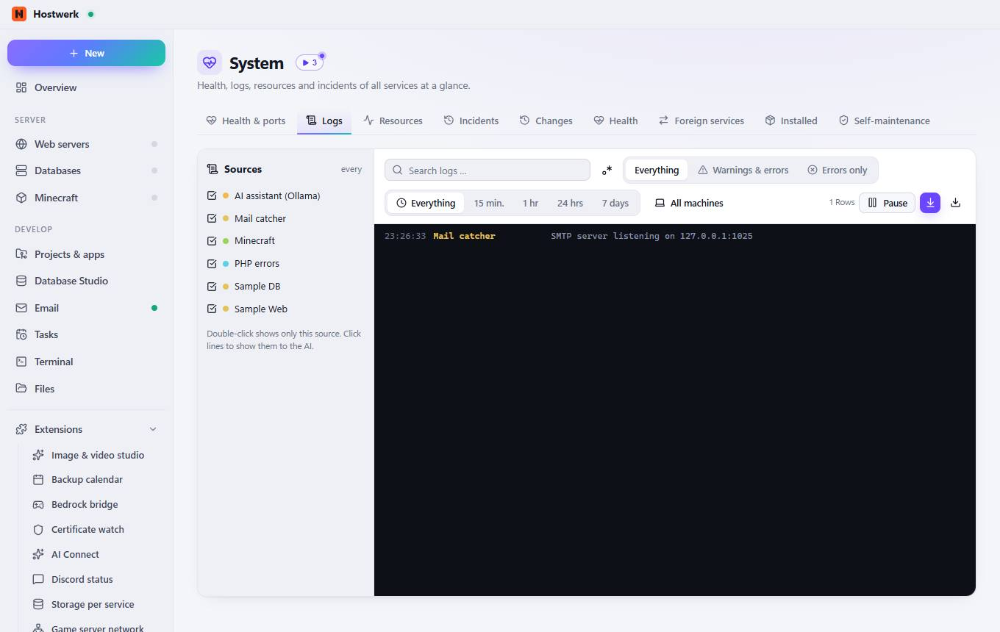
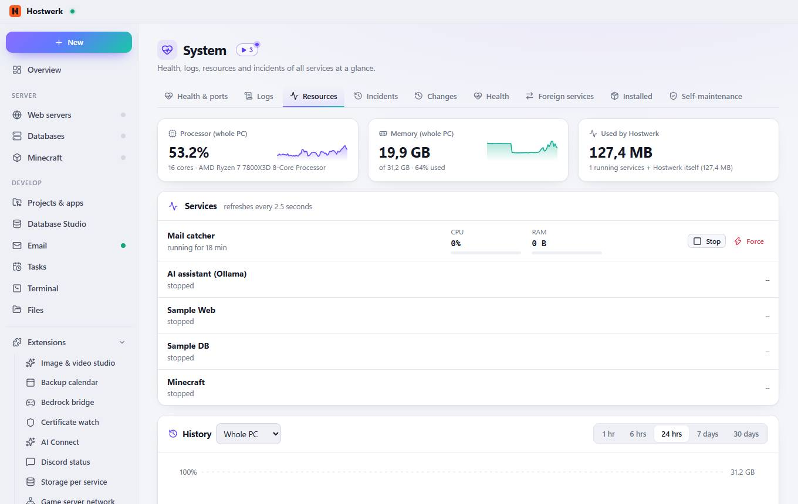
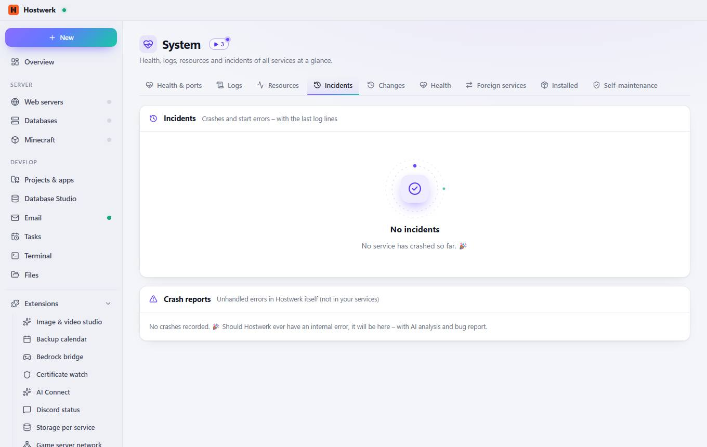
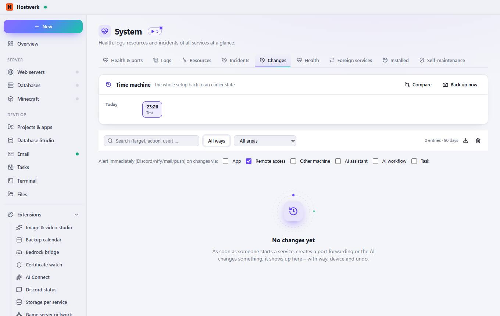
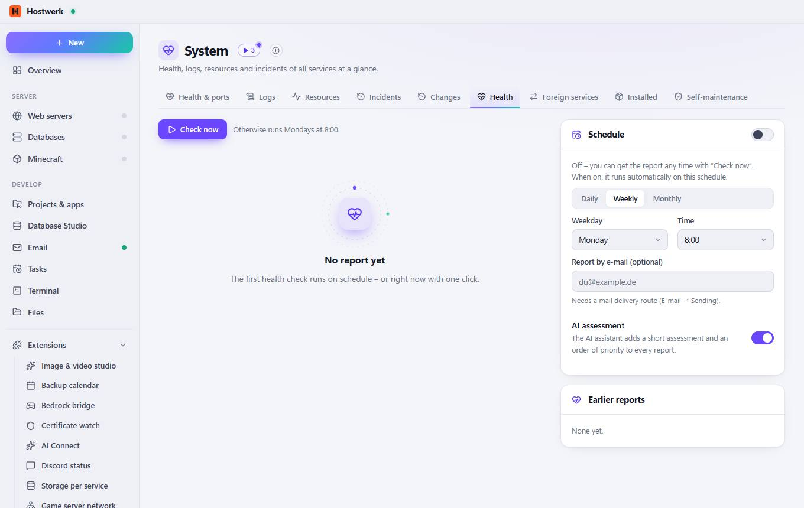
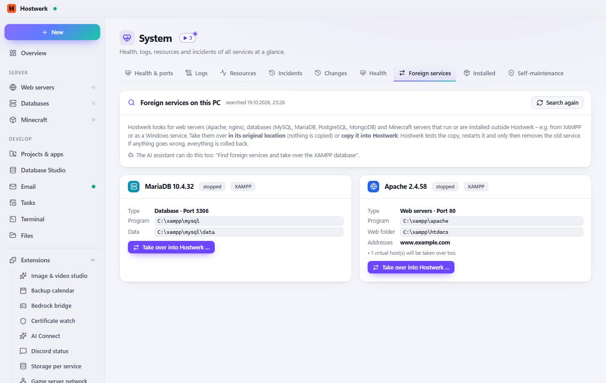
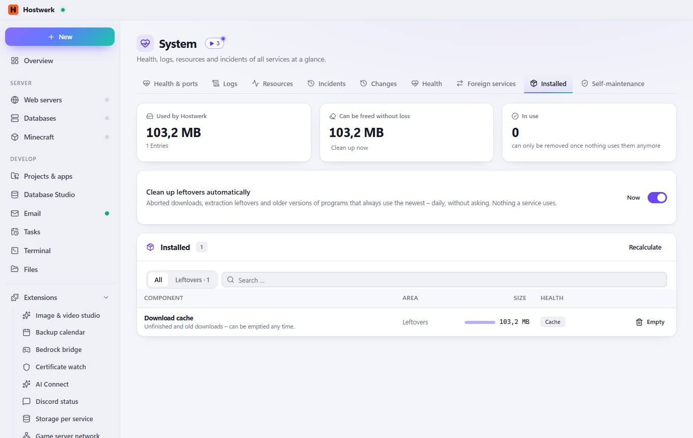
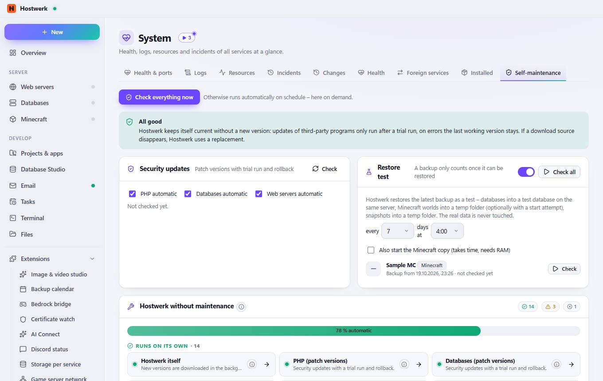

# System

[← Back to the overview](README.md)

Health, logs, resources and incidents of all services at a glance.

### Areas on this page

- Ports
- Self-healing
- Phone & web app
- Windows protection (Smart App Control)
- Diagnostic report

### What you can do here

- Check again
- QR code for the phone
- Try the phone view here
- Save full report

### Inputs

- Automatically restart crashed services

## Tabs

### Logs

**What you can do here:** every · Regular expression · All machines · Pause · Scroll to bottom automatically · Save as text file

### Resources

**Areas on this page:** Services · History

**What you can do here:** Stop · Force

### Incidents

**Areas on this page:** Incidents · Crash reports

### Changes

**Areas on this page:** Time machine

**What you can do here:** Compare · Back up now · 23:26 Test · Save as CSV · Clear log

### Health

> The check looks at disk space, services, age and usability of backups, pending updates, the security check, self-maintenance, crashes and failed tasks – on this PC and all paired machines.

**Areas on this page:** Schedule · Earlier reports

**What you can do here:** Check now

### Foreign services

**Areas on this page:** Foreign services on this PC · MariaDB 10.4.32 · Apache 2.4.58

**What you can do here:** Search again · Take over into Hostwerk …

### Installed

**Areas on this page:** Installed

**What you can do here:** Clean up now · Now · Recalculate · Empty

### Self-maintenance

> What does “maintenance-free” mean? Hostwerk keeps itself and your services up to date: updates with a trial run and a way back, renewals, cleanup, restarts after crashes. Here you see per area whether that already runs on its own – clicking ⓘ explains exactly what happens and what is left for you.
> Hostwerk itself Hostwerk checks daily for new versions, downloads them in the background and swaps them on the next start. If the new version doesn’t start cleanly, the previous one keeps running automatically. What you can do: Nothing – unless you want to skip versions (Settings → Updates).
> PHP (patch versions) Every 6 hours Hostwerk looks for security updates within your PHP series (e.g. 8.3.x). The new version is installed next to the old one, tested with a trial run and only then activated. If the test fails, the old one stays. What you can do: You decide on bigger jumps (8.3 → 8.4) yourself – Hostwerk only suggests them.
> Databases (patch versions) Like PHP: patch versions of MariaDB, MySQL and PostgreSQL are checked, installed with a trial run and rolled back on errors. What you can do: You switch major versions yourself in the database area.
> Web servers (patch versions) Apache, nginx and Caddy get security updates within their series – with a trial run; the old version stays as a way back. What you can do: Nothing.
> Geyser/Floodgate Geyser and Floodgate (Bedrock players) are updated and tested automatically. What you can do: Nothing.
> Certificates (Let’s Encrypt, local CA) HTTPS certificates (Let’s Encrypt and Hostwerk’s local certificate authority) are renewed in time. What you can do: Nothing – Hostwerk reports any error.
> AI programs and models Ollama, image models, speech recognition and voices are updated with a trial run; the model catalogs arrive online daily. What you can do: If AI is turned off, there is nothing to do here.
> Runtime (Node/Electron) Node.js and Electron, which Hostwerk runs on, are swapped with the app update – after a self-test. What you can do: Nothing.
> Restore test The latest backup is regularly restored into a throwaway environment and checked. That way a broken backup is noticed before you need it. What you can do: Nothing.
> Cleanup (leftovers, cache, trash) Hostwerk cleans up installation leftovers and old downloads daily; the trash is emptied after 30 days. What you can do: Nothing.
> Self-healing (restart services) If a service crashes or stops responding, Hostwerk restarts it (with a pause so it doesn’t restart endlessly). What you can do: Nothing – incidents are listed under System → Incidents.

**Areas on this page:** Security updates · Restore test · Hostwerk without maintenance · Monthly maintenance run · Online catalogs

**What you can do here:** Check everything now · Check · Check all · Open area

Generated on 2026-10-19 · Hostwerk 2.9.0
