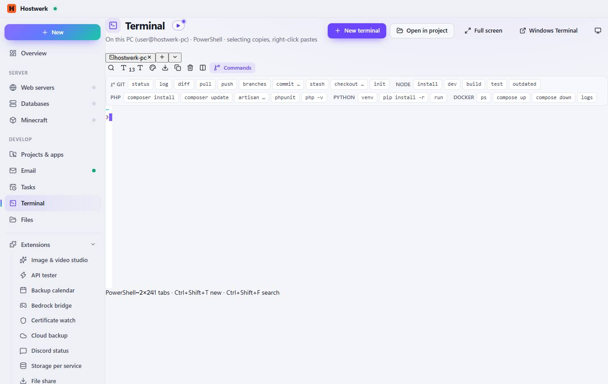

# Terminal

[← Back to the overview](README.md)

On this PC (user@hostwerk-pc) · PowerShell · selecting copies, right-click pastes

### What you can do here

- Short video: Terminal (45 seconds)
- New terminal
- Open in project
- Full screen
- Windows Terminal
- Terminal on another machine
- hostwerk-pc
- New terminal (PowerShell) · Ctrl+Shift+T
- Choose another shell
- Search (Ctrl+Shift+F)
- Smaller font
- Larger font
- Color scheme: Hostwerk – click to switch
- Save recording as a text file
- Copy selection
- Clear display
- Split (second terminal beside it)
- Commands
- status
- log
- diff
- pull
- push
- branches
- commit …
- stash
- checkout …
- init
- install
- dev
- build
- test
- outdated
- composer install
- composer update
- artisan …
- phpunit
- php -v
- venv
- pip install -r

Generated on 2026-10-20 · Hostwerk 2.10.0
